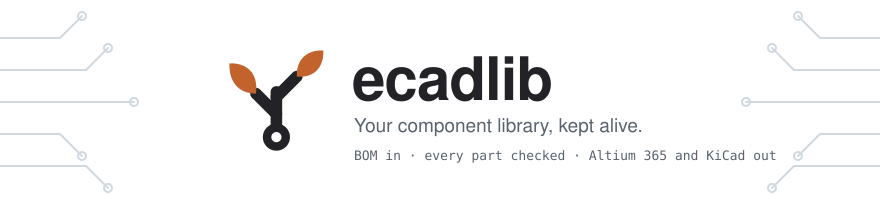
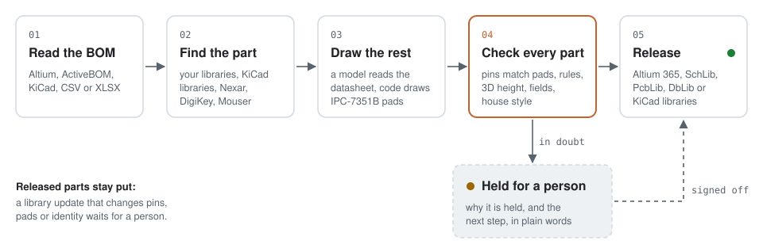

<p align="center">
  <a href="https://pcblivinglibrary.vercel.app">
    <picture>
      <source media="(prefers-color-scheme: dark)" srcset="docs/readme/header-dark.svg">
      
    </picture>
  </a>
</p>

<p align="center">
  <a href="https://pypi.org/project/ecadlib/"></a>
  <a href="https://github.com/oliBrowne/PCBLIVINGLIBRARY/actions/workflows/tests.yml"></a>
  
  <a href="LICENSE"></a>
</p>

<p align="center">
  <a href="https://pcblivinglibrary.vercel.app"><b>Website</b></a> ·
  <a href="#try-the-demo"><b>Try the demo</b></a> ·
  <a href="https://github.com/oliBrowne/PCBLIVINGLIBRARY/releases/latest"><b>Windows installer</b></a> ·
  <a href="docs/README.md"><b>Docs</b></a>
</p>

ecadlib is a librarian for your parts. Give it a BOM and it finds every symbol, footprint and 3D model you are missing,
draws the ones nobody has from the datasheet, and makes them match the rest of your library. **Every part is verified
before it is released**: anything that fails a check, or still needs a person, is held until someone signs it off. The
rest goes to **Altium 365** or **KiCad**. Free and open source (MIT); you bring your own API key and pick the model.

<picture>
  <source media="(prefers-color-scheme: dark)" srcset="docs/readme/flow-dark.svg">
  
</picture>

## What it does

* **BOM in.** Altium BOMs and ActiveBOMs, an Altium project, KiCad BOMs and schematics, or a hand-made CSV/XLSX. Each
  line comes back as already in your library, available from a source, needs a footprint, or DNP.
* **Official sources first.** Nexar, DigiKey and Mouser identify the part. Symbols and footprints come from your own
  libraries and the official KiCad libraries before anything else; EasyEDA/LCSC is an unofficial source, off unless
  you opt in (`ecadlib init` asks; `[providers] unofficial = true`), and then used last.
* **Drawn from the datasheet when nobody has it.** A datasheet reader fills in the package dimensions and a
  deterministic IPC-7351B generator draws the land pattern. Claude by default, or any model you choose.
* **Your house style.** `ecadlib style learn` reads your existing libraries, and new parts follow the same naming,
  descriptions, value formats and parameters.
* **Checked, or held.** A release check runs on every part: every pin has a pad, the footprint passes the rule book,
  the 3D height is plausible, the part fields are filled in and the files read back. A part that fails is held back
  from Altium 365 with the reason and the next step in plain words.
* **Change control.** Once a part is released, no library update can change it behind your back. A change to pins,
  pads or the part's identity waits for a person, who sees it in plain words ("pad 5 removed; pad SH added").
* **Released to your workspace.** Parts go to your Altium 365 workspace, or out as `.SchLib`/`.PcbLib`, a database
  library and KiCad libraries, all from one plan.

<p align="center">
  
  <br><sub>A held part says why and what to do next. Here the datasheet read and the standard package table disagree on
  pin pitch, so nothing was written to the library.</sub>
</p>

## Install

* **Windows, no terminal:** download **ecadlib-setup-&lt;version&gt;.exe** from the
  [Releases page](https://github.com/oliBrowne/PCBLIVINGLIBRARY/releases) and run it. A setup page opens where you
  paste an API key, pick a model and add ecadlib to Altium or KiCad. [docs/START_HERE.md](docs/START_HERE.md) walks
  through it.
* **Command line:** `pip install ecadlib` (Python 3.10+). These docs follow the main branch: what
  [CHANGELOG.md](CHANGELOG.md) lists under *Unreleased* (change control and `ecadlib part`, `mcp --http`, the run and
  review lines of `ecadlib status`) is not in the PyPI release yet. To get it:
  `pip install "ecadlib @ git+https://github.com/oliBrowne/PCBLIVINGLIBRARY"`.

## Try the demo

```
pip install ecadlib
ecadlib demo
```

About a second, offline, no API keys. It builds a 7-part library (0603 resistors, a 0402 capacitor, an LED, a SOT-23
MOSFET, a SOT-223 regulator and a SOIC-16 chip) from a BOM bundled with ecadlib:

```
7 parts: 6 ready, 1 held in 0.7 s (held: CH340C; that is expected, see the review)
written:
  ecadlib-demo/librarian/demo_bom_demo/plan.json     the library plan
  ecadlib-demo/librarian/demo_bom_demo/review.md     review: what to check, part by part
  ecadlib-demo/librarian/demo_bom_demo/models/       11 Altium files (.SchLib, .PcbLib)
  ecadlib-demo/kicad/demo_bom_demo/                  KiCad: .kicad_dbl, .kicad_sym, .pretty/
```

CH340C is held on purpose, so you see what a held part looks like. `ecadlib ui --workspace ecadlib-demo` opens the
result in your browser.

<p align="center">
  
</p>

## From BOM to Altium 365

The whole flow is five commands. The web UI (`ecadlib ui`), the **ecadlib** menu inside Altium and the MCP server run
the same steps.

**1. Set up once.** `ecadlib init` asks which tool you use, where your libraries are and which part sources to try,
learns your conventions from those libraries, writes `ecadlib.toml` and runs a setup check (`ecadlib doctor`).

```
ecadlib init
```

**2. Fill the library.** The librarian triages the BOM, reuses what you already have, and for each missing part tries
the official KiCad libraries, EasyEDA (if allowed), ecadlib's standard packages and finally the datasheet reader. It
writes the Altium files, a `plan.json` and a review, then runs the release check.

```
ecadlib datasheet estimate my_bom.csv            # optional: what the AI reads would cost, before anything is sent
ecadlib librarian my_bom.csv                     # writes ecadlib_workspace/librarian/my_bom (the init workspace)
ecadlib status                                   # ready, held, waiting for sign-off
```

**3. Deal with held parts.** `ecadlib review` goes through them one at a time: why each is held, ranked symbol or
footprint candidates to pick from, or **release anyway** after you have looked (recorded in the plan).

```
ecadlib review ecadlib_workspace/librarian/my_bom/plan.json
```

**4. Sign off** (optional policy). With an `approvals.json` next to the plan, parts wait until the named people
approve them. A rejected part is held either way, policy or not, until it is approved again.

```
ecadlib approve ecadlib_workspace/librarian/my_bom/plan.json approve --part CH340C -m "pinout checked"
```

**5. Release to Altium 365.** Sign in once with `ecadlib nexar signin` (your own free Nexar app; ecadlib stays signed
in, see [docs/altium.md](docs/altium.md#signing-in-to-altium-365-ecadlib-nexar-signin)), check the plan with a dry run,
then push. Held parts are never pushed. A part already in the workspace gets a new revision, and only after change
control lets it through.

```
ecadlib altium365 workspaces
ecadlib altium365 push ecadlib_workspace/librarian/my_bom/plan.json --workspace https://acme.365.altium.com --dry-run
ecadlib altium365 push ecadlib_workspace/librarian/my_bom/plan.json --workspace https://acme.365.altium.com
```

No Altium 365? `ecadlib dblib-sync` writes the same plan into a `.DbLib`/`.SVNDbLib` folder, `ecadlib altium-pkg`
builds an install package, and `ecadlib kicad-export` writes KiCad libraries.

## How far to trust it

The release check and the review hold are there because drawing parts is the easy half; checking them is the work.
What has been measured so far:

| What | Result | What it tells you |
|---|---|---|
| **Reading real datasheets** (the number that matters) | 30 of 110 real parts built fully right (27 %) | Live benchmark of 2026-10-18 with Claude Opus 5.5. That is why anything in doubt is held, not released. Method, every miss and newer runs: [docs/benchmark.md](docs/benchmark.md). |
| Footprint generator (replay check) | 328 / 331 on every pull request | Given a correct package description, the generator draws the right pads. It does not test datasheet reading. |
| Altium Designer 26 | Tried | The generated libraries, the ecadlib menu and parts released to Altium 365. Older Altium versions are untested. |

## Documentation

Everything else lives in [docs/](docs/README.md):

* [Using ecadlib](docs/using-ecadlib.md): the web UI, the MCP server and the command line
* [The librarian](docs/librarian.md): the release check, held parts, sign-off, library rules and safe updates
* [Change control](docs/change-control.md) and [house style](docs/house-style.md)
* [Altium and Altium 365](docs/altium.md) and [KiCad](docs/kicad.md)
* [BOMs and datasheets](docs/bom-and-datasheets.md) and
  [footprints, symbols and 3D models](docs/footprints-and-symbols.md)
* [Bring your own model](docs/models.md), [API keys](docs/api-keys.md) and [costs](docs/costs.md)
* [Using it from an AI agent (MCP)](docs/mcp.md)
* [Command line, setup and integrations](docs/command-line.md)
* [Working on ecadlib](docs/development.md): tests, the accuracy gate and releases

Where it's going: [docs/PRODUCT_SPEC.md](docs/PRODUCT_SPEC.md) and [ROADMAP.md](ROADMAP.md). Changes are in
[CHANGELOG.md](CHANGELOG.md).

## Credits

Parts converted from EasyEDA come from the **JLCEDA/EasyEDA Official Library** ([easyeda.com](https://easyeda.com),
[lceda.cn](https://lceda.cn)), whose data asks anyone reusing it to credit it. Parts from the **KiCad libraries**
([gitlab.com/kicad/libraries](https://gitlab.com/kicad/libraries), CC-BY-SA 4.0 with a design-use exception) are
labelled `(CC-BY-SA 4.0)` in the footprint description. ecadlib keeps the credit on every such part (a `Credit`
property in KiCad, a `Library Credit` parameter in Altium) and writes a `NOTICE.txt` listing the third-party terms of
each librarian run. Leave them in place if you share or publish the library.

## License

MIT. See [LICENSE](LICENSE).
