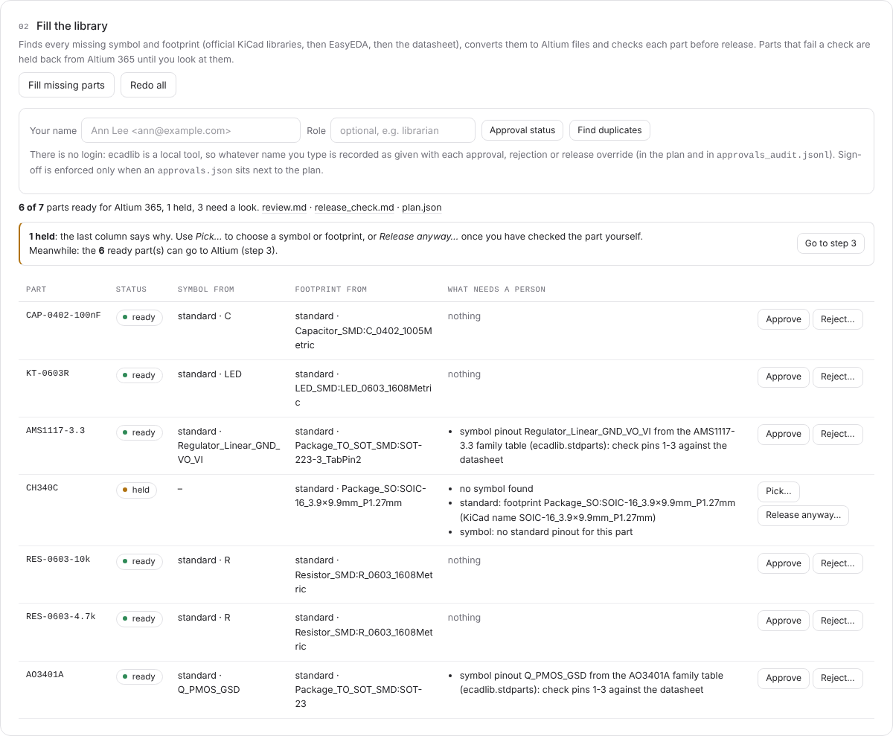
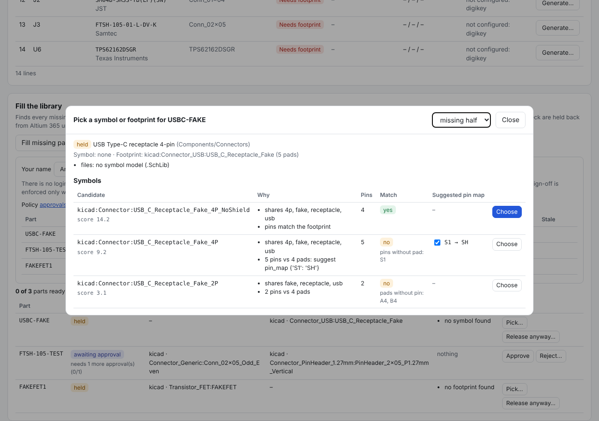
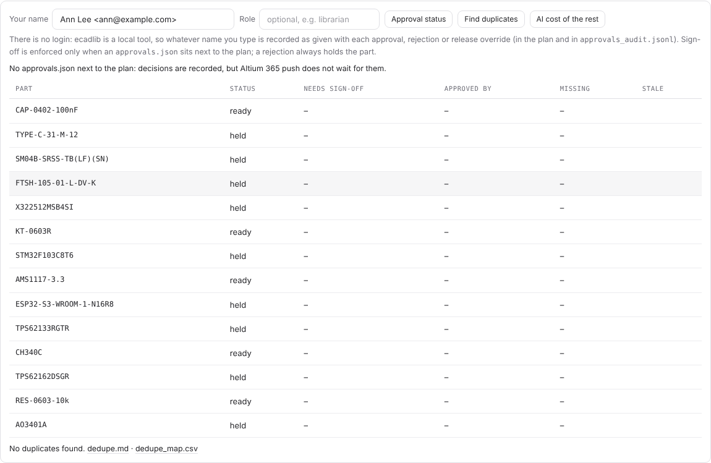
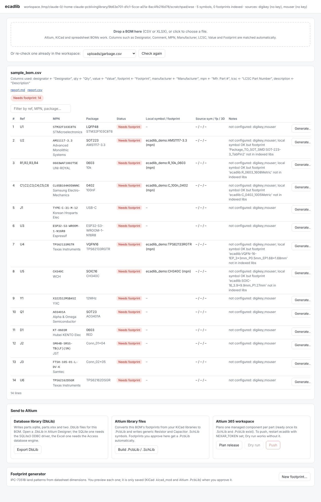
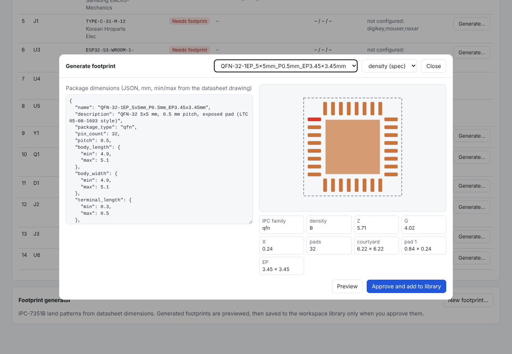
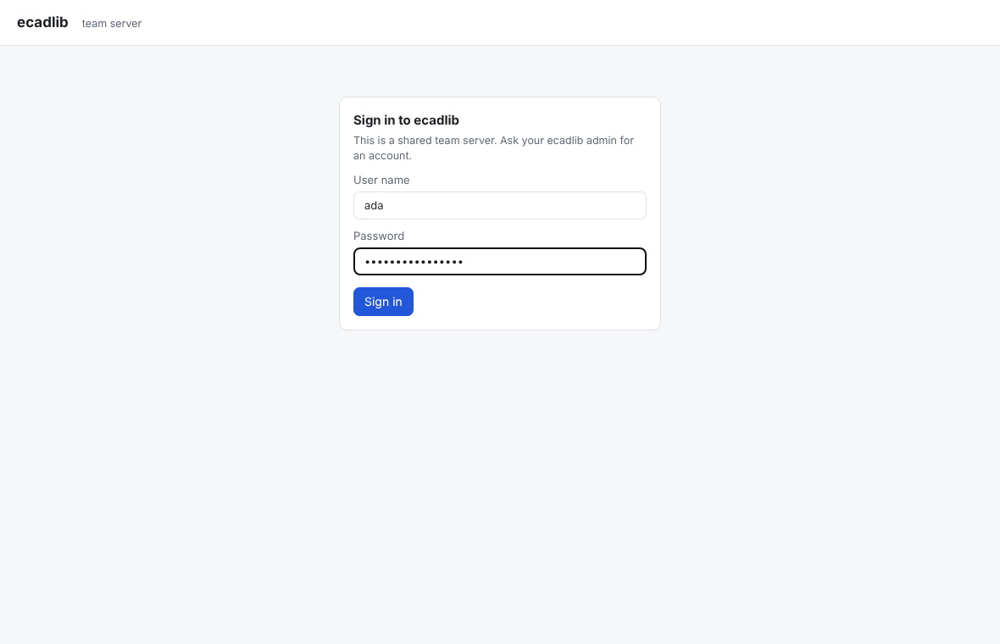
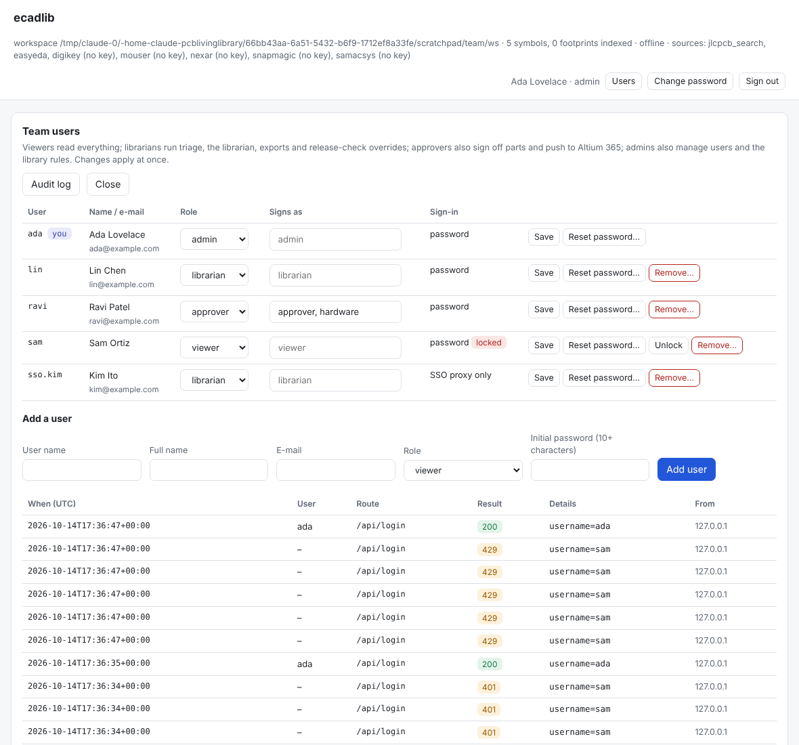

# ecad-librarian: "AI living library" prototypes

These are small Python prototypes for an open-source tool that manages ECAD components for KiCad and Altium. The design has three parts:

1. An LLM reads a datasheet mechanical drawing and fills `ecadlib/package_schema.json`.
2. A deterministic generator turns that JSON into an IPC-7351B land pattern.
3. A triage step works out which BOM lines already exist locally, which can be pulled from a public source, and which need a generated footprint.

## Start here (no terminal needed)

**Electronics engineer who just wants it to work?** Read [docs/START_HERE.md](docs/START_HERE.md). On Windows,
download **ecadlib-setup-&lt;version&gt;.exe** from the [Releases page](https://github.com/oliBrowne/PCBLIVINGLIBRARY/releases)
and run it. ecadlib then opens a setup page in your browser where you paste an API key, pick a model, and add ecadlib
to Altium or KiCad. There is no Python to install and no config file to edit. The rest of this README is for people
who use the command line or work on ecadlib itself (section 38 covers how the installer works).

## Quick start

```
pip install -e .                 # from this checkout (Python 3.10+); `pip install ecadlib` once a release is on PyPI
ecadlib demo                     # about a second, offline, no API keys: a small library in ./ecadlib-demo
ecadlib init                     # a few questions -> ecadlib.toml, then a setup check and the next commands
ecadlib librarian my_bom.csv -o ecadlib_workspace/librarian/my_bom   # fill every missing part; `ecadlib status` shows it
ecadlib ui                       # or do the same in your browser
```

* **`demo`** builds a 7-part library (0603 resistors, 0402 capacitor, LED, SOT-23 MOSFET, SOT-223 regulator, a SOIC-16
  chip) from a BOM bundled with ecadlib, using only the built-in standard parts: Altium `.SchLib`/`.PcbLib`, the KiCad
  `.kicad_sym` / `.pretty` / lib tables and a KiCad database library, plus the plan and review. One part (CH340C) is
  held on purpose, so you also see what a held part looks like. `ecadlib status --workspace ecadlib-demo` and
  `ecadlib ui --workspace ecadlib-demo` open it.
* **`init`** asks which tool you use (Altium, KiCad or both), where your existing libraries are, which workspace folder
  to use and which part sources to try, and lists which API keys are set (names only). `--yes` takes the defaults
  (`--tool`, `--lib`, `--workspace`, `--sources` set them without asking). It also learns your naming, parameters,
  folders, layers and density from the libraries it finds (`--from DIR` to scan more; section 18), then runs
  `ecadlib doctor` and prints the next commands. Your library folders and workspace become the default `--lib` and
  `--workspace` of every command run below that folder.
* **The first online run** builds a name index of KiCad's official libraries from gitlab.com (a few minutes, once; it
  is cached for 30 days). Parts that no source can supply wait for the datasheet reader, which needs
  `ANTHROPIC_API_KEY`; without it they are held and the run says so. No network? `--offline --sources standard`.

See section 32 for the first-run commands in detail.

## How you use it

Install it with pip (Python 3.10 or later):

```
pip install ecadlib                 # once a release is on PyPI (see Releases below)
pip install "ecadlib[pdf]"          # pypdf trims datasheets to --pages
pip install -e ".[dev]"             # from a checkout: editable, plus everything the test suite uses
```

`ecadlib --version` prints the installed version. Changes are listed in [CHANGELOG.md](CHANGELOG.md).

That gives you a single `ecadlib` command (`python -m ecadlib` works too). There are three ways in, and all of them call the same actions in `ecadlib/app.py`:

1. **Local web UI** (for most people). It runs on your own machine, so your API keys and libraries stay local.

   ```
   ecadlib ui --lib path/to/your/kicad/libs
   ```

   A browser tab opens at `http://127.0.0.1:8765`. To share one server with the whole team, with sign-in and roles, see **Team server** below; `python3 -m ecadlib team setup` runs it with Docker and HTTPS in one command (**Run it for your team**).
   * **Check a BOM:** drop in a CSV or XLSX, whether it's an Altium BOM, an Altium ActiveBOM, a KiCad BOM or a hand-made spreadsheet. A progress bar runs while parts are looked up. You then get a table of what is already in your library, what a part source can supply, what needs a footprint, and what is DNP. You can filter it by status or by search.
   * **Fill the library:** one button runs the librarian on the BOM. It finds each missing symbol and footprint (official KiCad libraries, then EasyEDA, then the datasheet reader), writes the Altium files, and runs the release check. Each part shows where its symbol and footprint came from and what still needs a person. Parts that fail the check are held back from Altium 365; **Release anyway…** overrides that after you have looked (it is recorded in the plan), and **Hold again** takes it back.

     
     * **Pick…** on a held part lists ranked symbol or footprint candidates (official KiCad library, your `--lib` libraries, ecadlib's package specs) with why each ranked, its pin/pad count, whether it matches the part's other half and a suggested pin map for a near miss. **Choose** converts it, records the choice in the plan (a librarian re-run keeps it) and re-runs the release check.

       
     * **Sign-off:** type your name, then **Approve** or **Reject…** a part; **Approval status** shows the policy and who has signed. There is no login (it is a local tool), so the name you type is recorded as given, in the plan and in `approvals_audit.jsonl`. With an `approvals.json` next to the plan (section 12), parts wait as *awaiting approval* and are not pushed until signed off.
     * **Find duplicates** lists parts with the same MPN, footprints with the same geometry and symbols with the same pinout across the plan and the workspace's `altium_models/` and `footprints/`; **Merge…** points the plan at the keepers (library files are never changed).

       
   * **Make a footprint:** click **Generate…** on a missing part. It picks a matching example package when one exists. Enter the datasheet dimensions, preview the IPC-7351B land pattern, and approve it. Approving writes a KiCad `.kicad_mod` and an Altium `.PcbLib`, and asks before replacing an existing footprint. The BOM is then re-checked automatically.
   * **Send to Altium:** there are three options.
     * **Export DbLib** writes the SQLite/XLSX/.DbLib set.
     * **Build .PcbLib / .SchLib** converts the BOM's footprints and writes generic R/C symbols.
     * **Altium 365** plans a release with a ready / needs-symbol / needs-footprint status per part. **Dry run** shows the exact requests without sending anything. **Push** is enabled only when `NEXAR_TOKEN` is set and a workspace is picked, and it asks for confirmation first.

   * **Find your way:** a bar at the top links the steps in order (1. Check a BOM, 2. Fill the library, 3. Send to Altium) and the Review queue (with how many items wait), Footprints, Status and Settings (library rules). After each action a blue line says what happened and what to do next ("8 held: use Pick…"; "Next: Dry run"), with a button to the next step. Long actions show progress in their own card.
   * **Status:** counts of BOMs, parts in library plans, ready, held, awaiting approval and review-queue items, the last BOM check, and a list of what waits for someone. **Run setup check** (admins in team mode) shows `ecadlib doctor` in the page, failures first, with how to fix each one. Routes: `GET /api/status` (viewer) and `GET /api/doctor` (admin).
   * Errors are one plain line, with workspace paths shown relative to the workspace. A viewer in team mode is told which role they need.
   * **Checked in a real browser:** `tests/test_ui_browser.py` drives Chromium (Playwright) through these flows at 1280 px and 390 px wide, local and team mode (68 checks: next-step lines, progress, keyboard focus, no sideways scrolling, no console errors, roles). It skips when node, Playwright or Chromium is missing. `tests/ui_fixture.py DIR [--team|--empty]` serves the same offline workspace by hand.

   
   
   

2. **MCP server**, so Claude or another agent can do the same work in conversation (for example, "check this BOM and draft footprints for anything missing").

   ```
   claude mcp add ecadlib -- ecadlib mcp --lib /path/to/libs --workspace /path/to/workspace
   ```

   Its tools are `workspace_info`, `triage_bom` (with `summary_only` for large BOMs), `preview_footprint`, `approve_footprint`, `librarian_run` (fill every missing part, then the release check), `release_check` (with `allow` for parts a person has signed off), `held_parts`, `part_candidates` and `choose_part` (fix a held part), `approval_status` and `approve_part` (sign-off; `user` is required, the agent must pass the person's own name), `find_duplicates` (with `merge`), `build_altium_models`, `export_altium_dblib`, `altium365_plan`, `altium365_push` (dry run unless `dry_run` is false; held parts are never pushed), `sim_models` (SPICE/IBIS models; `attach` writes them) and `list_example_specs`.
3. **CLI**, for scripts and CI: `ecadlib triage`, `ecadlib footprint`, `ecadlib check`, `ecadlib footprint-bench`, `ecadlib dblib`, `ecadlib dblib-sync`, `ecadlib altium-lib`, `ecadlib altium365`, `ecadlib kicad-export` (the library as KiCad files, section 11), `ecadlib eagle-export` and `ecadlib easyeda-export` (Fusion Electronics / EAGLE and EasyEDA Pro, section 11b), `ecadlib resolve`, `ecadlib approve`, `ecadlib dedupe`, `ecadlib sourcing`, `ecadlib step-gen`, `ecadlib upkeep` (section 15), `ecadlib a365`, `ecadlib project`, `ecadlib where-used` and `ecadlib sim-models` (section 17), `ecadlib init` and `ecadlib rules` (section 18), `ecadlib demo` (section 32), `ecadlib kicad-pcm` and `ecadlib altium-pkg` (section 31), `ecadlib ai` (section 33), `ecadlib symbol` (section 19), `ecadlib datasheet`, `ecadlib team`, `ecadlib agent` (the library agent, section 20), `ecadlib agent-watch` (21), `ecadlib queue` (22), `ecadlib visual-check` (23), `ecadlib migrate` and `ecadlib rebuild` (35). Run `ecadlib <command> -h` for options. Each is described below; the older `python3 -m ecadlib.<module>` form still works.

The UI and MCP server write everything to one workspace folder (default `./ecadlib_workspace`). It has these subfolders:
* `uploads/`
* `reports/`
* `footprints/ecadlib.pretty/`: approved footprints plus their source JSON
* `altium_models/PcbLib|SchLib/`
* `altium/`
* `altium365/`
* `http_cache/`

Both servers use only the standard library on top of the package requirements. The web UI binds to 127.0.0.1. It refuses requests with an unexpected Host header (DNS rebinding), cross-origin POSTs, and any file path outside the workspace.

### Using the web UI

* **First visit.** An empty workspace shows a welcome card: *Try it with a sample BOM* builds the 7-part sample (the one `ecadlib demo` uses) from ecadlib's standard parts, offline and without an API key; *Run the setup check* runs `ecadlib doctor`.
* **Drop a BOM anywhere on the page** (CSV or XLSX). Long actions (checking a BOM, filling the library, the sample) show live progress with one line per part ("3/14 SOT-23  ready") and a **Stop** button; the rest of the page keeps working. A stopped librarian run leaves the library plan as it was.
* **Parts as cards.** Step 2 lists every part with a footprint picture and chips: ready / held / waiting for sign-off, the cross-check result, KiCad / Altium match, and what reading its datasheet cost and with which model; the header adds the totals so far. Search and status chips filter the list.
* **Click a part** to open its side panel: why it is held in plain words with the next step (wording from `ecadlib/messages.py`), both values when the cross-check or the KiCad / Altium comparison disagrees, the datasheet (at the page in question when known), and the actions: pick a symbol or footprint, release anyway, approve or reject.
* **Undo.** Approve and reject (in step 2 and in the review queue) show at once and are sent when the few-second Undo window closes; *Release anyway* is recorded at once and its Undo holds the part again.
* **Keyboard.** `?` lists the shortcuts: `/` search, `j` / `k` next / previous part, `Enter` open, `Esc` close, `h` held only, `u` choose a file, `1` `2` `3` steps, `q` review queue, `s` status. Light and dark themes follow the system; `prefers-reduced-motion` turns animations off.
* The same part cards are available as `Workspace.library_parts(bom)`, `GET /api/parts?bom=` and the MCP tool `library_parts` (`ecadlib/partview.py`).
* **Your library** (`l`) shows your whole library across tools: a tile per tool (Altium, Altium 365, KiCad, Fusion, EasyEDA) that opens your library as it is in that tool, or every part once with a column per tool; last changed and by whom, copying parts between Altium and KiCad (into a project too), and a part page with pictures, sources, release check, sign-off, where-used, lifecycle, history and fix buttons. See section 39.

### Team server (`ecadlib ui --team`)

Run the web UI on one machine for the whole team, with sign-in. Local mode (no `--team`) is unchanged.

```
ecadlib team --workspace /srv/ecadlib add-user ada --role admin --name "Ada Lovelace" --email ada@example.com
ecadlib team --workspace /srv/ecadlib add-user lin --role librarian --name "Lin Chen" --email lin@example.com
ecadlib ui --team --workspace /srv/ecadlib --lib /srv/kicad-libs --host 0.0.0.0 --port 8765 --cert cert.pem --key key.pem
```



* **Users** live in `team_users.json` in the workspace. Passwords are stored as `hashlib.scrypt` hashes, each with its own salt, and the file is written with mode 0600. The first admin can only be created on the command line. After that, admins manage users on the **Users** page or with `ecadlib team add-user|set-role|reset-password|remove|list`. Changes take effect at once, even on a running server. A password reset or removal signs that user out everywhere.
* **Roles.** Each role can do everything the roles before it can.

  | Role | Can |
  | --- | --- |
  | viewer | read everything and download reports |
  | librarian | upload BOMs, triage, librarian, resolve, footprints, exports, release-check overrides, Altium 365 dry run |
  | approver | approve or reject parts, push to Altium 365 for real |
  | admin | manage users, save library rules, scan server folders for rules |

  Every route has a minimum role (`ROUTES` in `ecadlib/ui/server.py`). A route missing from that table answers 404 in team mode, and a test fails if any `/api/...` path in the server is missing from it. The page hides buttons the user's role cannot use, but the server is what enforces the roles.
* **Sign-off** in team mode records the signed-in user (`Name <email>`) and drops any typed name, so the UI hides the name box. The approval role is the user's team role, or one of the roles in their `--sign-as` list (for example `hardware`), so `approvals.json` `roles` and `users` work as before. `no_self_approval` still applies: whoever pressed **Release anyway** cannot approve that part.
* **Sessions** use a random token in an `HttpOnly; SameSite=Strict` cookie (`Secure` over HTTPS). A session ends after 12 h, or after 2 h without use, and on **Sign out**. Every POST needs the session's CSRF token in `X-CSRF-Token`. The Origin and Host checks stay on as well. The Host must be an IP address, `localhost`, this machine's name or an `--allowed-host`. After 5 failed sign-ins for one user name in 15 minutes, that name is locked for 15 minutes, and unknown names lock the same way. One address gets 30 failures in that window. Each try is counted before the password is checked, so parallel requests get no extra guesses, and checking the current password on **Change password** counts the same way. Admins can **Unlock** a user. Removing a user and adding the same name again does not bring back the old sessions. Team files (`team_users.json` and the rest) are never served or read as a BOM, under any letter case or file link. JSON request bodies are limited to 2 MB (uploads: 20 MB). A whole request (TLS handshake, headers and body) must arrive within `request_seconds` (120), and one address may hold `max_connections_per_ip` (64) connections at once; a trusted proxy is exempt. `team_audit.jsonl` is rotated at `audit_max_mb` (10) into `.1` … `.{audit_keep}` (5). Refusals before sign-in are logged at most `audit_refusals_per_minute` (20) times per address per minute; the next line counts the dropped ones (`suppressed`). Sessions and lockouts are kept in memory, so a restart signs everyone out.
* **Audit.** Every POST in team mode, including refused ones and sign-ins, is appended to `team_audit.jsonl` with time, user, client address, route, result and the main fields (never passwords). Admins see it under **Users → Audit log**. Approvals are also logged to `approvals_audit.jsonl` as before, with `via: ecadlib ui (team, signed in)`. `/api/file` never serves `team_users.json`, `team.json` or `team_audit.jsonl`.
* **Several users at once.** All writes in the workspace are serialised by one lock. Each background job belongs to the user who started it, and only that user and admins can see it. While the librarian runs on a BOM, a second librarian run or another write to that BOM is refused with 409 until it finishes. Every upload is stored in its own new folder, `uploads/<UTC time>-<random>/<file name>`, so two people uploading `BOM.csv` at the same moment both keep their file, and each gets its own triage report (`reports/triage_BOM_<folder>.*`) and librarian folder. The file keeps its name (reduced to letters, digits, `.`, `_` and `-`; any path in it is dropped), and the page shows it with its upload time. BOMs uploaded flat into `uploads/` by older versions still work and keep their old report names.
* **Past triages.** Every signed-in user, viewers included, sees the **Past BOM checks** list (also in local mode): BOM, when it finished, who ran it and how many lines need work. **Open** shows the saved result, with its per-line status and report links, without looking anything up again; re-running a triage still needs librarian. The routes are `GET /api/triage/history` and `GET /api/triage/result?id=...` (role viewer), and the MCP tool `triage_history` gives the same view. Finished results are library data for the whole team, but a job that is still running, with its live progress, stays visible only to the user who started it and to admins. Each triage now also writes `reports/triage_<name>.json` (the full result, the time and the user). Older triages that only left a `.csv` are listed too, without BOM or user. An id is only matched against the reports that exist, and is never turned into a path.
* **HTTPS.** Pass `--cert`/`--key` to serve TLS 1.2+ with Python's `ssl`. Without a certificate, team mode refuses to listen on any non-loopback address unless you add `--allow-http`, and then it prints a loud warning. The usual setup is a reverse proxy on the same machine, with ecadlib bound to loopback:

  ```
  # Caddyfile (automatic HTTPS)
  ecadlib.example.com {
      reverse_proxy 127.0.0.1:8765
  }
  # nginx
  server { listen 443 ssl; server_name ecadlib.example.com;  # ssl_certificate ... ;
    client_max_body_size 25m;
    location / { proxy_pass http://127.0.0.1:8765; proxy_set_header Host $host;
                 proxy_set_header X-Forwarded-For $remote_addr; proxy_set_header X-Forwarded-Proto https; } }
  ```
  Start it with `ecadlib ui --team --host 127.0.0.1 --allowed-host ecadlib.example.com --trusted-proxy 127.0.0.1`. The proxy must pass the original `Host` through: Caddy does this by default, and nginx needs the `proxy_set_header Host $host` line above. `--trusted-proxy` makes ecadlib use the proxy's `X-Forwarded-For` (for logs and lockout) and `X-Forwarded-Proto` (for `Secure` cookies). If the proxy does not send `X-Forwarded-Proto`, set `"secure_cookies": true` in `team.json`.
* **SSO through the proxy (optional).** If the reverse proxy signs people in (oauth2-proxy, Authelia, Cloudflare Access and the like) and sets a user header, start ecadlib with `--trusted-proxy <proxy IP>` and, if needed, `--proxy-user-header X-Forwarded-User`. The header is believed only on connections from that IP. Its value is matched against user names and e-mails in `team_users.json`, so add such users with `--no-password`. The proxy must overwrite the header on every request, never pass it on from the client. Anyone who can open a connection from the proxy's IP can claim any user, so only trust a proxy on the same host or a locked-down network.
* **Settings file.** `team.json` in the workspace is optional and holds `allowed_hosts`, `trusted_proxies`, `proxy_user_header`, `session_hours`, `idle_minutes`, `max_failures`, `lockout_minutes`, `max_failures_per_ip`, `secure_cookies`, `request_seconds`, `max_connections_per_ip`, `audit_max_mb`, `audit_keep` and `audit_refusals_per_minute`. Command-line flags add to it.
* **The MCP server stays local.** `ecadlib mcp` talks over stdio to the agent that started it on the same machine. It has no network listener and no sign-in. For a team, run agents against their own checkout or workspace, or let them use the web server's HTTP API with a session like a browser would.



Tests: `python3 -m tests.test_team` runs a real HTTP(S) server on a free port. It covers sign-in and sign-out, lockout, CSRF, Origin and Host checks, every route against every role, approvals taking identity from the session, path containment, per-user jobs, the SSO header, the admin API and TLS with a self-signed certificate made by `openssl` (skipped when `openssl` is missing).
`python3 -m tests.test_team_history` covers past triages for each role and in local mode, and uploads of the same file name from four users at once, using threads.

### Run it for your team (Docker, one command)

On a machine with Docker (with the compose plugin) and Python 3.10+, from this checkout:

```
python3 -m ecadlib team setup          # or: scripts/team-setup.sh   (no pip install needed)
```

It asks for the address people will use and the first admin's user name, name, e-mail and password (typed without echo). Everything can be given as flags for scripts: `--domain`, `--admin`, `--name`, `--email`, `--password-stdin` (one line on stdin), `--http-port`, `--https-port`; `-h` lists them. It then:

* writes `.env` next to `docker-compose.yml` (mode 0600). It holds the domain, the TLS mode and the ports. It holds no password and no API keys.
* builds the image from this checkout (`Dockerfile`: `python:3.13-slim`, runs as uid 10001, health check, no secrets in the image). With `--image ghcr.io/olibrowne/pcblivinglibrary:X.Y.Z` it pulls a published image instead.
* creates the first admin in the `ecadlib-data` volume. The password goes to `ecadlib team add-user --password-stdin` on a pipe. It is never written to a file, put on a command line or printed. If an admin already exists, the setup asks for nothing.
* starts **ecadlib + Caddy** with `docker compose up -d --wait` and prints the URL.

How HTTPS is set up depends on the address:

| Address | TLS |
| --- | --- |
| a public name (`ecadlib.example.com`) | Let's Encrypt, through Caddy. The name must resolve to the machine, and ports 80 and 443 must be reachable. The ACME e-mail defaults to the admin's. |
| an IP address, a one-word name or `.lan`/`.local`/`.internal`/`.home.arpa` | Caddy's own CA (`--tls internal`). Browsers warn until they trust it. Export the CA with `docker compose cp caddy:/data/caddy/pki/authorities/local/root.crt ecadlib-ca.crt` and install it on each computer. |
| your own certificate | `--own-cert DIR` with `DIR/cert.pem` (full chain) and `DIR/key.pem`. ecadlib serves TLS itself with `--cert/--key` and there is no Caddy (`docker-compose.own-cert.yml`). The container runs as uid 10001, so `chown 10001 DIR/key.pem`. |

Running the setup again is safe. `.env` keeps its values unless a flag changes them, an existing admin is left alone, and compose only recreates what changed. To switch modes, run it again with the new `--tls`, `--own-cert` or `--domain`.

**How the proxy is trusted.** ecadlib publishes no port of its own. It listens on plain HTTP (`--allow-http`) on the private `ecadlib-net` network only. Caddy has a fixed address there (`ECADLIB_PROXY_IP`, default 172.30.87.2). Other containers get addresses from a separate range, so they can never take Caddy's address. ecadlib is started with `--trusted-proxy` set to exactly that address and `--allowed-host` set to your domain. So it believes `X-Forwarded-For` and `X-Forwarded-Proto` (`Secure` cookies) from Caddy and from nothing else. Caddy drops any `X-Forwarded-User` header a client sends (the SSO header from the section above). ecadlib is started with `--proxy-user-header` set to that same name, which overrides `proxy_user_header` in `team.json`. To use another header name, set `ECADLIB_PROXY_USER_HEADER` in `.env`: Caddy then drops that one and ecadlib reads that one. If that subnet clashes with one of yours, set `ECADLIB_SUBNET`, `ECADLIB_IP_RANGE` and `ECADLIB_PROXY_IP` together in `.env`. Docker's port forwarding can hide client addresses behind the network gateway, depending on the host. When it does, the audit log shows the gateway's address, and the 30-failures-per-address lockout counts everyone together. The per-user lockout is not affected.

**API keys and libraries.** Put `NEXAR_TOKEN=...`, `ANTHROPIC_API_KEY=...` and similar keys in `api-keys.env` next to `docker-compose.yml` (`chmod 600`; it is git-ignored and never copied into the image), then run `docker compose up -d`. KiCad libraries for `--lib` go in `/data/libs`: `docker compose cp ./kicad-libs/. ecadlib:/data/libs/`, then `docker compose restart ecadlib`.

**Users.** After the first admin, manage users on the **Users** page, or with `docker compose run --rm ecadlib team --workspace /data/workspace add-user|reset-password|set-role|list ...`.

**The library agent (optional).** `docker compose --profile agent up -d` also starts `ecadlib agent serve` (section 20) on the same `ecadlib-data` volume. It does nothing until `[agent] enabled = true` is in `/data/workspace/ecadlib.toml`. Until then it only keeps its status file fresh, which is what its health check reads (`ecadlib agent status --healthy 10800`). Its keys (`GITHUB_TOKEN`, `NEXAR_TOKEN`, `ANTHROPIC_API_KEY`) come from `api-keys.env`. The image includes `git` and `pdftoppm`. For real pull requests, clone your library repo into `/data` and set `[agent] library_repo` to it; without one, each review batch is written to `/data/workspace/agent/batches/<id>/` (PR text and pictures) instead.

**Back up `/data`.** Everything (users and password hashes, plans, reports, footprints, audit log, libraries) is in the `ecadlib-data` volume. Keep the backup private, because it contains the password hashes:

```
docker compose run --rm --no-deps -T --entrypoint tar ecadlib czf - -C /data . > ecadlib-data-$(date +%F).tgz
# restore:
docker compose stop ecadlib
docker compose run --rm --no-deps -T --entrypoint tar ecadlib xzf - -C /data < ecadlib-data-YYYY-MM-DD.tgz
docker compose start ecadlib
```

Caddy's certificates and its local CA are in the `caddy-data` volume. Back it up the same way (`--entrypoint tar caddy ... -C /data`) if you don't want browsers to have to trust a new local CA after a rebuild.

**Upgrade.** Take a backup, then `git pull` and run `python3 -m ecadlib team setup` again: it rebuilds the image and recreates the containers, and the volumes stay. With a published image, run `python3 -m ecadlib team setup --image ghcr.io/olibrowne/pcblivinglibrary:NEW`. Sessions are kept in memory, so an upgrade signs everyone out.

**Images.** `.github/workflows/docker.yml` builds the image and runs this whole stack on every pull request. The CI check runs `team setup`, runs it again, then signs in over HTTPS with curl through Caddy. A `v*` tag also publishes `ghcr.io/<owner>/<repo>:X.Y.Z` and `:X.Y` for amd64 and arm64. Nothing is published from branches or pull requests.

Tests: `python3 -m tests.test_team_setup` runs the setup end to end against a stand-in `docker` command. It checks `.env` creation and mode, the admin in the "volume", that a second run changes nothing and asks nothing, that the password is on no command line and in no file, the TLS mode choice, and the proxy-trust wiring in the compose and Caddy files.

Tests: `python3 -m tests.test_ui` covers the workspace, web server, MCP server and CLI. `python3 -m tests.test_offline` covers the core modules. `python3 -m tests.test_footprints` checks generated footprints by part type against KiCad's library and the KLC rules.

Requirements: Python 3.10 or later (tested on 3.11 and 3.13) with `requests`, `pandas`, `openpyxl`, `jsonschema` and `olefile` (and `tomli` on Python 3.10), which pip installs. `pypdf` and `pillow` are optional extras. `easyeda2kicad` was installed only so its source could be read for the endpoints; nothing imports it at runtime.

```
ecad-librarian/
├── README.md
├── ecadlib/
│   ├── footprint_gen.py      # IPC-7351B generator -> .kicad_mod  (+ `compare` vs a reference footprint)
│   ├── footprint_adv.py      # BGA/LGA/CSP, pin headers, connectors, odd shapes (pad_table from the datasheet drawing)
│   ├── footprint_bench.py    # pad-by-pad comparison with KiCad's official footprints
│   ├── package_schema.json   # JSON Schema: the datasheet-dimension contract an LLM fills
│   ├── bom_triage.py         # BOM CSV/XLSX -> triage report (.md + .csv)
│   ├── providers.py          # Provider interface: EasyEDA, JLCPCB search, + DigiKey/Mouser/Nexar/SnapMagic/SamacSys stubs
│   ├── kicad_index.py        # scans .kicad_sym / *.pretty for MPN / LCSC / value+package matches
│   ├── altium_export.py      # Altium DbLib: parts.sqlite + parts.xlsx + two .DbLib files
│   ├── app.py                # Workspace: the shared actions behind the UI, MCP server and CLI
│   ├── ui/                   # local web UI (python -m ecadlib.ui), one static page, stdlib server
│   ├── mcp_server.py         # MCP server over stdio (python -m ecadlib.mcp_server)
│   ├── altium365.py          # Altium 365 workspace: release plan + push via the Nexar Design API
│   ├── a365_sync.py          # two-way Altium 365 sync: pull workspace components into the plan, status, reconcile
│   ├── altium_dblib_sync.py  # Altium without 365: the same plan -> .DbLib / .SVNDbLib library folder
│   ├── altium_lib.py         # pure-Python .PcbLib/.SchLib writer (+ minimal reader, `dump`)
│   ├── kicad_export.py       # librarian plan -> .kicad_sym + .pretty + .3dshapes + lib tables
│   ├── cfb.py                # Compound File Binary (OLE2) v3 writer used by altium_lib
│   ├── assets/pcblib_template.json.gz   # Library header + FileVersionInfo from an Altium-saved file (see NOTICE)
│   ├── httpcache.py          # disk cache + per-host rate limit around requests
│   ├── sourcing.py           # price/stock per BOM line, cost rollup, second sources and drop-in passives
│   ├── upkeep.py             # weekly lifecycle/upstream/price/A365 checks, only new changes, one GitHub issue or PR
│   ├── sim_models.py         # SPICE / IBIS models: find, parse, pin-map check, attach (SchLib SIM link, KiCad Sim.*)
│   └── sexpr.py              # tiny KiCad S-expression reader (+ quote-keeping writer)
├── examples/
│   ├── sample_bom.csv        # 14 lines, LCSC numbers checked against lcsc.com (see below)
│   ├── packages/*.json       # 9 package specs (0402/0603/0805/1206, SOIC-8/16, QFN-32, VQFN-16)
│   ├── symbols/*.json        # symbol pin lists: CH340C, TPS62133RGTR (both UNVERIFIED), Resistor, Capacitor
│   └── kicad_lib/ecadlib_demo.kicad_sym   # 5-symbol "local library" for the triage demo
├── tests/test_offline.py     # offline self-tests (header mapping, values, IPC math, provider parsing)
└── out/
    ├── footprints/ecadlib.pretty/*.kicad_mod   # 9 generated footprints
    ├── footprints/gen_log.txt, compare_vs_kicad_official.txt
    ├── triage_sample_bom.{md,csv}                       # live run (sources blocked, see below)
    ├── triage_sample_bom_stub_providers_only.{md,csv}   # shows the needs_footprint_generation bucket
    ├── altium/{parts.sqlite, parts.xlsx, ecadlib_sqlite.DbLib, ecadlib_excel.DbLib}
    ├── altium_models/{PcbLib/*.PcbLib (9), SchLib/*.SchLib (4)}   # written by altium_lib.py
    └── altium365/{plan.json, push_dry_run.json}
```

---

## 1. `footprint_gen.py`: IPC-7351B footprint generator

```
ecadlib footprint gen ecadlib/package_specs/*.json -o out/footprints/ecadlib.pretty [--density A|B|C]
ecadlib footprint compare <mine.kicad_mod> <reference path or URL>
ecadlib check <any.kicad_mod or .pretty> ... # the footprint rule book, works on KiCad's own footprints too
ecadlib check --summary Lib.pretty/         # counts per rule for a whole library
```

* **Package types** (`package_type`, with `lead_type` to pick a different IPC lead family):
  * `chip`: 2-terminal R/C/L/LED. IPC table 3-5 for 0603 and up, table 3-6 below 0603. `inner_span` takes the gap directly when the drawing gives it (LEDs).
  * `molded`: inward-L / molded body: tantalum, SMA/SMB/SMC, SOD-123F (table 3-13). `lead_type: "melf"` for MELF.
  * `gullwing`: SOIC/SOP/TSSOP/MSOP, plus SOT-23/SOD-123 via `pin_positions` and SOT-223/DPAK via `tab`.
  * `qfp`: 4-sided gull-wing. `qfn`: QFN/DFN/SON with an optional exposed pad (`pins_top_bottom: 0` for DFN).
  * `polarized: true` adds KiCad's pin-1 silk bracket and fab chamfer (LED/diode: pin 1 = cathode; tantalum: pin 1 = +).
  * `land`: the maker's recommended land pattern, when the datasheet has one. It replaces the IPC pads.
* **Numbers** follow what KiCad builds its own library with (fillet tables from KiCad's `ipc_7351b.yaml`; see [docs/footprint-rules.md](docs/footprint-rules.md)):
  `Z = Lmin + 2Jt + √(CL²+F²+P²)`, `G = Smax − 2Jh − √(CS²+F²+P²)`, `X = Wmin + 2Js + √(CW²+F²+P²)`,
  RMS tolerance for S, F = 0.10, P = 0.05, rounded to 0.05 mm (0.02 for chips under 0603).
  Opposite gull-wing rows stay ≥ 0.4 mm apart, and pad heels are pulled back to keep 0.2 mm from an exposed pad.
* **Output** (KLC F5/F6): silk 0.12 cut back 0.2 mm from the real rounded pad outline (0.1 mm on tiny parts),
  fab 0.10 with a pin-1 chamfer, courtyard 0.05 on the 0.01 mm grid with 0.25 mm excess (0.15 under 0603),
  roundrect pads, exposed-pad paste split into windows at 65 %. Format `version 20221018` (KiCad 7+; Altium imports it).
* **Checks:** every generated footprint is run through `footprint_check` (copper gaps, silk clearance, fab,
  courtyard, pin 1, paste), and every footprint the release check sees through the
  [footprint rule book](docs/footprint-rulebook.md): naming (KLC and IPC-7351 names checked against the copper),
  part type, origin, pad layers and shapes, annular rings, thermal vias, text, 3D model, courtyard clearance,
  polarity marks, and the pad-to-pin map (an unwired exposed pad, a reversed diode). Spec mistakes, such as lead span and body width swapped, mils instead of mm,
  or more pins than fit, are refused with a plain-language reason.

### Compared with KiCad's official footprints

`tests/test_footprints.py` generates 26 example parts and compares pad 1 and the courtyard with KiCad's library:

| Kind | Parts | Result |
|---|---|---|
| Resistors | R_0402, R_0603, R_0805, R_1206 | identical pads, courtyard and silk |
| Capacitors | C_0805 | identical; C_0402 within 0.03 mm (typical body sizes, not KiCad's) |
| LEDs | LED_0603, LED_0805 | identical, including the cathode bracket |
| Inductor | L_0805 | within 0.3 mm (KiCad uses a different body size for inductors) |
| ICs | SOT-23, SOT-23-5, SOIC-8, SOIC-16, TSSOP-16, LQFP-48, QFN-16, QFN-32 | identical |
| ICs (typical inputs) | MSOP-8, DFN-8, SOT-223 | within 0.15 / 0.3 / 0.6 mm |
| Diodes, tantalum | SMA, SMB, SOD-123, SOD-323, tantalum A | IPC-7351B result; KiCad draws these by hand from the maker's land, so give `land` to match it exactly |

All 26 pass the rule check, as do all 27 KiCad reference footprints.

### Harder footprints: BGAs, connectors and odd shapes (`footprint_adv.py`)

```
ecadlib footprint gen ecadlib/package_specs/advanced/*.json -o out/footprints/ecadlib.pretty
ecadlib footprint-bench [--offline] [--fixture tests/fixtures/kicad_bench.json] [--save-fixture FILE]
```

* `bga` (BGA/LGA/CSP): `rows` x `cols` at `pitch` (`pitch_y`), rows lettered A, B, ... from the top without I O Q S X Z
  (JEDEC; AA after Y), columns numbered from the left. Missing balls as `depopulated` names or ranges (`"E5:J9"`) or as a
  `ball_map` (one string per row, `-` = no ball). Land: the datasheet's `land_diameter`, else IPC-7351B from the nominal
  `ball_diameter` (collapsing balls −25 % from 0.55 mm, −20 % from 0.25 mm, −15 % below; non-collapsing +5 %; LGA =
  terminal). `land_style` NSMD (mask 0.05 mm bigger) or SMD (copper 0.05 mm bigger, mask = land). Courtyard body + 1.0 mm.
  Silk and fab mark the A1 corner.
* `pin_header`: 1 or 2 columns, through-hole (pin 1 at the origin, square pad 1, KiCad's drill/pad per pitch) or SMD
  (`land`, single rows alternate sides).
* `connector` and `custom`: a `pad_table` copied from the datasheet's land-pattern drawing in the drawing's own terms:
  `unit` (mm, mil, in), `y_axis` (up, down), `view` (top, bottom = mirrored), `origin` (center, pin1, datum +
  `center_at`), then `pads` and `arrays` (N pads at a pitch). Pads can be SMD, plated through-hole (round or slot:
  `drill` + `drill_h`) or NPTH; `MP`/`SH` pads are mounting/shield pads, not pins; `polygon` pads for odd shapes;
  `paste: "grid"` splits a big pad's paste into windows; `thermal_vias`; `keepouts`; `same_net` for stacked pads (USB-C).
  Through-hole pads with only a drill get KiCad's connector rule (drill + 1.0 mm, at most pitch − 0.8 mm across the
  row). The footprint origin is pin 1 for through-hole parts and the centre for SMD (KiCad). Courtyard: the union of
  pads and body, + 0.5 mm, traced as one outline.
* **Table checks** (`check_pad_table`, errors stop the build, warnings go in the report): mils typed as mm, pin count,
  duplicate or skipped numbers, overlapping pads, a pad off the row pitch (misread coordinate), one or two pads that
  break an otherwise symmetric pattern, pin 1 in the middle of a row or not at 0,0 when the drawing's origin is pin 1,
  annular ring.
* **`footprint_check`** now also knows: ball grids (A1 top-left and marked on silk and fab, every ball on the grid,
  land 35–65 % of the pitch, JEDEC row letters); mounting/shield pads (left out of pin-1 and numbering rules);
  dual-row zig-zag numbering; stacked USB-C GND/VBUS pads (a warning); polygon pads (exact gaps); NPTH clearance;
  a courtyard outline that is not a rectangle. All 20 KiCad references below pass it with no errors.
* **3D:** `step_gen` builds BGA bodies with balls (depopulated ones left out) and connector boxes with pins and contacts.
* **Altium:** approval (`Workspace.approve_footprint`, the UI and MCP) writes the `.PcbLib` for every family through
  `altium_lib.footprint_from_spec`: SMD pads as before, through-hole pads with their drills (round, square, slots;
  `kicad_import`'s converter), NPTH holes, mounting/shield pads, KiCad mask margins as manual mask expansion (BGA NSMD),
  tented thermal vias, paste windows on Top Paste, keep-outs, and a polygon pad as a small anchor pad plus regions with
  the exact outline on Top Layer and Top Solder (and Top Paste when it has paste). Altium gives primitives that touch a
  pad the pad's net on the board. `tests/test_altium_tht.py` approves all 41 advanced specs and reads each `.PcbLib`
  back (altium_lib's reader and pyaltiumlib): 2767 pads, 119 plated through-hole, 3 NPTH, 5 slots, 22 paste windows and
  the polygon pad match the `.kicad_mod`. Not checked: none of them has been opened in Altium Designer. The footprint
  preview fits its view to the pads, holes, body and courtyard, so connectors with pin 1 at 0,0 are drawn whole.

`ecadlib footprint-bench` compares every pad (centre, size, drill) and the courtyard with KiCad's official footprint
(fetched from gitlab.com and cached; `tests/fixtures/kicad_bench.json` keeps just the numbers for offline tests). Run
2026-10-14:

| Kind | Parts | Pads within 0.01 mm | Courtyard |
|---|---|---|---|
| BGA | BGA-256 1.0 mm, BGA-100, BGA-324 0.8 mm (rows to V), BGA-144 (centre E5:J9 depopulated), UFBGA-132 (ring missing, ball map) | 956/956 | 5/5 |
| Pin headers | 1x05 / 2x05 2.54 mm, 1x05 2.00 mm, 2x05 1.27 mm, three SMD headers | 55/55 | 5/7 (KiCad's SMD header courtyard also wraps the lead tails, which the spec doesn't give) |
| Connectors | JST XH 2 and 4 pin, JST PH SMD, JST SH SMD, Molex KK 254 (table in mil), Molex PicoBlade (bottom-view drawing from pin 1), USB-C HRO TYPE-C-31-M-12 (datum origin, slots, NPTH, stacked pads) | 50/50 | 7/7 |
| IC | SOT-23-6 | 6/6 | 1/1 |

1067/1067 pads (100 %), 20/20 footprints, 18/20 courtyards, 20/20 clean in `footprint_check`.

Widened 2026-10-15 to 57 footprints, 2942/2942 pads within 0.01 mm, 53/57 courtyards (the four dual-row SMD headers,
as above), 57/57 clean: eight more BGAs (rows A..N, A..Y and AA..AF, BGA-672 with A1 depopulated, a WLCSP-36 at
0.4 mm, BGA-68 with 13 single balls missing, the 2 x 3 x 15 SDRAM grid, maker's lands where IPC differs), QFN-16 and
DFN-8 with thermal vias (custom pad tables; vias may have their own row pitch, `thermal_vias.pitch_y`; KiCad's B.Cu
copy of the exposed pad is not compared), JST PH / XH 6 / GH, a 2x20 and a 1.00 mm header, six SMD headers built
from the land tables alone (single-row headers now have their own table), and 15 IPC chip / SOT / SO / QFP / QFN parts.
`tests/test_footprint_review.py` adds property tests over random BGA / header / connector specs (pad count, no
overlaps, courtyard, symmetry, PcbLib read back = `.kicad_mod` including mask and paste margins).
A PcbLib converted back to KiCad turns an anchor pad with its copper / mask / paste regions into a KiCad custom pad
(`gr_poly` primitives, as KiCad's own library writes them), not net-less copper polygons. Through-hole custom pads
carry their shape on top and bottom copper in Altium; inner layers get the anchor pad and hole (Altium regions cannot
be "all layers"; the connection is the same, only an inner-layer trace to the outer edge of the shape would differ).
`thermal_vias.unit` (mm default, mil, in, or `table`) takes the vias in the pad table's unit. BGA lands from the ball
size follow the IPC-7351B collapsing-ball table (0.75 -> 0.55 ... 0.17 -> 0.15, 0.15 -> 0.13; from the standard's
BGA section as reproduced in maker notes, not re-read online here: ipc.org is blocked). The connector and header
specs carry the datasheet's numbers (pitch, pad sizes, hole sizes, body), which KiCad's library also follows, so these
rows mostly test the frame handling (units, y axis, bottom view, origins), the derived pad sizes and the courtyard; the
BGA lands are computed from the ball size (except UFBGA-132, whose land comes from the ST datasheet). Not checked: real
PDFs through `datasheet.py` (no API key here), and the generated through-hole and BGA files opened in Altium Designer.

---|---|---|---|---|---|
| R_0603_1608Metric | 0.825×0.91 @0.7925 | 0.80×0.95 @0.825 | +0.025 / −0.04 | −0.033 | 2.92×1.42 / 2.96×1.46 |
| C_0402_1005Metric | 0.465×0.57 @0.4025 | 0.56×0.62 @0.48 | −0.095 / −0.05 | −0.078 | 1.58×0.88 / 1.82×0.92 |
| R_0805_2012Metric | 0.96×1.36 @0.925 | 1.025×1.40 @0.9125 | −0.065 / −0.04 | +0.013 | 3.32×1.86 / 3.36×1.90 |
| R_1206_3216Metric | 1.09×1.71 @1.46 | 1.125×1.75 @1.4625 | −0.035 / −0.04 | −0.003 | 4.52×2.22 / 4.56×2.26 |
| **SOIC-8_3.9x4.9mm_P1.27mm** | 1.965×0.58 @2.4725 | 1.95×0.60 @2.475 | **+0.015 / −0.02** | −0.003 | 7.42×5.40 / 7.40×5.40 |
| **QFN-32-1EP_5x5mm_P0.5mm** | 0.845×0.24 @2.4325 | 0.875×0.25 @2.4375 | −0.03 / −0.01 | −0.005 | 6.22×6.22 / 6.26×6.26 |

SOIC-8 (JEDEC MS-012AA inputs) and QFN-32 come out within 0.03 mm. The fab outline with its pin-1 chamfer matches KiCad's coordinates exactly for SOIC-8 and QFN-32. The QFN pin-1 triangle is identical to KiCad's, and the SOIC one is 0.09 mm higher. The 0402 is the outlier: KiCad deliberately uses larger pads than IPC table 3-6 for parts smaller than 0603. That gap is a policy choice, so it could become an option. Density A gives an 0603 pad of 1.025×1.01 and density C gives 0.625×0.81.

---

## 2. `bom_triage.py`: BOM triage

```
python3 -m ecadlib.bom_triage examples/sample_bom.csv --lib examples/kicad_lib --lib out/footprints -o out/triage_sample_bom
python3 -m ecadlib.bom_triage examples/sample_bom.csv --lib examples/kicad_lib --lib out/footprints \
        --providers digikey,mouser,nexar,snapmagic,samacsys -o out/triage_sample_bom_stub_providers_only
python3 -m tests.test_offline
```

* **Headers:** headers are matched fuzzily and case-insensitively, using synonyms, word containment and difflib, with guards so "LCSC Part Number" is not taken as the MPN and "Mfr Part #" is not taken as the manufacturer. The header row is found automatically within the first 10 rows, so XLSX files with a title row work; this was tested with an XLSX that had renamed headers (`RefDes`, `MANUFACTURER PART NUMBER`, `lcsc#`). Malformed LCSC numbers are flagged.
* **Local library:**
  * `.kicad_sym` symbols are matched by MPN (symbol name or an MPN-like property), by `LCSC` property, or by value plus package for passives (`0.1uF` equals `100nF`, and `4k7` is understood).
  * The symbol's `Footprint` must resolve inside one of the indexed `*.pretty` folders.
  * A generated footprint counts when the package matches and the designator class agrees, so an LED 0603 is not given `R_0603`.
* **Statuses:**
  * `in_library`
  * `in_library (generated footprint)`
  * `available_easyeda` (symbol and footprint, with 3D reported separately)
  * `easyeda_footprint_only`
  * `needs_footprint_generation`
  * `unverified (source unreachable)`, which is kept separate on purpose so a network failure is never reported as "needs generation"
* **Providers** (`providers.py`, interface `lookup(line) -> SourceResult`, raising `NotConfigured`):

  | provider | auth needed | state in prototype |
  |---|---|---|
  | `jlcpcb_search` | none: anonymous JSON POST to `jlcpcb.com/api/overseas-pcb-order/v1/shoppingCart/smtGood/selectSmtComponentList` (taken from easyeda2kicad 1.0.1 `search_jlcpcb_components`; its docstring says "Works anonymously") | implemented; MPN → LCSC by exact normalised match |
  | `easyeda` | none: `GET https://easyeda.com/api/products/{LCSC}/components` with `Referer: https://easyeda.com/` | implemented; parses `result.dataStr.head.c_para`, `packageDetail.dataStr.shape` and `SVGNODE~{…c_etype: outline3D}` for 3D, following easyeda2kicad's importer |
  | `digikey` | OAuth2 client credentials (`DIGIKEY_CLIENT_ID/SECRET`), Product Information API v4 | stub |
  | `mouser` | `MOUSER_API_KEY` (Search API) | stub |
  | `nexar` | OAuth2 client credentials (`NEXAR_CLIENT_ID/SECRET`), GraphQL, quota-limited | stub |
  | `snapmagic` | partner token only, with no self-serve public API | stub |
  | `samacsys` | account plus Library Loader or partner access, with no documented public REST API | stub |

  * easyeda2kicad 1.0.1 calls `/components` with no `?version=`. The `?version=6.4.19.5` suffix comes from older releases; I kept it, and it is untested.
  * easyeda2kicad 1.0.1 also knows `pro.easyeda.com/api/components/searchByNumbers` (LCSC → v2 UUID, unauthenticated). Its other v2 endpoints are marked "requires auth" in its source.
  * I found no public, unauthenticated LCSC search endpoint. The `wmsc.lcsc.com` endpoints are undocumented and were also blocked here.
* **HTTP:** `httpcache.py` caches 2xx and 404 responses on disk under `out/http_cache/`, keyed by a sha256 of method, URL and body, with a 7-day TTL. It allows at most one request per second per host (`--rate`), supports `--offline`, and returns network errors as data rather than exceptions. A cache filled on a machine with open egress can be copied over and replayed with `--offline`.

### What happened live (2026-10-13, from this sandbox)

* **Blocked:** `easyeda.com`, `jlcpcb.com`, `pro.easyeda.com`, `modules.easyeda.com`, `lcsc.com`, `wmsc.lcsc.com`, `api.digikey.com`, `api.mouser.com`, `api.nexar.com` and `altium.com`. Every one was refused by the sandbox's egress proxy with a CONNECT 403 before any request reached the vendor. This is an environment policy, not a vendor response, so **the EasyEDA and JLC providers were not exercised against real responses here.** Their parsers are tested only with synthetic payloads shaped after easyeda2kicad's field paths (`tests/test_offline.py`).
* **Reachable:** `gitlab.com` (raw files and API), `pypi.org` and `raw.githubusercontent.com`. KiCad reference footprints and two public `.DbLib` examples were fetched from these.
* **Live triage result** (`out/triage_sample_bom.md`): 4 `in_library` (10k 0603, 100nF 0402, TPS62133 → generated VQFN-16, CH340C → generated SOIC-16) and 10 `unverified (source unreachable)`. AMS1117-3.3 matched a local symbol, but its footprint `Package_TO_SOT_SMD:SOT-223-3_TabPin2` is a KiCad stock-library footprint and was not indexed. Pass the KiCad system footprint directory as another `--lib` to resolve it.
* **Stub-only run:** with only the stub providers, nothing errors, so the same 10 lines land in `needs_footprint_generation`.
* **LCSC numbers in `sample_bom.csv`:** these were checked against each `lcsc.com/product-detail/Cxxxx.html` page using the assistant's web-fetch tool, outside the sandbox proxy. They were *not* checked through the EasyEDA endpoint, which was blocked.

  | LCSC | MPN on page | package |
  |---|---|---|
  | C8734 | STM32F103C8T6 | LQFP-48 |
  | C6186 | AMS1117-3.3 | SOT-223 |
  | C25804 | 0603WAF1002T5E | 0603 |
  | C1525 | CL05B104KO5NNNC | 0402 |
  | C165948 | TYPE-C-31-M-12 | |
  | C2913202 | **ESP32-S3-WROOM-1-N16R8** | |
  | C73973 | TPS62133RGTR | VQFN-16 3×3 |
  | C84681 | CH340C | SOP-16 |
  | C9002 | X322512MSB4SI | 3225 |
  | C15127 | AO3401A | SOT-23 |
  | C2286 | KT-0603R | LED 0603 |
  | C160404 | SM04B-SRSS-TB(LF)(SN) | |

  * C2913202 is the N16R8 module, not N8R8, which I had guessed first.
  * J3 (Samtec FTSH-105-01-L-DV-K) deliberately has no LCSC number.
  * U6 (TPS62162DSGR) has its LCSC number omitted to exercise MPN search. A search result suggests it is C40256, which I did not verify.
  * The lcsc.com pages for C8734 and C6186 show an "EasyEDA Library" section with symbol and footprint diagrams.

---

## 3. `altium_export.py`: Altium Database Library

```
python3 -m ecadlib.altium_export examples/sample_bom.csv --triage out/triage_sample_bom.csv -o out/altium [--win-dir C:\ecadlib\altium]
```

This writes one table per category (Capacitors, Connectors, Crystals, Diodes, ICs, Resistors, Transistors) to `parts.sqlite`, and the same tables as sheets to `parts.xlsx`. It also writes two `.DbLib` files.

* **Columns:** `Part Number` (key), `Library Ref`, `Library Path`, `Footprint Ref`, `Footprint Path`, `Description`, `Value`, `Comment`, `Manufacturer`, `Manufacturer Part Number`, `Supplier 1`, `Supplier Part Number 1`, `Supplier 2`, `Supplier Part Number 2`, `ComponentLink1Description/URL` (LCSC page) and `ComponentLink2Description/URL` (datasheet).
* **Generic symbols:** passives use a generic symbol (`Resistor`, `Capacitor`) with `Comment = "=Value"`, and their Part Number is synthesised (`RES-0603-10k`).
* **Footprints:** footprint refs reuse the KiCad footprint names, so `Footprint Path` points at a `PcbLib\ecadlib.PcbLib`. That file has to be produced by importing `out/footprints/ecadlib.pretty`, as described below.

**Verified**, from Altium's online docs and two real `.DbLib` files fetched from GitHub (`ximtech/altium-library`, a PostgreSQL/ODBC library, and `ttrinidad/altium-library`, the Celestial MSSQL/UDL library):
* A `.DbLib` is an INI file. It has an `[OutputDatabaseLinkFile] Version=1.1` section, and a `[DatabaseLinks]` section holding `ConnectionString=`, `AddMode=3`, `RemoveMode=1`, `UpdateMode=2`, `LeftQuote`/`RightQuote`, `QuoteTableNames`, `UseTableSchemaName`, `DefaultColumnType=VARCHAR(255)`, `SchemaName` and `LastFocusedTable`. The quote characters are `"` for Postgres and `[`/`]` for MSSQL.
* Each table gets a `[TableN]` section with `TableName`, `Enabled=True`, `UserWhere=0` and `UserWhereText=`.
* Field mappings are written as `[FieldMapN] Options=FieldName=T.C|TableNameOnly=T|FieldNameOnly=C|FieldType=…|ParameterName=…|VisibleOnAdd=…|AddMode=0|RemoveMode=0|UpdateMode=0`. Reserved names are bracketed (`[Library Ref]`, `[Footprint Ref]`, …), and the key column `Part Number` had `FieldType=0` while every other column had `FieldType=1`.
* The connection is OLE DB, either as a connection string or `FILE NAME=…\x.udl`. ODBC sources go through `Provider=MSDASQL.1`. Excel is supported, and each sheet becomes a table with a `$` suffix.
* Reserved fields include `Library Ref`, `Library Path`, `Footprint Ref`, `Footprint Path`, `Footprint Ref n`/`Footprint Path n`, `Description`, `PCB3D Ref/Path` and `Sim *`. `Library Ref` must be mapped. `Supplier n`, `Supplier Part Number n` and `ComponentLinkNURL/Description` columns appear in the real files.

**Assumed (not tested, since there is no Windows or Altium here):**
* That `FieldType=0` means "key". It was observed, not documented.
* The SQLite connection string, which relies on Christian Werner's *SQLite3 ODBC Driver* being installed. Altium's docs do not mention SQLite.
* The ACE OLE DB Excel string, which needs the *Microsoft Access Database Engine* redistributable with matching bitness (Altium is 64-bit).
* That unlisted columns auto-map by name. I also wrote explicit FieldMaps for every column.
* The absolute `C:\ecadlib\altium\…` path: set it with `--win-dir`, or edit it in Altium's DbLib editor ("Connect").
* An Access `.mdb` file is Altium's most-trodden path, but it cannot be written portably from Python, so it was skipped.

### Getting footprints and symbols into Altium (options researched before section 5 was built)

* **Altium's own KiCad importer** (Import Wizard): the docs list `*.kicad_mod`, `*.kicad_sym`, `*.lib`, `*.kicad_pcb`, `*.kicad_sch` and `*.kicad_pro` "up to KiCad version 8.x". This is the least-effort route. It is also why the generator emits the KiCad 7 file format rather than KiCad 9/10.
* **Altium scripting** (DelphiScript/JScript/VBScript inside Altium, using `PCBServer.CreatePCBLibComp`, `IPCB_Pad`, …): this can build PcbLib footprints directly from the same JSON. Altium also ships an **IPC Compliant Footprint Wizard / Batch Generator** that takes package dimensions from a spreadsheet. I recall that tool from memory and did not verify it here; mapping `package_schema.json` onto its template could be the cleanest Altium-native route.
* **Python libraries** (versions from PyPI on 2026-10-13):
  * **`altium-monkey`** 2026.9.22 (wavenumber-eng, **AGPL-3.0**, alpha, CPython 3.12–3.14, manylinux wheels): its README claims reading *and writing* of `.SchLib` and `.PcbLib` ("create schematic symbols and PCB footprints"). This is the only Python option found with write support, but the AGPL licence matters for an open-source tool's licensing.
  * **`pyaltiumlib`** 0.7.1 (ChrisHoyer): read-only. It extracts metadata and renders to SVG.
  * **`pyaltium`** 0.4.0 (pluots, 2022): read-only and stale.
  * **`olefile`** (BSD): generic OLE2 read/write, useful as a base for a writer.
  * **AltiumSharp** (C#, github.com/issus/AltiumSharp): its README support table says SchLib and PcbLib are **Write: Yes**. The licence is stated inconsistently on the page (MIT in the README, Apache-2.0 in the sidebar).

## 4. `altium365.py`: Altium 365 workspace exporter (Nexar Design API)

```
python3 -m ecadlib.altium365 plan examples/sample_bom.csv --triage out/triage_sample_bom.csv \
        --models <dir with SchLib/<ref>.SchLib and PcbLib/<ref>.PcbLib> -o out/altium365/plan.json
NEXAR_TOKEN=... python3 -m ecadlib.altium365 workspaces
NEXAR_TOKEN=... python3 -m ecadlib.altium365 push out/altium365/plan.json --workspace <url> [--dry-run]
```

`plan` turns each unique part into one managed workspace component under `Components/<Category>`, with the same parameters as the DbLib rows (manufacturer, MPN, value, supplier, links). `push` then, for each part:

1. looks the component up by name (`desLibrary.components(where: {name: {eq}})`);
2. if it exists, updates its parameters with `desUpdateComponentRevisionParameters` (this is the "keep the library current" path);
3. otherwise uploads the `.SchLib` and `.PcbLib` to `files.nexar.com/File/Upload` and calls `desReleaseComponent`, which releases symbol, footprint and component in one call, using the workspace's default naming schemes and lifecycles for each content type.

Parts without Altium model files are planned as `needs_altium_models` and skipped on release (they still get parameter updates if they already exist in the workspace). `--dry-run` sends nothing and writes the mutation inputs it would send.

**Verified** (from Nexar's support articles and the schema and code in `NexarDeveloper/nexar-release-component-demo-wpf`, last commit 2024-07-23):
* `desReleaseComponent(input: DesReleaseComponentInput!)` takes component name, comment, description, parameters, folder, naming scheme and lifecycle ids, plus `symbolFiles` and `footprintFiles` as `{fileId, relativePath}`. The demo uploads real `.SchLib`/`.PcbLib` binaries from a `Released\` folder, so **release needs Altium-format files; KiCad files cannot go up directly**.
* Uploads are `multipart/form-data` POSTs to `https://files.nexar.com/File/Upload` with the access token in a `token` header; the response body is the file id, valid 24 hours.
* Design queries need a user token with `openid`, `user.access`, `design.domain` scopes (the token the Nexar portal generates has them).
* `desUpdateComponentRevisionParameters` adds or edits parameters; `replaceExisting: true` replaces all of them. The component id changes after each update.
* The release payload exposes only `errors`, not the new component id. Part choices (manufacturer/supplier links) and 3D models are not inputs; 3D models travel inside the `.PcbLib`.

**Tested offline** (2026-10-13):
* All five GraphQL operations and a release input built by `plan` validate against Nexar's published schema (`tests/nexar/schema.graphql`, MIT, from the demo repo). Run with `pip install graphql-core`.
* End to end against a local mock of api.nexar.com and files.nexar.com that executes requests against that schema: `workspaces` listed the mock workspace; `push` uploaded two real Altium files (the demo repo's sample `.SchLib`/`.PcbLib`, byte counts intact), released CH340C with them, updated parameters on an existing `RES-0603-10k`, and skipped the 12 parts without models; a wrong token exits with a clear 401 message.

**Not tested live** (this sandbox's proxy blocks api.nexar.com and files.nexar.com, and there is no workspace or token here):
* Whether `componentReleaseFolder` takes a path like `Components/ICs` or only a single folder name.
* Which Nexar or Altium 365 plan is needed for Design API write access.
* Altium also has a newer native Altium 365 GraphQL API at `https://{workspace}/api/graphql` with its own files service. Its library mutations aren't documented publicly yet; this exporter targets Nexar.

**Getting the `.SchLib`/`.PcbLib` files:** `altium_lib.py` (section 5) now writes them. With `--models out/altium_models` the plan has **4 of 14 parts `ready`** (CAP-0402-100nF, TPS62133RGTR, CH340C, RES-0603-10k) and the dry-run push releases those 4 and skips 10. Those files have not been opened in Altium Designer, so the first real release is also their first real test. The fallback is still Altium's KiCad importer on `out/footprints/ecadlib.pretty`.

### Two-way sync: `a365_sync.py` (manage the library you already have)

```
NEXAR_TOKEN=... ecadlib a365 pull      out/librarian/<bom>/plan.json --workspace <url> [--folder Components] [--no-models]
NEXAR_TOKEN=... ecadlib a365 status    PLAN --workspace <url>            # read-only; exit 1 when anything differs
NEXAR_TOKEN=... ecadlib a365 reconcile PLAN --workspace <url> [--prefer workspace|local]
```

`pull` lists every component in the workspace (`desLibrary.components`, paged) with its folder, comment, description, parameters, revision id, lifecycle state and the names and GUIDs of its symbols and footprints. Components the plan lacks are added with status `existing` and `source.component = "a365"`. Their `.SchLib`/`.PcbLib` are downloaded from each symbol's and footprint's `dataDownloadUrl` into `<plan dir>/a365_models/` and read back with `altium_lib`'s readers. A raw OLE file and a zip that holds one are both accepted; anything else is recorded in `a365.model_errors`. Every item keeps the snapshot it was pulled from (`a365.base`, plus revision, id and GUIDs). `<plan dir>/a365_state.json` holds the same data for all components, in the format `upstream check-a365 --state` and `dedupe` already read.

On the next `pull`, `status` or `reconcile`, each field is compared three ways (base, workspace, plan): parameters one at a time, then comment, description, folder, symbol and footprint names, and model GUIDs. Each component comes out as `in_sync`, `changed_in_workspace` (someone edited it in Altium), `changed_locally`, `merged` (both sides changed different fields; both are kept), `conflict` (both sides changed the same field), `deleted_in_workspace`, `deleted_locally`, `new_in_workspace`, `new_local` or `linked` (a BOM part whose name is already in the workspace). `pull` brings in workspace edits, keeps local ones and leaves conflicts alone. `reconcile` also settles conflicts: by default the workspace wins and the plan's value is kept in `a365.overwritten`; with `--prefer local` the plan's value wins and the next push sends it. Report: `<plan dir>/a365_sync.md` and `.csv`. A backup of the previous plan goes to `plan.json.pre-a365`.

**Push.** An item with an `a365` block is updated, never released again. It is found by name, then by its node id. Its parameters go up with `replaceExisting: true`, merged over the workspace's current set, and parameters removed locally are cleared. If the workspace revision moved since the pull and the parameters there differ from the snapshot, push skips the item and says to run `reconcile`, so an edit made in Altium is never overwritten without notice. After an update the item's revision is written back to the plan. Nexar has no mutation for comment, description, folder or models, so local changes to those are reported as `not pushable`. Pushing new parts works as before.

**Elsewhere.** Pulled items pass `release-check` unchanged, because they are already released. `dedupe` treats them as library entries: they rank as keepers and are never rewritten. If a BOM part matches a pulled item by name or MPN, the `librarian` reuses that item and fetches nothing for it; pulled items the BOM does not use stay in the plan. The shared Workspace class (`app.py`) has `a365_pull` and `a365_status` methods, and the MCP server exposes them as tools. The web UI has no buttons for them yet. With a BOM, these read and write that BOM's librarian plan; without one, `altium365/workspace_plan.json`. If an `ecadlib.toml` rules file is present, its house name for the MPN parameter and its folder map are used (`--rules`).

**Schema fields used** (validated against `tests/nexar/schema.graphql` with graphql-core): `DesComponent{id name comment description isManaged createdAt modifiedAt folder{path} revision{id details{lifeCycleState{name} createdAt modifiedAt}} details{parameters{name value} symbols{name guid dataDownloadUrl folder{path}} footprints{...}}}`, `components(first, after){totalCount pageInfo{hasNextPage endCursor}}`, and `desComponentById`. The schema has no component GUID and no revision label or number. It has only `revision.id`, which, like the component id, changes with each revision, so drift is detected from content plus revision id. Model GUIDs come from the symbols and footprints.

**Not tested live.** api.nexar.com is blocked from this sandbox. Everything above runs against a stateful mock (`tests/test_a365_sync.py`) that validates every query against the schema. Still unknown: what `dataDownloadUrl` actually returns (a raw `.SchLib`/`.PcbLib`, a zip, or something else), and whether it needs the bearer token (the client tries without it first, then with it). Also unknown: whether `details` is too slow at 50 components per page on a large workspace (`PAGE` in the module).

### Altium without 365: `altium_dblib_sync.py` (`.DbLib` / `.SVNDbLib`)

```
ecadlib dblib-sync out/librarian/plan.json --to D:/libs/ecadlib [--svn [--svn-url URL] [--commit]] [--prune] [--win-dir D:\libs\ecadlib] [--dry-run]
```

For teams that keep a Database Library or an SVN Database Library instead of an Altium 365 workspace. It takes the same `plan.json` that `altium365 push` uses and keeps one library folder in step with it: `SchLib/<Library Ref>.SchLib` and `PcbLib/<Footprint Ref>.PcbLib` (one model per file), `<name>.xlsx` (one sheet per category, every cell text), a flat `<name>.csv` for diffs, the `.DbLib` (or `.SVNDbLib` with `--svn`) and `ecadlib_sync.json`, which records the rows and files the tool wrote. Each part is reported the way `push` reports it: `added`, `updated` (with the changed columns or model files), `up_to_date`, `held` (left exactly as it is), `skipped` (no models), or `error` (a model that does not read back through `altium_lib`'s readers, or does not contain the ref its row names; it never reaches the table). Re-runs rewrite only what changed. Columns added by hand to the sheet are kept, and the plan's `cleared` fields are blanked. Rows and files that drop out of the plan are reported as `not_in_plan`. `--prune` deletes them, but only the ones this tool wrote. An existing `.DbLib` is merged rather than replaced: edits made in Altium's DbLib editor survive, and missing tables and field maps are appended. With `--svn`, `--commit` runs `svn add`/`delete`/`commit` on exactly the touched files when `svn` is on PATH and `--to` is a working copy; otherwise it prints those commands. svn is not installed here, so that path is tested with a fake runner. On the sample plan (`out/librarian/plan.json`) the result was 11 added and 3 held; a second run wrote nothing.

**Verified** against two real files fetched from GitHub: `ryankurte/altium-library/electronpowered.dblib` (Excel) and `mechanart/AltiumLibrary/mechanart_oshw.SVNDbLib`. The Excel fast connection writes `LibraryDatabaseType=Microsoft Excel`, `LibraryDatabasePath=<file>` and `DatabasePathRelative=1`, and its tables are `<sheet>$`. `[Library Path]`/`[Footprint Path]` are mapped as reserved fields. An SVNDbLib has the DbLib layout plus `SVNRepositoryURL=` and `FileRepositoryIsRelative=0` in `[DatabaseLinks]`, and its `LibrarySearchPath` lists the repository's symbol and footprint folders, separated by `;`. Altium's docs say that SVNDbLib model paths are "relative to the root of the repository" and that Access/Excel paths can be stored "relative to the Database Library/SVN Database Library file".

**Unverified** (there is no Altium or Windows here): that the `.xlsx` opens through ACE `Excel 12.0 Xml`, since the real example used `.xls` with `Excel 8.0`; that `SVNRepositoryURL` should be the working-copy URL (the URL `--to` is checked out from) so `SchLib\x.SchLib` resolves; that `LibrarySearchPath` is where Altium keeps the "Models Location" folders; the `.SVNDbLib` extension case (Altium writes `.SVNDbLib`); and the INI encoding (UTF-8 here, though only ASCII names are expected).

## 5. `altium_lib.py`: Altium `.PcbLib` / `.SchLib` writer (pure Python)

```
python3 -m ecadlib.altium_lib pcblib ecadlib/package_specs/*.json -o out/altium_models/PcbLib [--density A|B|C] [--single lib.PcbLib]
python3 -m ecadlib.altium_lib schlib examples/symbols/*.json  -o out/altium_models/SchLib
python3 -m ecadlib.altium_lib dump out/altium_models/PcbLib/SOIC-8_3.9x4.9mm_P1.27mm.PcbLib
python3 -m ecadlib.altium365 plan examples/sample_bom.csv --triage out/triage_sample_bom.csv \
        --models out/altium_models -o out/altium365/plan.json      # -> 4 ready, 10 needs_altium_models
                                                                     #    add --models out/altium_models_kicad (section 6) -> 14 ready
```

No dependencies beyond the standard library. `cfb.py` writes the OLE2 container (v3, 512-byte sectors, mini stream, DIFAT for files over ~7 MB). `altium_lib.py` builds the Altium streams inside it. The record layouts are ported from **AltiumSharp** (C#, Apache-2.0; attribution in the file header and `NOTICE`). `altium-designer-mcp` (GPL-3.0) was read for notes only, and none of its code is used.

What gets written:
* **Footprints** come from the same `footprint_gen.build()` output as the `.kicad_mod` files: SMD pads with rounded-rect corner %, F.SilkS to Top Overlay, F.Fab to Mechanical 13, F.CrtYd to Mechanical 15, and the pin-1 triangle as a region. Exposed-pad paste windows become Top Paste fills, and the EP's own paste is suppressed. Units are exact: 1 mil = 10000 internal units and 1 mm = 10^8/254. One footprint per file by default (Altium 365 releases one model per file). `SOURCE_DATE_EPOCH` makes output byte-reproducible.
* **Symbols** come from a small JSON pin list (`examples/symbols/*.json`): a rectangle-body IC with pins on the left and right with electrical types, plus generic 2-pin Resistor and Capacitor symbols. Each has a Designator and Comment, plus a footprint link to the PcbLib name.
* **Designator and comment text:** the reference becomes `.Designator` on Top Overlay and the value `.Comment` on Mechanical 13 (stroke font, KiCad's height, stroke width, rotation and justification; the anchor is shifted so a nominal 3-character designator and 8-character comment centre where KiCad centres them).
* **Pin graphics:** pins in `examples/symbols/*.json` take an optional `"shape"`: a KiCad shape name (`inverted`, `clock`, `inverted_clock`, `input_low`, `clock_low`, `output_low`, `edge_clock_high`, `non_logic`) or `{"inside_edge"|"outside_edge"|"inside"|"outside": symbol}` with Altium's IEEE symbols. `~{EN}` in a pin name becomes Altium's overline `E\N\`.
* **Display modes:** symbols can carry alternate (De Morgan) views, written as Altium 24 writes them.
* `CH340C.json` and `TPS62133RGTR.json` carry `"needs_datasheet_verification": true`. **Their pinouts were written from memory and must be checked against the datasheets before anything is released.**

**Verified here** (2026-10-13; `python3 -m tests.test_offline` runs 11/11, 5 of them new):
* **Container:** `olefile` reads all 13 outputs with `raise_defects=DEFECT_INCORRECT` and logs nothing. 200 random trees and an 8 MB file that needs DIFAT read back byte-exact. 18 real Altium files from AltiumSharp's TestData and the Nexar demo were rewritten through `cfb.to_bytes`, and each came back with an identical stream tree.
* **Records, byte for byte against real Altium-saved files** (AltiumSharp TestData): re-encoding the decoded records with this writer gives
  * tracks 190/190, fills 5/5 and regions 4/4 identical;
  * SMD pads: 12 identical, and 2106 that differ only at pad main-block byte 103, a paste-mask flag that real files set to 1 and this writer leaves at 0;
  * SchLib pins: 63 identical. 106 more differ only in an empty swap-id string, and 4 that use pin symbols were skipped.
* **Text and pins (added 2026-10-14):** 16 of 17 stroke-font PCB text records identical (the other differs only in stale bytes after the font name; 19 TrueType/barcode/framed texts skipped). SchLib pins, all 595 in TestData: 384 identical, 111 differ only in the not-accessible bit 0x20, 4 in swap-id/default, 96 use other formal types. Display modes and edge symbols match an Altium 24-saved sample record for record apart from UniqueIDs.
* **Third-party reader:** `pyaltiumlib` 0.7.1 parses all 13 files. Coordinates, sizes, rounded-rect shape and corner %, paste expansion and pin names/types all match the input. One example is SOIC-8 pad 1 at (-2.4725, 1.905) mm, 1.965×0.58 mm, corner 50%. Its only warnings are "unsupported RecordID 45/46/48" (the footprint-link records), and it prints the same warnings for the real Nexar demo `.SchLib`. Footprints and symbols rendered to SVG looked right.
* **Structure:** compared with an Altium Designer 2025-era TestData library and the 2014-era Nexar sample, the stream set is the same, apart from `PrimitiveGuids` (optional, and also absent from the Nexar sample) and `Models/` (no 3D bodies).
* **Not run:** AltiumSharp's own reader. It needs .NET 10, and the proxy blocked the .NET download.

**Assumed (not checked in Altium Designer, which was never run here):**
* That Altium Designer and Altium 365 accept these files. Nothing was opened in Altium Designer. The `Library/Data` header is copied from an Altium-saved library rather than synthesized, because altium-designer-mcp's notes report that Altium rejects synthesized ones with "Catastrophic failure whilst loading section Library". That header still carries the source library's view settings.
* Pad format: the 202-byte main block and the 596-byte per-layer size/shape block match the TestData files. Newer Altium versions write a longer full-stack block. The byte-103 flag above is assumed to be a cache that Altium recomputes.
* EP paste is suppressed with a negative manual paste expansion, which is assumed to read as "no paste". KiCad draws the paste windows as rounded rectangles, and they are written here as rectangular fills.
* `LayerKindMapping` is empty, so Mechanical 13 and 15 have no layer types and appear as plain mechanical layers. Solder mask and paste use "from rule" except on the EP.
* SchLib: `Weight` = records + 1 and the pin flag bits were inferred from real files.
* Not written by the generator path: through-hole pads and 3D bodies (the KiCad import in section 6 adds through-hole pads, arcs, keep-outs and 3D bodies) and `PrimitiveGuids`.
* Text: Altium is assumed to recalculate the cached text size (exact only for `.Designator`/`.Comment`). Not checked in Altium: signal-flow arrow direction, the falling-edge clock written as clock plus active-low input, and how display modes behave when switching views. Names over 31 characters are truncated as CFB storage names, and `SectionKeys` holds the mapping in the same way Altium does.

**Checked against real Altium libraries (2026-10-15, `tests/test_altium_interop.py`):** 553 Altium-saved `.PcbLib`/`.SchLib` files from the
Celestial Altium Library (github.com/issus/altium-library; its license forbids redistribution, so none is committed) read with our reader
and with `pyaltiumlib` 0.7.1: 3367 pads agree field for field (position, size, hole, slot, rotation, plating, mask/paste modes), every
record count matches the files' own `Header` counts, and 3765 tracks/arcs/regions/texts agree (region vertices to 0.01 mil). The only disagreements are pyaltiumlib's
(it swallows the record after a 3D body, so regions after a body go missing there). Byte statistics of 1139 real SMD pads show our 202-byte
pad blocks differ only where we set manual paste/mask expansion. Real files keep the STEP checksum signed in `Library/Models` and unsigned
in the body (as we write it), store Mechanical 17-32 as layer byte 72 plus a v7 layer id (the reader now decodes it to Altium's id 66+n;
the writer and `[layers]` still stop at Mechanical 16), and put text cp1252 can't hold in a `|%UTF8%KEY=...||` twin before `|KEY=?`
(read, and now written by the SchLib writer; binary pin names stay cp1252). Our files read back the same through pyaltiumlib
(test skipped when it is not installed). Nothing here was opened in Altium Designer.

## 6. `kicad_import.py`: KiCad library parts to Altium

```
python3 -m ecadlib.kicad_import batch examples/kicad_import_parts.json -o out/altium_models_kicad [--step]
python3 -m ecadlib.kicad_import footprint Package_TO_SOT_SMD:SOT-23 [--as NAME] [--height MM] [--step] -o out/altium_models_kicad
python3 -m ecadlib.kicad_import symbol Transistor_FET:AO3401A [--as NAME] [--footprint SOT-23] [--param K=V] -o out/altium_models_kicad
    (local inputs work too: X.kicad_mod, Lib.kicad_sym:Name, Name.kicad_sym; --offline uses only out/http_cache)
python3 -m tests.test_kicad_import
```

Fetches official footprints, symbols (KiCad 7-9, including `.kicad_symdir` and `extends`) and STEP models from gitlab.com/kicad/libraries and writes one `.PcbLib`/`.SchLib` per part. It handles through-hole pads (round and slotted, plated and NPTH), rect/roundrect/oval/circle pads (custom pads become an anchor pad plus copper, mask and paste regions with their outline, or their bounding rectangle when they use arcs or curves; trapezoids become rectangles; per-pad mask margins and tented pads carry over), arcs and circles, keep-out zones, and hidden or stacked power pins. Every part gets a 3D body: an extruded body over the fab outline by default, with the height taken from the KiCad STEP model, else a per-package table, else `--height`; `--step` embeds the STEP model instead. Without a KiCad model, a generated STEP is embedded instead of the box (section 14; `--box` keeps the box). `examples/kicad_import_parts.json` maps the 10 sample parts that had no models; with it the plan goes from 4 to 14 ready. Outputs are not committed because the KiCad libraries are CC-BY-SA 4.0 (with a design-use exception).

Reference and Value text become `.Designator` and `.Comment`; pin shapes map onto Altium pin symbols, `~{X}` names onto overlines, and De Morgan body styles onto Altium display mode 1. Multi-unit symbols become multi-part.

Checked here: text records, pin symbols, through-hole pads, arcs, 3D bodies, keep-out regions and embedded STEP models re-encode byte for byte against Altium-saved files from AltiumSharp's TestData (except for colour, opacity and thermal-relief settings this writer doesn't set). All outputs read back with pyaltiumlib, `altium_lib dump` and olefile in strict mode, and every symbol pin has a pad with the same number. **Not checked in Altium:** slot orientation, through-hole paste, the extruded-body checksum, and stacked hidden pins. FTSH-105 uses KiCad's generic 1.27 mm 2x05 SMD header as a stand-in, so compare it with the Samtec drawing.

## 7. `datasheet.py`: datasheet reader (step 1 of the design)

```
ANTHROPIC_API_KEY=... python3 -m ecadlib.datasheet <datasheet.pdf | https://...pdf> --part <MPN> \
        [--package "<hint, e.g. RGT VQFN-16>"] [--pages 30-33] [--model claude-opus-5-5] [--fetch] -o out/datasheet
python3 -m ecadlib.datasheet <pdf> --part <MPN> --from-response out/datasheet/<MPN>.response.json -o out/datasheet  # re-check offline
python3 -m tests.test_datasheet
```

Claude reads the package drawing and pin table and returns every dimension as printed (min/nom/max plus unit), with the PDF page and figure it came from, through a structured-output schema derived from `package_schema.json`. The tool converts inches and mils to mm, then runs schema validation, `footprint_gen.validate`/`build`, sanity rules (pin count vs pin table, pitch x pins vs body, min <= nom <= max, unit plausibility) and symbol checks (unique pins, 1..N plus EP). Anything that fails goes in `needs_review`; nothing is corrected. Outputs: the package spec, the symbol JSON, a provenance sidecar, a review checklist (.md) and the raw response. The PDF is treated as untrusted data. Exit code 0 when clean, 2 when something needs review, 1 on error.

### A whole BOM in one batch

```
export ANTHROPIC_API_KEY=...                      # or name another variable in ecadlib.toml [datasheet] api_key_env
ecadlib datasheet estimate out/librarian/plan.json          # tokens and $ before anything is sent
ecadlib datasheet batch out/librarian/plan.json [--no-wait] [--no-batch] [--part P] [--yes]
ecadlib datasheet batch examples/sample_bom.csv -o out/librarian --lib ...   # librarian + batch in one go
ecadlib librarian BOM ... --datasheet-batch [--datasheet-no-wait]           # the same, as a librarian option
python3 -m tests.test_datasheet_batch
```

Every plan part that still has no symbol or footprint goes to the reader. Its datasheet link comes from the BOM's datasheet column, the plan's `ComponentLink2URL`, a link a source found (KiCad symbol, EasyEDA `lcsc.url`) or LCSC's `https://www.lcsc.com/datasheet/<C-number>.pdf`, tried in that order. Each link is downloaded (stored under `<cache>/datasheets/` with its URL, SHA-256, size and page count) and must start with `%PDF`; an HTML viewer page is skipped. A link this machine cannot reach is sent as a URL document for the API to fetch, and the part is flagged. Only the pages for the part's package are sent first (`[datasheet] page_budget`, see *Fewer pages* below); with `page_budget = 0`, a PDF over `[datasheet] auto_pages` pages (default 40), or over the request limits, is cut to the pages whose text mentions the package outline, land pattern or pin table, plus pages 1 to 3. Page numbers in the outputs are mapped back to the original file. `--pages` chooses the pages yourself.

All parts go into one Message Batch (half price), one request per part with `custom_id` = part name. The batch is polled, the JSONL results are collected, and each part is built through the librarian's writers. Every result is marked `verify`, so the release check holds it until a person has looked; LLM output is never released automatically. The release check then runs again. The batch id is kept in `<out>/datasheet/batch_state.json`, so `--no-wait` or an interrupted run collects the same batch next time instead of paying twice. A batch create is never retried after an ambiguous failure. Errored or expired requests are sent again on the next run. `--no-batch` makes one Messages call per part instead, with the server-side refusal fallback; the Batches API does not accept that parameter.

* **Result cache:** answers that parsed are stored under `<cache>/datasheet_results/`, keyed by PDF SHA-256 + model + schema version (a hash of the output schema and prompt, so new `package_schema.json` families invalidate it) + part/package/pages/effort. Re-runs cost nothing. Refusals and truncated answers are not cached.
* **Errors and retries:** 429, 5xx and 529 (overloaded) are retried with exponential backoff, honouring `retry-after`. 401, 402/billing, 403, 404 (model) and 413 (too many pages) fail at once with what to do. Every request is logged to `<out>/datasheet/api_log.jsonl` (status, request-id, usage, a body summary with PDFs as size and hash). The key is never logged.
* **Estimate:** with a key, input tokens come from `/v1/messages/count_tokens`. Without one, the estimate is rough: pages x 3,000 tokens. Prices are $ per MTok from the claude-api model table, with the batch at half price. `[datasheet] max_cost_usd` refuses a run whose worst case (every answer at `max_tokens`) is higher, unless `--yes`.
* **Self-check:** compares the extraction with its own footprint name (pin count, EP, pitch, body and EP size) and with family norms (standard pitches; pitch, body and pin-count ranges per `package_type`). Disagreements are listed as `self-check:` review items. A family with no norms gets the generic checks, and the sidecar says so.
* **Workspace / MCP:** `Workspace.datasheet_estimate(bom)` and `datasheet_batch(bom, sync, wait, parts)`; MCP tools `datasheet_estimate` and `datasheet_batch`. The tool submits and returns by default; call it again to collect.

**Not tested live:** no API key is available here, so no successful extraction or batch has run. With an invalid key the live API returned 401 `authentication_error` for messages, count_tokens, batch create and batch retrieve, and the client reported each one correctly. The tests use a fake HTTP layer in the documented Messages, count_tokens and Batches shapes. Datasheet hosts (LCSC and the others) are blocked from this sandbox.

### Fewer pages, a model per part, and what it cost (`ds_route.py`)

```
ecadlib datasheet pages DS.pdf --part AZ1117CH-3.3TRG1 --package SOT-223-3_TabPin2   # pages + model a read would use
python3 -m tests.test_ds_route
```

```toml
[datasheet]
page_budget = 6          # pages on the first try (0 = the whole PDF, as before)
route = "single"         # single: `model` for every part | ladder: start cheap, move up when the checks fail
ladder = ["claude-haiku-5-5", "claude-sonnet-5-5", "claude-opus-5-5"]
escalate = true          # retry with more pages / the next model when an answer is incomplete or fails
max_attempts = 4         # most answers paid for per part
```

* **Pages:** every PDF longer than `page_budget` is cut to the pages that matter for *this* part: the package drawing and land pattern that name its package (from the footprint hint, or from the ordering-table row with its MPN, e.g. `AZ1117CH-3.3TRG1` sits under `SOT223`, `BQ771800DPJR` gives the TI drawing code `DPJ`), the pin table, the ordering information and the drawing's next page. Tables of contents, tape-and-reel and revision pages count little. When the answer is incomplete (unresolved dimensions, missing pins, a page cited outside the pages sent) the next try sends about three times as many pages, then the whole PDF. A PDF without a text layer is sent whole.
* **Model:** with `route = "ladder"` a part starts on the rung that suits its package: two- and three-terminal parts (chip passives, SOD, SOT-23, SOT-223) on the first, SOIC/SOT-23-6/QFN/DIP up to 32 pins on the middle one, more pins, BGA/LGA/CSP, connectors and unknown packages on the top one; a datasheet over 40 pages moves a part up one rung. An answer that fails datasheet's own checks (schema, sanity, pin table, self-check) or is refused goes to the next model; the top model with every page is the last try, and its answer is kept with its review items. An explicit `--model` means one model.
* **Cache:** every answer is cached under its PDF hash + model + pages + schema version, so a re-run replays the route without paying: a cheaper model's failed answer is cached as a failed step, never as the part's answer. In a batch, parts that need another step go into the next batch round (with `--no-wait`, the next run).
* **Cost:** each answer's tokens and USD (from the API usage block: input, cache write 1.25x, cache read, output, half price in a batch; the Haiku 5.5 rate above 100K prompt tokens) go to `<out>/datasheet/cost.jsonl`. The librarian's `review.md` lists them per part, `ecadlib status` (and the MCP `status` tool) sums them per model, and `ecadlib datasheet estimate` prices each part on the model its route starts on, with the worst case of the further steps.

**Why the default stays `route = "single"` on Claude Opus 5.5.** Page picking is on by default: it cuts what is sent without changing who reads it, and widening covers a miss. A cheaper model is a quality trade nobody has measured here yet (no API key in this sandbox), so the ladder is opt-in; run `ecadlib eval` with `--model` per rung and switch when its pass rate holds.

**Measured (offline, 24 parts in 23 public datasheets from gitlab.com: STM32G0B1, TJA1051, AZ1117C, USBLC6-2, BQ25750, ATmega8, KEMET/Samsung/Yageo/TDK passives, ...):** the pages each part needs (drawing for its package, pin table, land pattern, ordering table; 56 needs, marked by hand) are on the first try for 54 of 56 with 132 pages sent, against 49 of 56 with 503 pages before (whole PDF up to 40 pages, the old picker above); the second step covers 55 of 56, and the miss is a Samsung 84-page catalogue that the whole PDF covers. Rough input (3,000 tokens a page, no key to count) falls from about 1.51 M to 0.40 M tokens; rough first-try USD for the 24 parts, synchronous: $10.61 before, $5.04 with picked pages, $2.20 with the ladder (9 parts start on Haiku 5.5, 10 on Sonnet 5.5, 5 on Opus 5.5). These are page and price estimates, not measured answers: no extraction ran live, and the page labels were made on the same datasheets the picker was tuned on.

## 8. `lifecycle.py`: lifecycle watcher (keep the library current)

```
python3 -m ecadlib.lifecycle examples/sample_bom.csv out/altium/parts.sqlite out/altium365/plan.json \
        [--a365 https://<ws>.365.altium.com] [--providers nexar,digikey,mouser,jlcpcb_search] \
        [--state out/lifecycle_state.json] [-o out/lifecycle_report] [--strict] [--offline]
python3 -m ecadlib.lifecycle out/altium365/plan.json --update-a365 --workspace <url> [--apply]
python3 -m tests.test_lifecycle
```

Reads parts from BOMs, the DbLib `parts.sqlite`, a `plan.json` or (with `--a365`) the released components of a workspace, and checks them against Nexar Supply (Octopart), DigiKey v4, Mouser and JLC stock. Statuses are normalised to `active < nrnd < ltb < obsolete` or `unknown`; a part takes the worst status and the highest stock its sources report. Each run is compared with the `--state` snapshot and written to `.md` and `.csv`. Exit codes: 0 nothing got worse, 1 a part got worse, 2 bad input, 3 no source answered (missing secrets or blocked network). `--update-a365` writes a `Lifecycle` parameter to released components (dry run unless `--apply`; it sends the full parameter set with `replaceExisting: true` so nothing is duplicated). `examples/lifecycle-watch.yml` is a sample weekly GitHub Actions job. Credentials: `NEXAR_CLIENT_ID`/`NEXAR_CLIENT_SECRET` (lifecycle needs a Nexar plan with Tech Specs), `DIGIKEY_CLIENT_ID`/`DIGIKEY_CLIENT_SECRET`, `MOUSER_API_KEY`, `NEXAR_TOKEN` for workspace access. Secrets are never written to the HTTP cache. **Not tested live:** every vendor host is blocked from this sandbox; the parsers are tested against the documented response shapes.

## 9. `librarian.py` and `release_check.py`: one command from BOM to library

```
python3 -m ecadlib.librarian examples/sample_bom.csv --lib examples/kicad_lib --lib out/footprints -o out/librarian \
        [--sources kicad,easyeda,standard,datasheet] [--allow PART] [--refresh [PART ...]] [--refresh-index] [--offline]
python3 -m ecadlib.release_check out/librarian/plan.json [--allow PART] [--unallow PART]
python3 -m tests.test_librarian; python3 -m tests.test_release_check
```

Triages the BOM, converts parts already in your `--lib` libraries, and for anything still missing tries in order:
* **kicad**: the official KiCad libraries. A name index is built once from the GitLab tree API and cached. Symbols match the MPN by exact name, KiCad `x` wildcards, or the MPN minus an ordering suffix; the footprint comes from the symbol's Footprint property, the BOM footprint, or a footprint named after the MPN. R/C/L/LED use `Device:*` plus the footprint by package.
* **easyeda**: by LCSC number, through a native converter (`easyeda_convert.py`).
* **standard**: `ecadlib.stdparts` (section 30), offline: chip passives and standard packages built from checked dimensions, plus symbols for R/C/L/LED/diodes and listed transistor/LDO families. Never placed ahead of kicad; fills only a missing half.
* **datasheet**: `ecadlib.datasheet`, when a datasheet URL is known and `ANTHROPIC_API_KEY` is set. `--datasheet-batch` reads every part that reaches this step as one Message Batch (section 7).

Outputs in `out/librarian/`: `models/`, a `plan.json` for `altium365 push` recording each part's source, `review.md/.csv` (what came from where and what needs a person), and the release-check report. Re-running skips finished parts unless `--refresh` is given.

**Shared footprint files (`fp_share.py`).** Two BOM lines with the same footprint name (`SOIC-14` on a 3.9 mm and a 5.3 mm part) share one `.PcbLib` only when the pads and courtyard are the same (`dedupe`'s geometry hash). Otherwise the later part gets its own name: the real package name (`SOIC-14_5.3x10.2mm_P1.27mm`; `<BOM name>_<real name>` when it does not start with the BOM name), else `<BOM name>_<part>`. That name becomes the item's `footprint.ref` (the BOM's stays in `footprint.bom_ref`), the footprint inside the `.PcbLib`, the symbol's footprint link, the Altium 365 footprint item and the KiCad export name. Re-runs never rename a file a part already has. A part an older librarian gave a shared file without comparing pads is resolved again.

The release check runs at the end and works on any plan. A part is **held** (and `altium365 push` skips it) unless: every pin has a pad and every pad a pin (mechanical and mounting pads excepted); the footprint passes `footprint_check` (KiCad-library parts: pad overlap, courtyard and pin 1); a 3D height is present and plausible for the package; Manufacturer, MPN, datasheet link and Description are filled in; the files exist and read back; and no datasheet-reader output is unreviewed. `--allow PART` overrides the failures present at that moment and is recorded in the plan; missing or unreadable files cannot be overridden.

Live run on the sample BOM (2026-10-14): 11 of 14 ready, 3 held. TYPE-C-31-M-12 has no symbol and KiCad's footprint has intentionally overlapping same-net pads. FTSH-105 has no footprint, LCSC number or datasheet. X322512MSB4SI has no crystal symbol chosen automatically. **Not tested live:** EasyEDA (blocked from this sandbox; the format assumptions are listed in `easyeda_convert.py`) and the datasheet step (no API key).

### Fixing held parts: `resolve.py`

```
python3 -m ecadlib.resolve out/librarian/plan.json list                               # held parts and why
python3 -m ecadlib.resolve out/librarian/plan.json --part X322512MSB4SI show          # both halves, pins vs pads
python3 -m ecadlib.resolve out/librarian/plan.json --part X322512MSB4SI list          # ranked candidates
python3 -m ecadlib.resolve out/librarian/plan.json --part X322512MSB4SI choose symbol kicad:Device:Crystal_GND24
python3 -m ecadlib.resolve out/librarian/plan.json --part P choose symbol kicad:Lib:Name --map S1=SH   # pin -> pad
python3 -m tests.test_resolve
```

You don't need to edit `plan.json` by hand. `list --part` ranks candidates for the missing half (or for both halves):
* official KiCad names (`kicad:Lib:Name`, from the librarian's cached index)
* your `--lib` libraries (`local:Lib:Name`)
* ecadlib's package specs (`spec:Name`, built by `footprint_gen`)
* any `alternatives` recorded on the item

Ranking uses shared name tokens (rare ones weigh more), MPN prefix, package, body size, pitch and pin grid, and the usual libraries for the designator class. For connectors it also adds `Conn_` symbols for the pad count. The best names are then opened, and their pins or pads are compared with the item's other half using the release-check rule. A full match ranks first. A near miss gets a suggested `--map`.

`choose` converts the part into `models/` the same way the librarian does. It then updates the item, recording "chosen by user" in `librarian.tried`, and `librarian_state.json`, so a librarian re-run keeps the choice. Finally it re-runs the release check on that item only. The Python API (`held`, `show`, `candidates`, `choose`) returns plain dicts and lists.

Live run on a copy of the 14-part plan (2026-10-14):
* TYPE-C-31-M-12: top candidate `Connector:USB_C_Receptacle_USB2.0_16P` (pins match), now **ready**. With a symbol present, the stacked A1/B12 pads are warnings.
* X322512MSB4SI: the four 4-pin `Crystal_GND23/24` symbols match. `Crystal_GND24` was chosen, and it is now **ready**. Which pins are ground still has to be checked against the datasheet.
* FTSH-105-01-L-DV-K: the top candidates are the `PinHeader_2x05_P1.27mm` footprints (10 pads, match). With `_Vertical_SMD` chosen, the only hold left is the missing datasheet link.

## 10. `upstream.py`: upstream change alerts

```
python3 -m ecadlib.upstream check-kicad out/altium_models_kicad/manifest.json [-o out/upstream_kicad] [--update] [--offline]
NEXAR_TOKEN=... python3 -m ecadlib.upstream check-a365 out/altium365/plan.json --workspace <url> \
        [--folder Components] [--state out/a365_state.json] [-o out/upstream_a365]
python3 -m tests.test_upstream
```

Every `kicad_import` conversion records in `<out>/manifest.json` where each output came from: source URLs (footprint, STEP, symbol and its `extends` parents), sha256 and git blob id, the last GitLab commit, a pad/courtyard/pin summary, the output hash and the converter version. `check-kicad` asks the GitLab API for each source's blob id without downloading, then fetches and diffs only changed files: pads added, removed, moved or resized, courtyard changes, pins added, removed or renamed, and files deleted or renamed upstream. `--update` reconverts the changed parts. `check-a365` compares a release plan with the workspace: missing components, parameter, comment, description, folder and model-name differences (parameters added by hand in Altium 365 are not drift), and workspace components the plan doesn't list. Nexar exposes no symbol or footprint revision, so `--state` records component revisions and model GUIDs and flags changes since the last run. Exit codes: 0 no changes, 1 changes, 2 error. `examples/upstream-watch.yml` is a sample weekly job. **Tested live** against gitlab.com; `check-a365` only against a mock (Nexar is blocked here).

## 11. `kicad_export.py`: the same library as KiCad files

```
ecadlib kicad-export out/librarian/plan.json -o out/kicad --name mylib [--lib examples/kicad_lib] [--include-held] [--offline]
python3 -m tests.test_kicad_export
```

Writes what the librarian built for Altium as a KiCad library: `mylib.kicad_sym` (one symbol per plan part, named after it, with Reference, Value, Footprint `mylib:<footprint>`, Datasheet, Description, Manufacturer, MPN, supplier numbers such as `LCSC` and the plan's other parameters), `mylib.pretty/` (one `.kicad_mod` per footprint, renamed to the plan's footprint name), `mylib.3dshapes/` (STEP models, referenced as `${KIPRJMOD}/mylib.3dshapes/X.step`), `sym-lib-table` / `fp-lib-table` with `${KIPRJMOD}` paths (the library's own row is added or replaced; other rows, such as a project's own libraries or another export, are kept, so `-o` can be the KiCad project folder), and `kicad_export.json` (what came from where, and the checks). Copy the folder's contents into the KiCad project, or paste the two `lib` lines into its tables. Held parts are skipped unless `--include-held`; output is sorted and repeatable.

* **Symbols:** a part whose symbol came from KiCad (`kicad:` or a `--lib` folder) gets that KiCad symbol again, with its `extends` chain flattened and renamed; an EasyEDA symbol is converted again from the EasyEDA data; anything else (datasheet reader, or a source that can't be reached) is drawn from its `.SchLib`, read back with `altium_lib.read_schlib` (pins with type, shape and visibility, body graphics, parts as units, display modes as De Morgan styles).
* **Footprints:** the plan's `.kicad_mod` when there is one, else the `.PcbLib` converted back. STEP files come from `kicad-packages3D` (through the HTTP cache); ecadlib-generated footprints have none, since Altium gets an extruded body.
* **Format:** KiCad 8 (`.kicad_sym` version 20231120, footprints at most 20240108), so KiCad 8, 9 and 10 can open it. KiCad 9/10 syntax from the upstream library is written the KiCad 8 way and flags KiCad 8 doesn't know are dropped.
* **Checks:** every file parses with `ecadlib.sexpr`, each footprint passes release_check's footprint rule at the level the release check recorded, and symbol pins are checked against footprint pads. **In KiCad itself** (7.0.11, see section 28): the `fp-lib-table` resolves in a KiCad project and its footprints match the library; KiCad 7 refuses the KiCad 8 symbol library as such, and loads it with the two KiCad 8 tokens (`exclude_from_sim`, `generator_version`) removed, every pin, graphic and field unchanged. KiCad 8, 9 and 10 were not run here. A KiCad 7 symbol's `ki_description` becomes the `Description` field.
* **License:** KiCad library content is CC-BY-SA 4.0. An export that includes some gets a `NOTICE.txt`, and the export stays out of git (`out/kicad/` is in `.gitignore`).

## 11b. `eagle_export.py` and `easyeda_pro_export.py`: Fusion Electronics / EAGLE and EasyEDA Pro

```
ecadlib eagle-export out/librarian/plan.json -o out/fusion --name mylib [--kicad out/kicad] [--include-held] [--offline]
ecadlib easyeda-export out/librarian/plan.json -o out/easyeda --name mylib [--kicad out/kicad] [--include-held] [--offline]
python3 -m tests.run_all test_tool_exports
```

The same library for two more tools, built from what `kicad-export` writes (it runs first, or `--kicad` reuses its
folder), so every tool gets the same symbols, footprints and fields.

* **Fusion Electronics / EAGLE:** `mylib.lbr` (EAGLE 9 XML; Fusion opens it with Library > Open or the Library
  Manager's Import) with one package, symbol and deviceset per part: pads with size, rotation, roundness, side, paste and
  mask; KiCad mask / paste margins as the exact openings on tStop / tCream (Eagle has no per-pad margin); oval and
  rectangular through-hole pads as an Eagle pad plus the rest of the copper; slots on Milling; custom pads as the anchor
  pad plus polygons; gates and pin-to-pad connects; Fusion's standard attributes (MPN, MANUFACTURER, DATASHEET,
  DESCRIPTION, PACKAGE, CATEGORY_L1 / L2 from the library folder, VENDOR / VPN from the first supplier) so its BOM and
  part search fill in; resistors, capacitors, inductors and ferrite beads get a user value.
* **EasyEDA Pro:** `mylib.elibz` (EasyEDA Pro's device library; File > Open / Import > EasyEDA Pro) with one device, symbol
  and footprint per part, written to the line format EasyEDA Pro uses (checked field by field against its own files):
  pads with solder mask and paste expansion per side, plating, the hole and the copper off the hole; custom pads as
  their outline (with exact arcs) plus copper fills; pins with type, shape and names; LCSC numbers as EasyEDA's
  Supplier / Supplier Part.
* **3D models:** neither format holds a STEP file (Fusion and EasyEDA keep 3D models in their own cloud), so
  `mylib.3dshapes/` holds the export's STEP files to attach there; models no longer in the library are removed.
* **Hand-off:** each export also writes `INSTALL.md` (the import steps for that tool, which footprint takes which STEP
  file, and any differences found in the read-back) and `mylib_fusion.zip` / `mylib_easyeda.zip` with the library,
  `INSTALL.md`, the licence notices and the STEP files: one file to hand to whoever uses the tool. The zip and the
  `.elibz` are byte-identical when nothing changed.
* **Read back pad by pad:** each library is parsed again by ecadlib's own reader and every footprint compared with its
  KiCad original (pads, drills, shapes, paste and mask per pad, exposed pad, courtyard), then the mask and paste layers
  are compared as areas, so an opening that belongs to a neighbouring pad is not reported as a fault while a missing
  one is. Symbols are compared pin by pin. Where a Python with KiCad's pcbnew is found, KiCad's own Eagle importer
  (and, from KiCad 8, its EasyEDA Pro importer) reads the files as a second, independent reader. What a format cannot
  hold is written approximately and listed as a warning, never silently: curved custom shapes in Eagle become polygons,
  an Eagle hole always opens the mask, EasyEDA pin types collapse to input / output / bidirectional, and overbars are
  written as a trailing `#`.
* **Release gate:** `[release] eagle` and `[release] easyeda` (`"hold" | "warn" | "off"`, default `"warn"`) run the same
  read-back on every part in the release check, so a footprint that would not survive the trip is held or warned about.
* **Surveyed:** every 7th footprint of KiCad's own library (1,927) was written and read back in both formats; the
  hardest ten are kept in `tests/fixtures/kicad/tool_export/`.
* **Also:** the web UI's "Send to Altium" step has buttons for both and links the zip, `POST /api/export/tool`
  (librarian role, returns `bundle` and `install`), the Workspace's `tool_export` and an MCP tool of the same name.
  `ecadlib testpack` exports both into `fusion/` and `easyeda/`, and its `CHECKLIST.md` has a section for checking
  each one in the real tool. `tests/test_tool_exports.py` runs the CLI, MCP, web UI and release gate on a real
  workspace.

## 12. `approvals.py` and `dedupe.py`: sign-off and duplicates

```
ecadlib approve out/librarian/plan.json status
ecadlib approve out/librarian/plan.json approve --part CH340C [--role librarian] [-m "pinout checked"] [--user "Ann <ann@x.com>"]
ecadlib approve out/librarian/plan.json reject  --part AO3401A -m "pin 3 is the drain"
ecadlib dedupe  out/librarian/plan.json [--lib out/altium_models --lib out/altium/ecadlib_sqlite.DbLib ...] [--merge] [--bom BOM.csv]
python3 -m tests.test_approvals; python3 -m tests.test_dedupe
```

**Approvals.** Put an `approvals.json` (or `.toml`) next to the plan, for example `{"required": 2, "roles": ["librarian"], "users": {"ann@x.com": ["librarian", "hardware"]}}`. Other keys are `no_self_approval` (default true: whoever gave the `--allow` override cannot approve that part), `applies_to` (`all` or `allowed`), `parts` (glob patterns) and `reject_blocks`. With a policy, the release check marks parts that pass but are not yet signed off as `awaiting_approval`, and `altium365 push` releases only parts that are ready **and** approved. Without a policy nothing changes. Each decision is stored in the part's `approvals` list with who, when, role, comment and a hash of the part's `.SchLib`/`.PcbLib` bytes and key fields. If any of those change later, the approval goes stale and push holds the part again. Identity comes from `--user`, then `$ECADLIB_USER`, then `git config user.name/email`. Every decision, including refused ones, is appended to `approvals_audit.jsonl` next to the plan. `release-check --allow P --user U` records who gave the override. The librarian keeps approvals across re-runs.

**Duplicates.** `dedupe` compares the plan with existing libraries: `.SchLib`, `.PcbLib`, `.kicad_mod`, a `.DbLib` with its SQLite or Excel file, and the Altium 365 component list from a `check-a365 --state` file (it reads `a365_state.json` next to the plan automatically). It finds three kinds of match:
* the same MPN once packaging suffixes are stripped (`/TR`, `-REEL7`, `T&R`, `#TRPBF`, `(LF)(SN)`, `,115`). A suffix with no separator, like TI's `RGTR`/`RGTT`, is kept unless you add a pattern to `dedupe.json`;
* the same footprint geometry under another name (pads and courtyard, with `.PcbLib` and `.kicad_mod` compared directly);
* the same symbol pinout, for symbols with 3 or more pins.

It also reports footprints and symbols that share a name but differ. Each group gets a recommended keeper; `--keep` overrides it. `--merge` first saves the plan as `plan.json.pre-dedupe` (kept from the first merge; later merges save `plan.json.pre-dedupe-<UTC time>`), then rewrites plan references to the keeper. A duplicate part gets `duplicate_of`, and push skips it. Footprint and symbol references are pointed at the keeper's file. It also writes `dedupe_map.csv` (and, with `--bom`, a remapped BOM copy). Library files, DbLib rows and workspace components are only reported, never changed or deleted.

Live run on a copy of `out/librarian/plan.json` (2026-10-14), with `--lib out/altium_models out/altium_models_kicad out/footprints out/altium/ecadlib_sqlite.DbLib`:
* No MPN duplicates.
* One geometry duplicate: `R_0402_1005Metric` = `C_0402_1005Metric` in `out/footprints`.
* 13 name conflicts, where `out/altium_models` and `out/footprints` hold different versions of the same footprint name (e.g. SOIC-8 pads 1.95×0.60 vs 1.965×0.58 mm), plus three symbols that differ from older conversions.

All 13 of the librarian's `.PcbLib` files hash the same as their source `.kicad_mod`.

## 13. `sourcing.py`: second sources and cost

```
python3 -m ecadlib.sourcing examples/sample_bom.csv --qty 100 [--alternates] [--write-plan out/altium365/plan.json] \
        [--providers nexar,digikey,mouser,jlcpcb_search] [--currency USD] [--country US] [-o out/sourcing] [--offline]
python3 -m tests.test_sourcing
```

For each fitted BOM line it needs BOM qty x `--qty` boards and costs every offer from Nexar/Octopart (all its authorized sellers), DigiKey v4, Mouser and JLCPCB/LCSC at the quantity you would really order: MOQ, order multiple and price breaks, buying up to the next break when that is cheaper in total. It picks the cheapest offer whose stock covers the order. The report (`.md` + `.csv`) gives the cost rollup (total and per board, plus what each distributor could supply on its own), lead time and MOQ per line, and flags `no_stock`, `low_stock` (below 3x need, `--low-stock-factor`), `single_distributor`, `lifecycle:nrnd|ltb|obsolete`, `not_found` and `no_price`.

`--alternates` looks for second sources:
* **Passives (R, C, L):** a parametric search, then a drop-in check against the part's own specs and the BOM. Value and package must match. Tolerance must be no wider, and voltage, power and current ratings no lower. Dielectric must be the same or better (C0G > X7R > X5R ...). A candidate whose data does not state every parameter is `unconfirmed` and is never used.
* **ICs and everything else:** Nexar `similarParts`, DigiKey substitutions and Mouser's suggested replacement are listed as **needs engineer review** and never substituted.
* NRND, LTB and obsolete candidates are dropped. `single_source` means nothing usable was found.

`--write-plan` fills empty `Supplier 1/2` and `Supplier Part Number 1/2` parameters in an altium365 `plan.json`. It never replaces a supplier that is already set, such as the BOM's LCSC number. For passives it also fills `Alternate Manufacturer N` and `Alternate Manufacturer Part Number N` with confirmed drop-ins. Filled names are removed from the item's `cleared` list, so `altium365 push` sends them instead of deleting them. Prices and IC review candidates go in `item["sourcing"]` only, so a price change does not cause a new component revision on every push. Exit codes: 0 every line can be bought from stock, 1 some cannot, 2 bad input, 3 no source answered.

Known limits: the supplier and alternate parameters `--write-plan` fills are part of the approval hash (`approvals.py`), so a part already signed off needs approving again after a write-back (and the release check run again). Price strings are parsed without knowing the locale: `1.234,50 €`, `1,234.50` and `0,125 €` (a leading 0 marks a decimal comma) are unambiguous, but `1,250 €` with exactly three digits after a single comma is read as 1250, not 1.25.

Credentials are the lifecycle ones: `NEXAR_CLIENT_ID`/`NEXAR_CLIENT_SECRET` or `NEXAR_SUPPLY_TOKEN` (pricing needs a Nexar plan that includes it), `DIGIKEY_CLIENT_ID`/`DIGIKEY_CLIENT_SECRET` and `MOUSER_API_KEY`; JLCPCB needs none. Responses are cached for 12 h (`--max-age`); Mouser's `apiKey` is redacted from cache keys and files, and token requests are never cached. **Not tested live:** every vendor host is blocked from this sandbox. The Nexar queries are validated against `tests/nexar/schema.graphql`. The other shapes come from public docs and third-party clients, and each provider's `shapes` string (repeated in the report) says what is assumed.

## 14. `step_gen.py`: package-shaped 3D models (STEP)

```
python3 -m ecadlib.step_gen ecadlib/package_specs/SOIC-8_3.9x4.9mm_P1.27mm.json -o out/SOIC-8.step [--height MM]
python3 -m ecadlib.step_gen QFN-24-1EP_4x4mm_P0.5mm_EP2.6x2.6mm -o out/qfn24.step     # from a footprint name
python3 -m ecadlib.step_gen --check out/*.step                                          # validate any STEP file
python3 -m tests.test_step_gen
```

When a footprint has no KiCad STEP model, `kicad_import` and the librarian now embed a generated STEP in the PcbLib instead of extruding a box (`--box` on either command, or `gen_step=False`, keeps the old behaviour; the box is still used when the family is unknown). The generator is pure Python: manifold solid B-reps with planar faces (round parts are 24-sided prisms), AP214, colours per solid (dark body, silver leads, light pin-1 dot or polarity band), units mm. Placement matches KiCad's library models: origin at the footprint origin, z = 0 on the board, pin 1 where the footprint has it (2-terminal parts at -x, dual/quad rows top left, through-hole at 0,0).

Families: chip R/C/L/LED (body + end caps; MELF round), molded tantalum/SMA/SMB/SMC (terminals folded under, polarity band), gull-wing SOIC/SSOP/TSSOP/MSOP/SOT-23(-5/-6)/SC-70/SOT-223 (tab)/SOD-123/323/523 and flat-lead SOT-89, QFP/LQFP/TQFP, QFN/DFN/SON (bottom terminals, exposed pad), and through-hole vertical pin headers, radial capacitors and axial resistors and diodes. Dimensions come from the package spec (datasheet-reader output, or `package_specs/<name>.json`), else from the footprint name and typical JEDEC/EIA outlines. The height comes from the caller, then `height_max`, then a per-family table that stays inside `release_check.HEIGHTS`.

`--check` (and the tests) parse the STEP file and check that every `#ref` resolves, that every closed shell is closed (each edge used by two faces in opposite directions), that loops connect, that faces are planar and oriented outward, that each volume is positive and every solid has a colour. The tests also compare the bounding box with the spec and check that each lead sits on the footprint_gen pad with the same number, for all 26 specs and 25 more footprint names. **Not checked:** no STEP kernel is installed here (no OCC, FreeCAD or cadquery), so the files have never been opened in Altium, KiCad or FreeCAD. Shapes are simplified: no pin-1 dimples, rounded edges or radial-cap polarity stripe. The SOT-89 tab and the name-derived dimensions are approximations.

## 15. `upkeep.py`: weekly upkeep (one issue or PR)

```
ecadlib upkeep library/altium365/plan.json [--bom bom.csv] [--manifest models/manifest.json] [--workspace URL] \
        [--checks lifecycle,upstream,sourcing,a365] [--state out/upkeep_state] [-o out/upkeep] [--apply] [--github issue|pr]
python3 -m tests.test_upkeep
```

This runs the lifecycle watcher, the KiCad upstream check, the price and stock check, and the Altium 365 drift check together, in one process. It compares the results with what the last run saw (`--state DIR`) and reports only what is **new**. That covers parts that became NRND, last time buy or EOL; stock that ran out or came back; a best unit price that rose by more than 20 % (`--price-jump`, or `price_jump_pct` under `[upkeep]` in `ecadlib.toml`); KiCad sources that changed, were renamed or were deleted; and new Altium 365 drift rows. The output is one `out/upkeep.md` plus `.json`. Exit codes: 0 nothing new, 1 new changes, 2 error. When a check fails, the other checks still run, its state is kept, and its changes are reported again next time.

A check without credentials is **skipped**, not failed, and the report says what to set. Lifecycle needs Nexar, DigiKey or Mouser keys. Sourcing also uses JLCPCB, which needs no key. A365 needs `NEXAR_TOKEN` and a workspace, from `--workspace` or `[altium365] workspace`. Upstream needs the provenance `manifest.json` that `kicad_import` writes. It is found next to the plan or in `<plan dir>/models/`.

`--apply` only reconverts KiCad parts whose upstream source *changed*. Renamed and deleted sources are left for a person. This gives a pull request a real library diff. `--github issue` updates **one** rolling issue labelled `ecadlib-upkeep`: it replaces the body and adds a short comment, so it never opens duplicates. `--github pr` commits the applied files to `ecadlib/upkeep-YYYY-MM-DD`, pushes the branch and opens or updates the PR. With nothing to commit, it falls back to the issue. When nothing is new, GitHub is not touched. The GitHub calls use the REST API when `GITHUB_TOKEN` and `GITHUB_REPOSITORY` (or `--repo`) are set, and `gh api` otherwise. If the GitHub step fails, no state is saved, so nothing is lost. [`examples/upkeep.yml`](examples/upkeep.yml) is a ready-to-copy weekly workflow (cron plus a manual run with an `apply` switch) for **your** library repo, with the secrets it reads listed at the top. It is not active in this repo. The same checks are available from the web/MCP side as the `upkeep_run` tool (`Workspace.upkeep_run`), which never calls GitHub. **Not tested live:** GitHub, GitLab, Nexar and the distributors are fakes in the tests.

## 16. `altium_project.py`: BOM from an Altium project, and where-used

```
ecadlib project Board.PrjPcb [-o bom.csv] [--variant Lite] [--json]      # also a single .SchDoc
ecadlib triage Board.PrjPcb --lib ...        ecadlib librarian Board.PrjPcb --lib ...   (ECADLIB_VARIANT=Lite for a variant)
ecadlib where-used --projects ~/altium/projects [--part GRM188] [--plan out/librarian/plan.json] [--lib DIR] \
        [--a365 a365_state.json] [--lifecycle out/lifecycle_state.json] [-o out/where_used]
python3 -m tests.test_altium_project
```

The project file's `[DocumentN]` list gives the schematics; each `.SchDoc` is read like a SchLib (OLE `FileHeader` stream of
`|KEY=VALUE|` records): components (RECORD=1: LibReference, DesignItemId, SourceLibraryName, UniqueID, ComponentKind,
Altium 365 VaultGUID/ItemGUID/RevisionGUID), their designator (34), parameters (41, `=Value` indirection resolved) and the
current footprint (44 -> 45 with IsCurrent). Parts are grouped by MPN parameter (or a DbLib DesignItemId, or LibRef +
value + footprint) with designators and a quantity per project variant; `[ProjectVariantN]` variations (Kind 1 not
fitted, 2 alternate part, matched by UniqueId) and parameter variations are applied with `--variant`. Graphical, Net Tie
(No BOM) and Standard (No BOM) components are left out; a multi-part component counts once. The CSV has the ActiveBOM-style
headers `read_bom` maps back, plus `Qty [variant]` columns. A `.BomDoc` listed in the project overrides the MPN with its
chosen solution and lists the others as alternates.

`where-used` reads every project under the folders and writes `.md`, `.csv` (part x project: designators, quantity,
variants where not fitted, revision), `_flags.csv` and `.json`. Flags: `missing_from_library` and `unused_library_part`
(against a librarian plan, library folders/DbLibs and Altium 365 state, matched by MPN key, Design Item ID or ItemGUID),
`duplicate_in_use` (dedupe group with another keeper), `old_revision` / `mixed_revisions` (same Altium 365 item at
different revisions across projects) and `lifecycle` (NRND / LTB / obsolete from `lifecycle_state.json`, the plan, or the
component's own Lifecycle Status parameter). Exit code 1 when anything is flagged. MCP tools: `project_bom`, `where_used`.

**Checked:** the `.SchDoc` reader against eight Altium-saved schematics from AltiumSharp's TestData (DbLib and Altium 365
components, multiple footprint models, no-BOM test points); `.PrjPcb` variants follow AltiumSharp's reader and fixture.
**Not checked:** no real `.PrjPcb` with variants or `.BomDoc` was available; the ActiveBOM layout is not published, so that
reader is tolerant and warns when it finds nothing. Multi-channel (Repeat) sheets are counted once, with a warning.
Revision order uses the `-N` suffix of Altium 365 item-revision ids; without one, differing revisions are only reported.

## 17. `sim_models.py`: SPICE and IBIS simulation models

```
ecadlib sim-models out/librarian/plan.json [--models ~/vendor_models] [--attach] [--offline | --no-net]
python3 -m tests.test_sim_models
```

**Find.** Resistors, capacitors and inductors get a built-in model from their Value (no download); a capacitor with an `ESR`/`ESL` parameter (or `[sim] capacitor_esr` in the rules file) or an inductor with a `DCR` gets a small generated `.subckt`. Diodes, transistors, regulators and op-amps look for SPICE, digital ICs (MCUs, USB/UART bridges, logic, interfaces) for IBIS, in this order: your `--models` folders (`.lib .cir .sub .mod .spi .spice .mdl .ckt .ibs`, also inside `.zip`; matched by `.subckt`/`.model`/IBIS `[Component]` name or file name, allowing an ordering suffix), Octopart documents named SPICE/IBIS/simulation (Nexar `documentCollections`, with `NEXAR_SUPPLY_TOKEN` or client credentials), then direct-download URL patterns per manufacturer, fetched only when the host's robots.txt allows it. Otherwise the report lists the manufacturer's model page and the IBIS Open Forum model list (ibis.org/models/) for a person: vendor download pages sit behind JavaScript, licence click-throughs or logins and are never scraped. Every fetch goes through the HTTP cache. **Reachability (2026-10-14, from this sandbox):** ibis.org, ti.com, onsemi.com, nexperia.com, diodes.com, st.com, infineon.com, analog.com, microchip.com, vishay.com, rohm.com, toshiba, wch-ic.com and ftdichip.com all refuse the proxy CONNECT (403); gitlab.com works, but KiCad has no SPICE model library (only symbols, and test models in its QA data). So the network sources are tested only against fakes; run with your own folder of downloaded vendor models, or on a machine that can reach the vendors.

**Check.** Each file is parsed by the small parsers in the module: SPICE `.subckt` name and ports (continuation lines, `PARAMS:`, comments), `.model` name and type, `.include`, encrypted PSpice/LTspice blocks; IBIS `[IBIS Ver]`, `[File Name]`, `[Component]`, `[Manufacturer]`, `[Package]`, `[Pin]`, `[Model]`, `[Comment Char]`, and pins whose model does not exist. Model pins are matched to the symbol's pins (the `.SchLib` read back): **verified** when every model pin matches a symbol pin by name (with aliases: A/ANODE, K/CATHODE, G/GATE, +IN/IN+/INP, VCC/V+ ...), or for a 2-pin passive; **verify** when matched by pin number, by position or by the pin-1-is-cathode convention; **mismatch** when the counts disagree or an IBIS `[Pin]` list is not the symbol's pins (also compared with the footprint's pad count). A mismatch is never attached.

**Attach** (`--attach`). Altium: a SIM implementation is added to the part's `.SchLib` (RECORD=45 `ModelType=SIM`, `ModelName`, `ModelDatafile0` = the model file, `ModelDatafileEntity0`/`Kind0`, then RECORD=46, one RECORD=47 per pin mapping the symbol pin (`DesIntf`) to the model node index (`DesImp0`), and RECORD=48); IBIS models are linked as `ModelType=SI`. The model file is copied beside the `.SchLib` as `<ModelName>.ckt` (subcircuit), `.mdl` (`.model`) or `.ibs`. Generic passives on the shared Resistor/Capacitor symbols get a value-driven `RESISTOR`/`CAPACITOR`/`INDUCTOR` link; part-specific models are not added to a symbol another part shares. KiCad: the plan item gets `Sim.Device`/`Sim.Library`/`Sim.Name`/`Sim.Pins`/`Sim.Params`, which `ecadlib kicad-export` writes into the `.kicad_sym` with the model files in `<lib>.sim/` (field names and the `Sim.Pins "1=K 2=A"` form checked against KiCad's own `qa/data/eeschema/spice_netlists` schematics). An attached model whose pin map is **verify** is added to the item's `verify` list, so the release check holds the part until someone looks (`--allow`). Outputs: `sim_models.md`/`.json` next to the plan, `models/Sim/`.

**Altium 365.** `DesReleaseComponentInput` takes symbol and footprint files only; the schema has a `SIMULATION_MODEL` content kind but no way to release one with a component, so model files are not pushed. The SIM link travels inside the released `.SchLib`; `altium365 push` notes this per part. MCP tool: `sim_models` (with `attach`); Workspace: `Workspace.sim_models(bom, attach, models)`, which also searches the workspace's `sim_models/` folder.

**Not verified.** AltiumSharp confirms the record types (45 implementation, 46 map-definer list, 47 map definer with `DesIntf`/`DesImpCount`/`DesImp{i}`, 48 parameters) and that `ModelType` can be `SIM` or `SI`, but none of its Altium-saved test files has a SIM or SI link. The datafile kind (`SIM`), the pin-map owner (the RECORD=46) and the `.ckt`/`.mdl`-beside-the-library lookup are assumptions, and Altium's own SIM parameters (kind, sub-kind, SPICE prefix, netlist template) are not written. Open one attached library in Altium Designer and run a simulation before relying on it. In KiCad, an IBIS device is one pin plus a driver model, so IBIS files are copied but no `Sim.*` fields are set. `Sim.Type` is left out for `.model` devices; the assumption is that KiCad takes the type from the library file (KiCad's own BJT example sets `Sim.Type GUMMELPOON` as well).

## 18. `rules.py` and `ecadlib init`: one file for your library conventions

`ecadlib.toml` holds your naming conventions, required parameters, folder map, layer mapping, footprint density, source order, BOM column names and approval policy. Every tool reads it: the librarian, `altium_export`, `altium365`, `altium_dblib_sync`, `kicad_import`, `altium_lib pcblib`, `footprint_gen gen`, `release_check`, `upstream check-a365`, `kicad_export`, the web UI and the MCP server. Each CLI takes `--rules PATH`. Without it, the tool looks for `ecadlib.toml` in the input's folder and its parents, then in the current folder and its parents (a Workspace uses its own `ecadlib.toml`). Without any file, the outputs are byte-for-byte what they were before (a test checks this).

**Making the file (minimal setup).** `ecadlib init --from DIR [--from DIR ...] [--a365 parts.json] [--yes]` scans:

* `.SchLib`/`.PcbLib`: component and footprint naming patterns, parameter names and how often each is used, which mechanical layers carry the courtyard, assembly and 3D body, and the density (from IPC name suffixes, or from chip pad toe-to-toe compared with IPC-7351 A/B/C);
* `.DbLib` and its data (`.xlsx`/`.csv`/`.sqlite`; for `.mdb` only the field map is read);
* an Altium 365 part list (an `altium365` state file, or JSON in the `a365_sync` shape `{name, folder, parameters, symbol, footprint}`): folders and parameters;
* KiCad `.kicad_sym`/`.pretty`, and BOM/parts spreadsheets (column names).

Names are pattern-mined per category (`RES_{package}_{value}_{tolerance}`, `R{package}_{value}`, `{mpn}` ...) with value style (`4K7`, `4.7k`, `4.7kΩ`) detected. The written file says, for every setting, where it came from and how confident the guess is. `init` asks a question only where the evidence is split (the best pattern under 60% with a runner-up at 20% or more); `--yes` takes the best guess. If `ecadlib.toml` already exists, `init` shows a diff, writes the proposal to `ecadlib.toml.proposed` and changes nothing unless you confirm or pass `--force` (the old file is kept as `.bak`).

The UI has a **Library rules** card (type the folders to scan, review the proposals with their evidence, edit the TOML, save; replacing an existing file asks first and shows the diff). The MCP server has `propose_rules` and `save_rules`.

`ecadlib rules check [PATH]` validates a file (errors name the bad key and suggest the nearest valid one); `ecadlib rules show` prints the effective rules.

Plans keep ecadlib's own parameter names internally; your house names (`[parameters.names]`) are applied at the outputs: the Altium 365 push, DbLib export and sync, KiCad export, and the A365 drift check.

**Accuracy and limits.** On synthetic libraries in four house styles (classic Altium SchLib/PcbLib, glued names in a DbLib, MPN-named Altium 365 list, KiCad), inference gets 34 of 34 settings right, and parts planned with the inferred file come out named like the existing ones. Not checked: no real customer library has been scanned and nothing written was opened in Altium; IPC-7351 names from the generator are approximate; name case (upper/lower) is not inferred; `.mdb` DbLib data is not read. Because the current folder's `ecadlib.toml` is used when the input folder has none, a stray file there will change output; pass `--rules` to be explicit.

## 19. `symbol_layout.py`: tidy symbols for big chips

A 100-pin MCU used to come out as one long column per side, in pin-number order. Now every symbol with 40 or more pins is laid out by function. The layout is used for datasheet-reader symbols, for EasyEDA symbols (the librarian re-lays them out; symbols taken from the KiCad libraries stay as drawn), for `altium_lib.ic_symbol` and `schlib`, and for the KiCad export, which reads those SchLibs back.

* **Groups.** Pins are grouped by name, and by type when the name says nothing. Power (VDD, 3V3, VBAT), analog supply (VDDA, VREF+) and power out (VCAP, 3V3OUT) go on top; ground (GND, VSS, AGND, VREF-) and the exposed pad go on the bottom. Reset/boot/enable, clock/oscillator, debug (SWD, JTAG, boot UART such as U0TXD), USB, ADC/DAC and other inputs go on the left. UART, I2C, SPI, CAN, Ethernet, ports, other outputs and NC go on the right.
* **Names.** Alternate-function names are grouped by their first name (`PA9/USART1_TX` and `PH0-OSC_IN` are port pins). Overbars and active-low marks (`~{RESET}`, `/RESET`, `RESET#`, `RST_N`) are ignored for grouping.
* **Ports.** Each port is its own block, sorted by number (PA0..PA15, then PB0...). Blocks are separated by one empty grid row. Whole ports move between the left and right side to keep the body roughly square. A port is split only when that saves more than 6 rows.
* **Stacking.** Power pins that share a name (VDD, or VDD_1..VDD_5 numbered 1..n) are stacked: one pin shows its name and number, and the rest sit on the same spot with name and number hidden. Names that only look alike are never stacked: VDD1 / VDD2 (an isolator's two sides), VDD18 / VDD33 and VDD_18 / VDD_33 are different supplies. KiCad gets the rest as hidden passive pins (KLC S4.3). `stack_power = "hide"` makes them hidden pins tied to the net by name instead (Altium HiddenNetName; the KiCad export names those hidden power pins after that net, since KiCad connects them by name); `"none"` draws every pin.
* **Grid.** Everything is on the grid: body edges, pin ends and pin pitch (100 mil, which is 2.54 mm in KiCad).
* **Multi-part.** With `split_pins` set, larger parts become multi-part symbols. Part A holds power, ground and NC; the other parts hold the signal blocks in order, at most `unit_pins` pins each.

Parts below `layout_pins` pins keep the plain "side per pin" layout byte for byte. `layout=True/False` (or `"layout"` in symbol JSON) forces the grouped layout on or off.

```
ecadlib symbol pins.csv -o out/STM32F103VET6.SchLib --kicad out/STM32F103VET6.kicad_sym --preview out/stm32.svg --list
ecadlib symbol part.SchLib -o tidy.SchLib --split 64          # re-lay out an existing symbol; also .json, LIB.kicad_sym:NAME, kicad:Lib:Name
```

The CSV needs `num` and `name` columns; `type` and `group` (to override the grouping) are optional. `--list` prints the groups, and the command exits 1 if any pin is off the grid or overlaps another. Settings live in the rules file:

```toml
[symbols]
layout_pins = 40        # grouped layout from this many pins (0 = never)
split_pins = 0          # multi-part above this many pins (0 = never)
unit_pins = 48          # most pins in one signal part
stack_power = "stack"   # stack | hide | none
pin_length = 300        # mil, a multiple of the grid
grid = 100              # 50 or 100 mil
# order = [...]         # group order; sides = { debug = "right" } moves a group
```

`ecadlib init` proposes `pin_length` and `grid` when the IC symbols in your SchLibs use other values. Workspace: `preview_symbol(pins, name, split, stack, save)`; MCP tool `preview_symbol`. `datasheet.py` can call `symbol_layout.arrange_pins(pins, rules)` to show the grouping in its review.

**Checked:** an STM32F103-style 100-pin LQFP, an ESP32-WROOM-32 module and an FT232RL USB bridge (tests/fixtures/symbols). Each was checked for grouping, order, overlapping pins and grid, read back with `read_schlib`, and parsed as KiCad. The previews were inspected by eye. **Not checked:** nothing has been opened in Altium Designer or KiCad yet. Name widths are estimated at 70 mil per character, so bodies may be a little wider than needed. Pins whose names match no rule fall back to "other" and are placed by type.

## 20. `agent.py`: the library agent (watch, build, prove, review, push, upkeep)

```
ecadlib agent run [--dry-run] [--upkeep] [--lib DIR]      # one pass now
ecadlib agent serve [--interval SECONDS]                  # every [agent] interval_minutes until SIGTERM / Ctrl-C
ecadlib agent status [--healthy SECONDS]                  # last run, queue counts, batch PRs (exit 1 if stale)
ecadlib agent approve ID [--user U] [-m NOTE]   |   ecadlib agent reject ID -m NOTE
ecadlib agent push [--dry-run]                            # approved parts -> Altium 365 now
python3 -m tests.test_agent
```

One pass follows the parts your projects and BOMs use and keeps the library right:

1. **Watch.** `agent_watch.scan()` finds parts that are new, changed or removed in the watched sources. Each one becomes a queue item (`agent_queue`, one open item per part).
2. **Build.** Detected items go through the librarian as one cumulative BOM, `agent/library_bom.csv`, so the agent's library is that BOM's plan under `librarian/`. Sources are tried in the usual order, and with `[agent] datasheet_batch` the datasheet reader sends one Message Batch without waiting: the next pass collects it, and those parts stay `building` until then. A part that still has no symbol or footprint goes to **failed**, with the librarian's reason.
3. **Pictures and proof.** The `visual_check` renderers draw the part's footprint and symbol twice: *before*, from the current library version (or the library repo's git `HEAD` when the file is gone), and *after*, from the new build. `visual_check.prove()` then compares them with the datasheet. A `fail` verdict goes to **failed** with its reason. `pass`, `doubt` and `skipped` go to **review**, and the doubts are listed.
4. **Review: one PR per batch.** Review items are grouped `batch_size` at a time. Each batch gets branch `ecadlib/agent-<batch>` in the library git repo (`[agent] library_repo`, else the workspace if it is a repo). That branch holds the changed library files (symbol, footprint, `.kicad_mod`, `plan.json`) and the pictures under `pictures_path`. The commit is built with git plumbing on a temporary index, so the repo's working tree, index and `HEAD` are never touched. The branch is pushed without `--force`. The PR is opened through GitHub REST, with the token from the variable `github_token_env` names and `owner/name` from `github_repo` or the origin remote. Its body has the before/after pictures (linked at the commit), the proof findings and the doubts (release-check holds, `verify` notes, proof warnings). When an item is rebuilt, the same PR is updated (PATCH), never duplicated. The PR text and pictures are always written to `agent/batches/<id>/` too. Without a git repo, a remote or a token, that folder is the whole result, the run report says why, and with git but no token the branch is only committed locally.
5. **Push.** Approve or reject in the web UI's Review queue or with `ecadlib agent approve|reject`. Sign-off goes through `approvals.py`, so the release check and the push see it. Approved items go to Altium 365 through `altium365.push`, so held parts and unmet approval policies are still skipped. That happens on every pass when `auto_push = true`, otherwise with `ecadlib agent push`. `--dry-run` sends nothing.
6. **Maintain.** On `upkeep_schedule` (default weekly), `upkeep.run` checks every librarian plan in the workspace. Its new findings become queue items with origin `upkeep`: NRND/LTB/obsolete, stock-out, price jump, KiCad source changed/renamed/deleted, Altium 365 drift. A changed KiCad source is rebuilt; the other findings go straight to review for a person. Good news (back in stock, recovered) is not queued.

**Unattended for weeks.** A pass that dies anywhere (killed, power cut) loses nothing: the watch state from before the scan is kept in `agent/watch_pending.json` (upkeep findings in `upkeep_pending.json`) until every change is queued, items left in `building` or `proving` are picked up by the next pass, and an item that stopped the agent three times goes to **failed** instead of stopping it again. A person's decision during a pass stands (the agent leaves that item alone). Approve and reject wait while the librarian rewrites the plan (`agent/plan.lock`: "decide again in a minute"), so neither overwrites the other. The review page sends the build it showed (`build_token`): a part rebuilt since cannot be approved by that click. Only the approved build is pushed: a part whose library files changed since, or with nothing built (a removal, an upkeep finding), is not sent; a source change after the approval becomes a new item once the approved build is pushed. The PR body shows part data as inert text (no HTML, links, @mentions or "fixes #N"), the batch branch starts from the remote's base branch (local unpushed commits never reach `origin`), a retried part gets a new batch, and a merged or closed batch PR is replaced by a new one. A rules typo is logged by `serve`, which keeps going. A part rejected, failed or moved to another batch has its files and pictures removed from the batch branch on the next update, and the PR body lists it under "Taken out of this PR". When every part of a batch is pushed, rejected or failed: with a pushed part the agent comments "All parts decided; ready to merge" once and leaves the PR open (it is how the library repo gets those files); with nothing pushed it comments the outcome and closes the PR. Every approval path (review queue, Approvals page, `ecadlib approve`) waits for `agent/plan.lock`. Part keys normalise the manufacturer (case, punctuation, Inc/Ltd/GmbH/N.V. suffixes, aliases such as ST = STMicroelectronics, TI, ADI, WE; extend them with `[agent] manufacturer_aliases = { "Alias" = "Canonical" }`; a changed table re-keys the queue and watch state once), and a blank manufacturer joins the one known maker of that MPN, so one part is built once; older queue items and watch state are re-keyed once (duplicates become rejected "duplicate of" items). `agent run --dry-run` writes nothing at all: no lock files, queue or workspace folders. `tests/test_agent_soak.py` runs three seeds of 45 passes over weeks of fake time with random BOM edits, kills between steps, approvals, rejections, rebuilds, retries, merged PRs and clock steps, and checks after each: valid JSON state, one open item per part, no part lost, legal moves only, nothing pushed that a person did not approve on that build, one open PR per batch branch, `HEAD` and the working tree untouched, and fast-forward-only pushes.

Only one pass runs at a time (`agent/run.lock`; a second one returns `skipped`). `agent/status.json` (state, heartbeat, last run) is what the web UI and `status` read. `--dry-run` reports what would be detected, built, batched and pushed. It writes nothing: it puts the watch state back so the next real pass still sees those changes. Workspace: `agent_status()`, `agent_run(dry_run=True)`; MCP tools `agent_status` and `agent_run` (dry run unless `dry_run` is false).

Rules, in `ecadlib.toml`:

```
[agent]
enabled = false            # serve idles until true; `agent run` works either way
interval_minutes = 60
library_repo = ""          # "" = the workspace when it is a git repo
library_path = "library"   # where library files go in library_repo when the workspace is outside it
base_branch = ""           # "" = the repo's current branch
pictures_path = "agent-pictures"
github_repo = ""           # owner/name; "" = from the origin remote
github_token_env = "GITHUB_TOKEN"
batch_size = 20
auto_push = false
upkeep_schedule = "weekly" # off | daily | weekly | monthly
datasheet_batch = true
libs = []                  # extra local KiCad library folders
```

**Checked:** `tests/test_agent.py` (9 tests) runs the whole loop with the real librarian on test_librarian's fake KiCad library, a real temporary git repo with a bare `origin`, and a fake GitHub REST session. The tests cover: two parts to review and one to failed with its reason; one branch and one PR whose body has pictures, findings and doubts; a second pass that changes nothing; a rebuild that PATCHes the same PR; a push that happens only after approval; a dry run that leaves every file and ref as it was; builder and proof failures; the no-git and no-token fallbacks; upkeep findings on their schedule; the run lock; `status --healthy`; and `serve` stopping cleanly. `agent_watch`, `agent_queue` and `visual_check` are fakes that follow the shared contract there. `tests/test_agent_e2e.py` then runs the loop with all four real modules together, with only the outside services faked (Anthropic, GitHub REST, Altium 365, the KiCad/EasyEDA web sources). It drives `ecadlib agent run` (CLI and `run_once`) on a workspace that watches a BOM and an uploads folder. One proof answer passes, one fails on pitch and one is a refusal (doubt). A run without a key is skipped but still goes to review with its pictures. The failed part stays out of the batch PR, and the PR links every picture at its commit. The test then uses the team-mode web UI: the queue, the item, its pictures, a rebuild, and refused self-approval and role checks. After approval it covers the release check, `agent push --dry-run` and a push. A second run with no change does nothing. A changed BOM footprint rebuilds the part and PATCHes the same PR. An upkeep finding becomes an upkeep item, and the six agent MCP tools are checked. **Not checked:** a live GitHub PR, a live Altium 365 push, and a real Claude answer.

## 21. `agent_watch.py`: watch projects and BOMs (library agent, step 1)

`ecadlib agent-watch [--dry-run] [--source TYPE:REF] [--json]` (Workspace `agent_watch_scan`, MCP `agent_watch_scan`)
scans the projects and BOMs you watch and reports, per part (key `manufacturer|MPN`), what is **new** (and not already in
the workspace library: the KiCad index the triage uses, the librarian plans' ready parts, Altium 365 components pulled
into a plan or an `a365_state.json`), **changed** (footprint, value, datasheet or LCSC number) or **removed** since the
last scan. The agent (`ecadlib agent`) turns these into queue items. Sources go in the rules (default: none, so nothing
is watched):

```toml
[agent.watch]
interval = 3600                                   # seconds between scans when the agent serves
exclude = ["old/*"]                               # globs for folder sources (include = [...] too)
sources = [
  { type = "folder", ref = "uploads" },           # every BOM under a folder; uploads/<time>-<random>/<name>: newest upload per name
  { type = "bom_file", ref = "boms/main.csv" },   # CSV / TSV / XLSX, read like `ecadlib triage`
  { type = "altium_project", ref = "boards/Main/Main.PrjPcb" },
  { type = "a365_project", ref = "Main board", workspace = "https://acme.365.altium.com", variant = "" },
]
```

State is `<workspace>/agent/watch_state.json` (atomic writes, a lock). A second scan with nothing changed returns
nothing; unchanged files (size and time, else hash) are not parsed again, so a 20,000-line BOM rescans in about 0.1 s
(first scan about 2 s). A source that fails (missing file, unreadable BOM, Nexar down, no `NEXAR_TOKEN`) is recorded with
its error and keeps its last good parts, so nothing is reported removed because of an outage. A renamed source with the
same content (same file hash, same folder files, same Altium 365 project id) takes over the old state. Altium 365 projects
are read through Nexar (`desProjects`, `desProjectById` → `design.variants` → `bom.items`); the queries are checked against
the bundled Nexar schema and tested with a fake client only: **not yet run against a live workspace**.

## 22. `agent_queue.py`: the library agent's review queue

```
ecadlib queue list [--status review] [--batch ID] [--workspace DIR]
ecadlib queue show ID
ecadlib queue approve|reject|rebuild|retry ID [--user "Ann <ann@x.com>"] [--role R] [-m NOTE]
python3 -m tests.test_agent_queue
```

The library agent puts every part it finds (new, changed or removed in a watched project or BOM, or an upkeep finding) into a durable queue under `<workspace>/agent/queue/`. Each item is one JSON file in `items/` and each batch one file in `batches/`. Every write goes to a temp file and then replaces the old one (`os.replace`). One lock covers the whole store: it is re-entrant across threads, and `fcntl.flock` on `.lock` makes it exclusive across processes, so the web server, `ecadlib agent serve` and the CLI can run at once. Windows uses `msvcrt.locking`, which gives up after about 10 s of contention and may not work on network drives, so keep the workspace on a local disk there. Items are keyed by part (`manufacturer|MPN`):
* A part detected again while its item is open updates that item.
* A failed or rejected item reopens only when the change itself is different.
* After a push, a new change gets a new item.

States: `detected -> building -> proving -> review -> approved -> pushed`. Any open state can go to `failed` or `rejected`. `failed`/`rejected -> detected` is a retry, and `review -> building` is a rebuild. Any other move raises, and every move is added to the item's `history`.

**Review queue page** (web UI). It lists items by status, with filters and a batch view. An item's page shows:
* the change that triggered it, with before/now fields;
* the build sources and notes;
* the proof verdict and findings;
* the before/after pictures side by side, and our rendering next to the datasheet page.

Pictures are served only from `<workspace>/agent/` (paths are resolved, so links that point elsewhere are refused) and only as PNG, JPEG, GIF or WebP. SVG is never served. Roles:
* viewers read;
* librarians can Reject (a note is required) and Rebuild/Retry;
* approvers can Approve.

In team mode the decision is signed as the signed-in user, typed names are ignored, and CSRF, Origin and the audit log apply as on every other write. When the item's `build` names its librarian plan (`bom` and `part`), approve and reject are also recorded through `approvals.py`, so `release-check` and `altium365 push` see them. If the policy refuses an approval, the item stays in review. Whoever started the build (`build.user` or `build.requested_by`) cannot approve it. MCP: `agent_queue_list`, `agent_queue_get`, `agent_queue_decide`. Like `approve_part`, `agent_queue_decide` needs the person's own name.

## 23. `visual_check.py`: visual proof against the datasheet

```bash
ecadlib visual-check SOIC-8.kicad_mod --datasheet ds.pdf [--pages 3,7-8] [--symbol PART.SchLib] [-o out/]
ecadlib visual-check PART --workspace W --datasheet ds.pdf        # a part already in the workspace
ecadlib visual-check SPEC.json --datasheet ds.pdf --render-only   # pictures only, nothing sent
```

It draws our footprint and symbol as PNGs, renders the datasheet pages, and asks Claude in one Messages API call
whether they agree. The footprint image is a stated **top view** of the copper lands. Pads are coloured by kind,
with their numbers on them. Pin 1 is blue and has a callout. It also shows the F.Fab body, the courtyard and the
silk, an mm grid with labelled major lines, and a scale bar. Dimension lines give the body size, the pad span and
the pitch. BGAs get row letters and column numbers. The header lists the measured facts: pad count, pitch, where
pin 1 is, and the direction of numbering. Every family the generator builds can be drawn, including slots, polygon
pads with vias, stacked USB-C pads and BGA ball maps. Symbols can be drawn from symbol JSON, `.SchLib`,
`LIB.kicad_sym:NAME` or a pin CSV, one image per part when they don't fit together. Datasheet pages are rendered
by `pdftoppm`. Pages are picked with the datasheet reader's keyword table unless `--pages` is given.

The answer comes back as JSON in a fixed schema, with one check per aspect: pitch, pad count, numbering, pin 1,
top or bottom view, body size, pad size, pin count, pin numbers and pin names. The checking is strict:

* A mismatch on pitch, pad count, numbering, pin 1, view, pin numbers or pin names is an error, so the verdict is
  **fail**.
* An unclear or missing check gives **doubt**. So do a refusal, `max_tokens`, malformed or off-schema output, and
  datasheet text addressed to an AI.
* **pass** needs a real answer in which every required check matches.
* With no API key the verdict is **skipped**, but the pictures are still written.

The call goes through the datasheet reader's `Client`, which handles the key, retries and the request log. The log
never holds the key or the image bytes. Answers are cached by a content hash under `<workspace>/agent/proof_cache/`.
Settings live in `[agent.proof]`: `model`, `effort`, `api_key_env`, `max_cost_usd`, `fail_on`, `max_pages` and
`dpi`. An empty model, effort or key variable falls back to `[datasheet]`. The cap is checked against a worst-case
estimate before anything is sent. The same check is available as `Workspace.visual_check` and as the MCP tool
`visual_check`. Pictures and `proof.json` go to `agent/proofs/<part>/`. Drawing needs Pillow (`pip install
'ecadlib[vision]'`).

## 24. Robustness tests: real-world BOMs, fuzzers, CLI smoke

```
python3 -m tests.test_realworld_boms        # BOM exports as engineers make them, plus the error contracts
python3 -m tests.test_fuzz [SCALE]          # deterministic fuzzers (fixed seeds, ~12 s; SCALE=15 for a long run)
python3 -m tests.test_cli_smoke [--subprocess]   # every command: -h and a minimal offline run
```

* **BOMs:** Altium ActiveBOM CSV/XLSX (title rows, `Manufacturer Part Number 1/2`, totals), KiCad 8 (`${QUANTITY}`, `${DNP}`), JLCPCB, DigiKey and Mouser cart exports, Octopart, semicolon CSV with decimal commas in latin-1, UTF-8 with BOM, UTF-16 (Excel "Unicode Text"), hand-made Excel with merged title rows, a cover sheet, blank lines, DNP marks and `R1-R10` ranges. They were run through triage, librarian, resolve, release-check, kicad-export, dblib, dblib-sync, dedupe, sourcing, upkeep, agent-watch, `agent run --dry-run`, the web UI upload and the MCP tools.
* **Spreadsheet safety:** report CSVs go through `ecadlib/sheetsafe.py`. A cell that a spreadsheet would run as a formula (`= + - @`, tab, CR) gets a leading apostrophe, and `read_bom` removes it again. Numbers (`-5`, `+3.3`) are not changed. The DbLib's `.xlsx` stores every cell as text and its `.csv` keeps bare `=Name` references, so Altium's `=Value` Comment still works.
* **Fuzzers:** the BOM reader, `sexpr.parse`, the KiCad footprint/symbol importer, the Altium OLE readers (`.SchDoc`, `.PcbLib`), package-spec validation and build, `ecadlib.toml` loading, the web UI's JSON endpoints and the MCP tools. Each target may raise only its documented error type (listed in the file's docstring); anything else fails with the input that caused it.
* **CLI smoke:** every registered command answers `-h`. A minimal real invocation of each one (offline, in a temporary folder with `$HOME` redirected) must exit with an expected code, print no traceback and change nothing outside its output folder. `--subprocess` runs the installed `ecadlib` script instead, for the fresh-install check: `pip wheel --no-deps .`, install the wheel into a clean venv (Python 3.11 and 3.13), and run `python -m tests.test_cli_smoke --subprocess` from outside the checkout. `test_third_party_imports_are_declared` fails when a module imports a package that is not in `[project] dependencies` (only `pillow` and `pypdf` are optional extras).
* **Files and locales:** every report, plan, state and KiCad text file is read and written as UTF-8 whatever the system locale (Windows' cp1252 used to crash on `10kΩ`). `plan.json`, `librarian_state.json` and the datasheet batch state are replaced atomically (`ecadlib/fsutil.py`: temp file, fsync, rename), so a crash or a full disk leaves the previous file instead of a truncated one; a damaged HTTP cache entry counts as a miss. `python3 -m tests.test_review_rvh` holds the regression tests.

## 25. Command-line conveniences: `doctor`, `status`, `completion`, `--json`, environment defaults

```
ecadlib doctor [--workspace W] [--lib DIR] [--rules F] [--json]   is this machine ready? (exit 1 on any FAIL)
ecadlib status [--workspace W] [--json]                           one screen about a workspace (read-only)
ecadlib completion bash|zsh|fish                                  shell completion script
```

* **doctor** prints one line per check, each OK / WARN / FAIL with a fix: Python version (3.10 warns when neither tomllib nor tomli can read TOML), the core packages (FAIL when missing), pillow / pypdf, `pdftoppm`, `kicad-cli` and `git` (WARN), which API keys are set (variable **names** only, never values; the names follow `[datasheet] api_key_env` and `[agent] github_token_env`), the rules file in use and whether it is valid (an error names `file:line`), the workspace (exists, writable: a temporary probe file is created and removed), the `--lib` folders, `[agent] libs` / `library_repo` and the `[agent.watch]` sources. Also `Workspace.doctor()` and the MCP tool `doctor`.
* **status** summarises a workspace without creating or changing anything: parts per librarian plan (ready, held, waiting for sign-off, duplicates), uploaded BOMs, the last triage, the last upkeep run (the workspace's and the agent's), the library agent's state and its review-queue counts, and what to run next. A damaged file is named under WARN and skipped. Exit 1 when the workspace does not exist. Also `Workspace.status()` and the MCP tool `workspace_status`.
* **completion** builds the script from each command's own argparse parser (commands, subcommands, options, fixed choices), so it always matches the installed version: `ecadlib completion bash > ~/.local/share/bash-completion/completions/ecadlib`, `source <(ecadlib completion zsh)` (uses zsh's `bashcompinit`), `ecadlib completion fish > ~/.config/fish/completions/ecadlib.fish`.
* **Errors:** a missing file, bad JSON, an unreadable table, a missing package, no permission or a bad `ecadlib.toml` print one line and a hint (exit 2) instead of a traceback; anything else prints `internal error (...)` (exit 1). `--debug` anywhere on the line, or `ECADLIB_DEBUG=1`, shows the full traceback.
* **Environment defaults** (a flag on the command line always wins): `ECADLIB_LIB` = `--lib` (several folders separated by `:`, `;` on Windows) for `triage`, `librarian`, `resolve`, `kicad-export`, `mcp`, `ui`, `agent-watch`, `agent run|serve` and `doctor`; `ECADLIB_WORKSPACE` = `--workspace` for `mcp`, `ui`, `team`, `queue`, `agent-watch`, `agent`, `visual-check`, `doctor` and `status` (not for `a365` / `upkeep` / `upstream`, where `--workspace` is an Altium 365 URL); `ECADLIB_CONFIG` = the rules file wherever ecadlib searches for `ecadlib.toml` (an explicit `--rules` and a workspace's own `ecadlib.toml` still come first). Without it `ecadlib.toml` is found by walking up from the working folder (unchanged).
* **Machine-readable output (`--json`)**, one JSON object on stdout, nothing else; the keys below are stable (new keys may be added):
  * `triage --json`: `{"bom", "lines", "mapping", "counts": {status: n}, "rows": [{"line", "designator", "qty", "mpn", "manufacturer", "lcsc", "value", "package", "status", "local_symbol", "local_footprint", "src", "src_symbol", "src_footprint", "src_3d", "src_mpn", "notes"}], "reports": [md, csv]}`
  * `release-check --json`: `{"plan", "report", "counts": {"ready", "held", "awaiting_approval", "duplicate"}, "rows": [one per part, as release_check.csv]}`; exit 2 when a part is held, as before.
  * `approve PLAN status --json`: `{"plan", "policy_file", "enforced", "awaiting_approval", "rows": [{"name", "status", "approved_by", "missing", "stale", ...}]}`
  * `doctor --json`: `{"ok", "checks": [{"check", "level", "detail", "hint"}]}`; `status --json`: `{"workspace", "exists", "rules", "boms", "plans", "totals", "last_triage", "last_upkeep", "agent", "problems"}`
  * Already there before: `agent-watch --json`, `resolve --json`, `project --json`, `init --json`, `footprint-bench --json FILE`.

### 25b. The terminal, human-friendly: `term.py` and `ecadlib review`

Every command people run most (`demo`, `init`, `doctor`, `librarian`, `triage`, `release-check`, `review`, `status`,
`kicad-export`, `dblib-sync`, `altium-pkg`, `parity`, `eval gate`, `migrate`, `rebuild`, `agent status`, `queue list`)
prints through one small layer, `ecadlib/term.py` (stdlib only), in the shared voice (`docs/ui-voice.md`):

* **One vocabulary:** a part is `✓ ready`, `! held` (with the reason in plain words, from `ecadlib/messages.py`) or
  `○ waiting for sign-off`; `… working`, `✗ failed`, `- skipped`. Plain output (piped, logs) prints the word only.
* **Colour and symbols only on a terminal**, never with `NO_COLOR`, `--json`, `TERM=dumb` or in CI logs (`CI`,
  `GITHUB_ACTIONS`, `GITLAB_CI`, ...). `ECADLIB_COLOR=always|never` overrides.
* **Tables fit the terminal** (`COLUMNS`, else its width; no limit when piped): the last column wraps under itself.
* **A final summary block:** the outcome (`6 ready, 1 held`), what was written where, and the next 1-3 commands.
* **Live progress** on a terminal: `librarian` shows one line `[3/14] SOT-23  ✓ ready` that updates in place, then a
  row per part; piped, the plain log lines as before. A slow network source or model call says what it waits on and
  for how long (`… waiting on the KiCad library (gitlab.com)  12 s`); piped: `still waiting on ... (30 s)` after 10 s,
  30 s, 60 s and then every minute. Live lines go to stderr.
* **`-q` / `--quiet`** (only the outcome and errors) and **`-v` / `--verbose`** (every reason with its fix, notes,
  sources) work for every command, anywhere on the line.
* **`--json` is unchanged**, byte for byte (`tests/test_term.py`); `ecadlib agent status` now prints a short summary
  and takes `--json` for the JSON it printed before; `ecadlib queue list` has a new `--json` (the item summaries).

```
ecadlib review [PLAN] [--workspace W] [--part P] [--yes] [--offline] [--lib DIR] [--limit N]
```

`ecadlib review` goes through the held parts one at a time: the reason and the fix in plain words, the datasheet link,
and for a missing symbol / footprint (or pins that do not match the pads) the best candidates from `resolve`. Then it
asks: `1-N` use a candidate (converted, written into the plan, re-checked), `a` release anyway (recorded with your name,
like `release-check --allow`; not offered when a file is missing), `d` open the datasheet (at the page a reason names),
`s` skip, `q` quit. With `--yes`, or when not on a terminal, it never asks: it prints each part with the commands that
fix it. Without PLAN it reviews every plan in the workspace. Exit 2 while anything is still held.

## 26. Connections to other tools: notifications, GitLab, plugins

**Notifications** (`ecadlib/notify.py`). With `[notify]` targets in `ecadlib.toml`, the library agent posts when a review
batch is published (`batch_ready`), when parts are held because they could not be built or failed their proof
(`part_held`), when upkeep finds new changes (`upkeep_changes`), and when a part goes EOL, NRND or last time buy
(`lifecycle`). `ecadlib upkeep` posts the last two after a run that saved its state. Nothing is sent without targets.

```toml
[notify]
retries = 3          # retried on 429, 5xx and network errors: backoff_s, then 2x, 4x; 60 s budget for all retries
[[notify.targets]]
name = "library-channel"
type = "slack"                      # slack (incoming webhook) | teams (Teams workflow webhook) | json (generic POST)
url_env = "SLACK_WEBHOOK_URL"       # the NAME of the environment variable; the URL itself never goes in the file
events = ["batch_ready", "part_held"]    # default: all four
[[notify.targets]]
type = "json"
url_env = "ERP_HOOK_URL"
token_env = "ERP_HOOK_TOKEN"        # json only: Authorization: Bearer <value>
events = ["lifecycle"]
```

Slack gets a `text` message, Teams an Adaptive Card message, and `json` gets
`{source, event, title, text, lines, more, url, data, time}`. A failed post goes into the agent report
(`rep["notify"]`) and the log, and the run carries on. Error messages name the target and host, never the URL.
`ecadlib notify show` lists the targets and whether their variables are set. `ecadlib notify test [--event E]
[--target NAME]` sends a test message.

**GitLab** (`ecadlib/forge.py`). The library agent's review batches become GitLab merge requests and `ecadlib upkeep
--gitlab issue|pr` opens the rolling issue or a merge request. Each one follows the GitHub path step for step: it finds
the open MR by source branch (MRs from forks are ignored), updates it in place, opens a new MR when the old one was
merged or closed, adds outcome notes and closes with `state_event=close`. The host is chosen by `[agent] git_host = "auto"`:
GitLab when origin is on a `gitlab*` host or on the host of `gitlab_api`, otherwise GitHub, so nothing changes for
GitHub users. Settings: `gitlab_api` (default `https://gitlab.com/api/v4`; for a self-hosted server, e.g.
`https://git.example.com/api/v4`, including servers under a path), `gitlab_project` (`group/sub/name` or a numeric id;
empty = taken from the origin remote) and `gitlab_token_env` (default `GITLAB_TOKEN`, needs api scope). In GitLab CI,
`upkeep` reads `CI_PROJECT_PATH` and `CI_API_V4_URL` by default. Checked live against gitlab.com, read-only: the merge
request list and get, issue list and project lookup, with the field names used (`iid`, `web_url`, `state`,
`source_project_id`, `target_project_id`). Opening, editing and closing MRs and issues is only tested against a fake
server, because there is no token in this sandbox.

**Plugins** (`ecadlib/plugins.py`). Part sources and exporters can be shipped as separate Python packages:

```toml
# the plugin's pyproject.toml
[project.entry-points."ecadlib.providers"]
stockroom = "ecadlib_example_plugin:StockroomCSV"      # a Provider class: name, auth, env, lookup(line) -> SourceResult
[project.entry-points."ecadlib.exporters"]
markdown-catalog = "ecadlib_example_plugin:markdown_catalog"   # export(items, out_dir, rules) -> [paths]
```

`[providers] order = ["stockroom", "jlcpcb_search", "easyeda"]` chooses and orders the part sources for triage, the
librarian, the web UI / MCP workspace and the agent. `[]` keeps each command's default, and `--providers` still
overrides it. `jlcpcb_search` is always placed before `easyeda`, because it finds the LCSC number that EasyEDA looks
parts up by. If a plugin raises an exception, or returns something other than a `SourceResult`, the BOM line gets a
note and triage carries on. A plugin that fails to import is listed by `ecadlib plugins list` with its error. Run an
exporter with `ecadlib plugins export NAME plan.json -o DIR` (MCP `plugin_export`, `Workspace.plugin_export`).
`examples/ecadlib_example_plugin/` holds a complete example: a stockroom-CSV part source and a Markdown catalog
exporter. Install it with `pip install ./examples/ecadlib_example_plugin`.

There is no read-only `/api/v1/` with token sign-in yet. The team server's API uses session cookies, and token
sign-in would mean new code in its auth layer.

## 27. Integration inputs and outputs: `bom_inputs.py`, `kicad_dblib.py`, `parts_export.py`

```
ecadlib triage board.kicad_sch --lib ... -o out/tri          # KiCad schematic, hierarchical sheets followed
ecadlib triage board.xml ...                                 # KiCad netlist / BOM XML (or the .net S-expression netlist)
ecadlib kicad-dblib out/lib/plan.json -o out/kicad --name mylib --export [--driver SQLite3]
ecadlib export-parts out/lib/plan.json --format csv|json|xlsx -o parts.csv
python3 -m tests.test_integration_io
```

* **BOM inputs** (every one gives the same lines `bom_triage`, the librarian and the agent already use):
  * `.kicad_sch` (KiCad 6 to 9): sub-sheets are followed, and a sheet file used twice counts twice with each instance's own references (KiCad 7+ `instances` paths, KiCad 6 root `symbol_instances`). Power symbols and parts marked "exclude from BOM" are left out, "Do not populate" becomes DNP, the units of a multi-unit part count once, and identical parts are grouped (`R1, R2, R30`, quantity 3). Custom fields (`MPN`, `Mfr Part #`, `LCSC`, ...) are matched like CSV headers; when sheets use different names for the same field, each part takes the first one it has. KiCad 5 `.sch` files get a clear "save it in KiCad 6+" message.
  * KiCad netlist / BOM exports: the XML from `kicad-cli sch export netlist --format kicadxml`, `sch export python-bom` and Eeschema's BOM generator, and the S-expression `.net`. Picked by content, so other `.xml` files are not taken for one; an XML with a DOCTYPE or ENTITY is refused.
  * `.xlsx` without openpyxl: when openpyxl is missing, the workbook is read with `zipfile` and ElementTree (shared and inline strings, sparse cells, numbers written the same way as before). pandas is still a dependency.
  * CSV: comma / semicolon / tab / pipe and UTF-8 (with or without BOM), cp1252, latin-1 and UTF-16 were already detected; they are now pinned by fixture files in `tests/fixtures/bom_inputs/`.
  * `[bom] columns` may give a list of house names for a field (`mpn = ["Herst.-Nr.", "Mfr Part #"]`): the first one present in a BOM is used. The named headers also help find the header row below title rows.
  * Altium ActiveBOM `.BomDoc` / `.PrjPcb` / `.SchDoc` were already read (section 16).
* **Checked with real KiCad:** `tests/fixtures/kicad_sch/` is a hierarchical schematic (one sheet used twice, a nested sheet in a sub-folder, a 2-unit part, a power symbol, a DNP part and an excluded test point). KiCad 7.0.11's `kicad-cli` exported it as XML, S-expression and python-bom netlists, and all three read the same lines as our schematic reader. `test_kicad_cli_agrees_with_our_schematic_reader` repeats that whenever `kicad-cli` is installed and skips otherwise.
* **KiCad database library** (`kicad-dblib`): `mylib.sqlite` has one table per category with `Part ID` (key), `Symbol`, `Footprint` and the fields `kicad-export` puts on each symbol (house names from `[parameters] names`). `mylib.kicad_dbl` holds the KiCad 7+ settings: `meta`, `source` (`type` odbc, `connection_string` `Driver={...};Database=${CWD}/mylib.sqlite`, or `--dsn`), `cache`, and one library per table mapping every column to a field. `sym-lib-table` gets a `mylib-db` row of type `Database`, and its other rows are kept. Symbol and footprint ids point at `mylib:<name>` from `ecadlib kicad-export --name mylib` (`--export` runs it first). Parts that are held or have no symbol are listed in `kicad_dblib.json`.
  * Verified: the JSON keys (`source.connection_string`, `source.timeout_seconds`, `cache.max_age`, `visible_on_add`, `inherit_properties`, ...), `${CWD}` and the `Database` plugin type all appear in KiCad 7.0.11's `_eeschema.kiface`, and the SQLite tables answer the queries KiCad makes (`SELECT * FROM "table" WHERE "Part ID" = ?`).
  * **Not verified:** KiCad has not opened the database library itself, because no SQLite ODBC driver is installed here. On Windows, install the "SQLite3 ODBC Driver" (ch-werner.de, which is the default `--driver`). On Linux, install libsqliteodbc (driver `SQLite3`). On macOS, install sqliteodbc.
* **Parts table** (`export-parts`): one row per library part (held parts only with `--include-held`). The columns are `parts_export.COLUMNS`: Part ID, Status, Category, Folder, Description, Value, Manufacturer, Manufacturer Part Number, Datasheet, Supplier 1/2 and their part numbers, Lifecycle, Altium symbol/footprint refs and files, KiCad lib ids, 3D height, release check, hold reasons, sign-off and approvers (from the approvals policy), sources, and Other Parameters. New columns are only ever added at the end. CSV is UTF-8 with BOM, XLSX stores every cell as text, and both neutralise formula cells. JSON is `{"format": "ecadlib-parts", "version": 1, "columns": [...], "parts": [...]}` with Other Parameters as an object. Workspace: `export_parts(bom, fmt)` and `kicad_dblib(bom)`, also available as MCP tools.

## 28. Real KiCad checks (`tests/test_kicad_real.py`)

```
python3 -m tests.test_kicad_real          # needs kicad-cli and KiCad's pcbnew Python module; skips cleanly without
```

Run 2026-10-15 with KiCad 7.0.11 (`kicad-cli`, `pcbnew` from `/usr/bin/python3`). The pcbnew work runs in
`tests/kicad_pcbnew_job.py` in a subprocess (KiCad's Python is often not the one running the tests).

* **Footprints:** all 68 package specs, density A and C of the 27 IPC parts and 30 random BGA / header / connector specs
  (152 files, 6389 pads) load in pcbnew with our pad numbers, centres, sizes and layers, one closed courtyard outline
  with our box, and the same graphics per layer; `kicad-cli fp upgrade` writes the same pads back and `fp export svg`
  plots them all. Done by hand once more over 174 files and 120 random specs: no difference.
* **DRC** (`pcbnew.WriteDRCReport`, one net per pad number) on a board of all 122 spec footprints: the only findings
  are the ones KiCad 7.0.11's own footprints of the same names show on the same board (0.2 mm thermal-via drills,
  the 1.00 mm header's 0.15 mm pad gap, USB-C's stacked pads, mounting pads with one number, REF** over the SOT-23
  pin-1 triangle). Density C put REF** on the silk outline; fixed.
* **Library tables:** the exported `fp-lib-table` (`version 7`, `${KIPRJMOD}`) resolves in a KiCad 7 project; DRC's
  library check finds every footprint and reports none as different from the library (a wrong library or name is
  reported, so the check is live). `sym-lib-table` has the same syntax; KiCad 7 has no CLI that loads it.
* **Symbols:** see section 11; EasyEDA symbols too (a slanted EasyEDA pin made KiCad reject the whole library: pins
  are now drawn at 0/90/180/270 with a note).
* **kicad_import** reads pads (number, centre, size, rotation, drill, slot direction, plating) exactly as pcbnew does:
  6304 pads of ours in the test, and by hand 71,605 pads of 2291 KiCad 7.0.11 library footprints (18 libraries) and
  2548 KiCad 7 symbols without an error after two fixes (text `(at x y unlocked)`, zero-length arcs).
* **PcbLib back to KiCad:** `kicad_export.footprint_from_pcblib` output for all 68 specs loads (on KiCad 7 after
  rewriting its KiCad 8 header and Reference/Value properties) with the same copper pads, holes and pad outlines.
* **STEP:** `step_gen` models of 10 families, put on a board, go through KiCad's OpenCascade reader
  (`kicad-cli pcb export step`) with no read error and every solid in the output; by hand all 68 specs (3151 solids).
* **Not checked:** KiCad 8, 9 and 10 (not installed; the optional CI job `kicad` also runs the tests on KiCad 8 from
  the KiCad PPA, not run from here); `sym-lib-table` loaded by KiCad; STEP geometry inside KiCad beyond loading.

## 29. `eval`: accuracy test set and scorer (`ecadlib/eval/`)

How often does the pipeline get a part right, and what does it cost? `ecadlib/eval/sets/kicad-v1.json` holds 331 real
parts with a known answer, taken from KiCad's official libraries (kicad-symbols 9280a93, kicad-footprints f8440fa):
chip passives 36, SOT 40, SOIC 30, TSSOP/MSOP/SSOP 30, QFN/DFN/SON 40, QFP 25, BGA/CSP 25, diodes 25, power SMD
(DPAK, LFPAK ...) 15, THT 30, connectors 35. Each case has the MPN, manufacturer, the package a BOM would name, a
datasheet link (315 of 331), the KiCad footprint it should match, the symbol's pin numbers and names, and `from`:
a KiCad symbol whose name is the MPN (footprint = its Footprint property, manufacturer from the datasheet's domain), a
connector footprint whose name carries the maker's part number (JST, Molex, Wurth), or a curated chip-passive ordering
code (Yageo, Panasonic, Murata, Samsung, KEMET, Lite-On; size code -> KiCad chip footprint). Only numbers are kept from
KiCad's files (pad centres, sizes, drills, courtyard box; pin names), CC-BY-SA 4.0 with the libraries exception.
`ecadlib eval build-set --symbols DIR --footprints DIR` rebuilds it from fresh checkouts (deterministic selection).

```
ecadlib eval run [--limit 30] [--family qfn,bga] [--model M] [--sources standard,easyeda,datasheet] -o out/eval/a
ecadlib eval run --record out/eval/rec -o out/eval/a      # live, and keep every Claude answer
ecadlib eval run --replay out/eval/rec -o out/eval/b      # re-score later (new scorer, new builder) without paying
ecadlib eval compare out/eval/a out/eval/b                # pass rate and $/part per family, cases that flipped
```

`run` writes one BOM of the cases and sends it through `librarian.run` (default sources: the rules' order without
`kicad`, which is the ground truth here). Whatever source answers, its `.kicad_mod` and `.SchLib` are scored
(`ecadlib/eval/score.py`): pad count and numbers; pad 1 (A1) position, which catches mirrored and rotated parts;
pitch (most common nearest-neighbour spacing); every pad's centre/size/drill; courtyard box; symbol pin numbers and
names (80 % must agree after normalising overbars and case). Positions are compared after centring both pad boxes, so a
different origin is reported but does not fail. Tolerances (`--tol pos=0.05 size=0.10 pitch=0.01 courtyard=0.25
pin1=0.25 drill=0.05`) are looser than `footprint-bench`'s because a datasheet's nominal dimensions differ a little
from KiCad's. Thermal vias inside an exposed pad are ignored. The report (`report.md`, `report.json`) gives the pass
rate overall, per family and per answering source, per-field counts, tokens and USD per part (from the message's
usage block when live, cached or replayed; otherwise datasheet's estimate, rough without a key) and wall time. Without
a key and without `--replay` nothing is sent: parts that need Claude are reported unresolved, with an estimate.

Checked here (no API key, so no live accuracy number yet): KiCad's footprints and symbols score 331/331 against
themselves; the scorer fails a 0.65 mm-pitch QFN built in place of a 0.5 mm one (pitch), a mirrored footprint (pin 1),
a missing exposed pad (pad count). The whole set through the `kicad` source (KiCad libraries served from local
clones; GitLab rate-limited the live crawl): first 295 parts resolved, 246 pass, with 29 connectors without a
symbol by MPN and 20 parts that got another part's footprint because both BOM lines named the same package (`SOIC-14`
for a 3.9 mm and a 5.3 mm body). Fixed (`fp_share.py`, below), and the eval BOM now gives chip passives and diodes
their R/C/L/D designator (a `U` line is not a capacitor to any source): 331 resolved, 302 pass, the 29 connectors
are the only failures. Shared footprints are still flagged (`footprint shared with`); they now have the same pads.
The `standard` source alone (offline, no key): 74 of 331 resolved, all 74 with the right footprint (0 wrong), 57
pass (the others get a footprint but no symbol by design: ICs, and TVS diodes, whose uni/bidirectional pin names the
MPN does not settle); chip 36/36, diode 21 resolved, sot 15. It answers only what the name settles: no JEDEC default
body any more (an earlier version gave 115 answers, 14 of them wrong, from bare `SO-14` / `SOIC-8` / `TDFN-12-1EP`). Estimate mode on the whole set: ~$0.60 per part on Opus 5.5
synchronous, mostly because PDFs that cannot be downloaded here are guessed at 30 pages.

### Accuracy can't silently drop: `eval gate` and `eval golden` (`ecadlib/eval/gate.py`, `golden.py`)

```
python -m ecadlib eval gate                     # whole set, offline, vs ecadlib/eval/baselines/kicad-v1.json (exit 1 on a drop)
python -m ecadlib eval gate --update            # deliberate change: rewrite the baseline, review the diff, commit it
python -m ecadlib eval gate --make-replay       # rebuild the replay pack (after a set or standard-table change)
python -m ecadlib eval golden                   # rebuild testpack / demo / package_specs outputs, compare fingerprints
python -m ecadlib eval golden --update [--group specs]   # deliberate change: rewrite ecadlib/eval/golden/*.txt, commit
```

**Gate** (CI job `accuracy-gate`, Python 3.11 and 3.13): `eval run` on all 331 cases with sources `standard,datasheet`,
no network (every request refused and counted) and no keys, the datasheet step answered from the committed replay pack
`ecadlib/eval/replay/kicad-v1.json.gz` (154 KB, one gzip JSON). The pack is **synthetic**, not a model's reading: the
answer a perfect reader would give, in the strict output schema the reader validates: printed min/nom/max dimensions
for the 154 packages in the standard table (gullwing, no-lead, QFP, chip; the IPC generator builds the land) and the
land-pattern table (`pad_table`) copied from the reference pads for the rest (BGA, connectors, THT, power), with the
case's pins; and the perfect answer to the cross-check's second read (`crosscheck.py`: the same critical numbers and
pins), so `[datasheet] cross_check = "auto"` runs as shipped (82 reads agree with the standard table, 171 pad-table reads
compare pin count and pins only and stay "unchecked", none held). So the gate measures the pipeline (reader checks, spec conversion, generators, pad tables, symbol writer,
librarian, scorer), not a model. It fails when a family's pass rate drops more than `--tol` (default 0.01) below the
baseline or when any case that passes in the baseline fails; new passes are listed (`--update` locks them in).
Committed baseline: 327/331 (bga 25/25, chip 36/36, connector 33/35, diode 25/25, power 15/15, qfn 38/40, qfp 25/25,
soic 30/30, sot 40/40, tht 30/30, tssop 30/30), 20-22 s here. The four failures: footprint_adv's pad-table checks reject
two Neutrik jacks (no pad 1: pads `G`, `S`, `T`; overlapping pads) and two `_ThermalVias` QFNs whose copied reference
lists the exposed pad's pieces twice at one place or over the pin pads (a reader would give the land once). (Two TO
cans failed before `sexpr.courtyard_bbox` counted arc-drawn courtyards; the set's three affected references were
rebuilt.) A real model's accuracy is still `eval run --record` / `--replay` with
a key (not run here: no key).

**Golden snapshots** (`tests/test_evalgate.py`, in the test job): normalised fingerprints of the files we write for the
six testpack parts, the demo BOM and 96 package specs (all `package_specs/*.json`, `advanced/*.json` and every 20th
standard-table entry, written the librarian's way: `convert_footprint` -> `write_pcblib`), in
`ecadlib/eval/golden/{testpack,demo,specs}.txt` (390 KB of text). One line per thing that matters: KiCad footprint
properties and every pad (more than 16 pads: pad 1 in full, the others grouped by shape/size/drill/layers with count,
centre box and hash), graphics per layer as count + bounding box + hash; symbol fields and every pin; Altium pads in mm,
every footprint / body / component parameter and every SchLib pin; DbLib and KiCad database rows. Not in it: uuids,
generator stamps, Altium UNIQUEIDs, GUIDs, MODELID / checksum and the file header's DATE / TIME (Altium files are read
back with `altium_lib`'s reader, so the container's timestamps never enter; a test writes the same footprint at two
`SOURCE_DATE_EPOCH`s: different bytes, same fingerprint). A change fails with a diff such as
`~ changed: spec/SOT-23.kicad_mod` / `-(pad 1 smd roundrect (at -0.9375 -0.95) (size 1.475 0.6) ...` / `+(... (size 1.485 0.6) ...`.

**Updating** after a deliberate change (a better generator, a new exporter field): run the command with `--update`,
read `git diff ecadlib/eval/baselines ecadlib/eval/golden`, and commit it in the same commit as the code that caused it,
saying why in the message. Never update to make an unexplained failure go away. When the set or the standard table
changes, `eval gate --make-replay` first (a test fails while the committed pack is stale).

## 30. `stdparts.py`: standard parts without Claude

```
python3 -m ecadlib stdparts resolve "SOIC-8 3.9x4.9mm" | 0603 --kind R | --mpn GRM188R71H104KA93D --kind C [--kicad-mod F] [--json]
python3 -m ecadlib stdparts list [PATTERN]
python3 -m ecadlib stdparts bench [--kicad DIR | --fixture tests/fixtures/stdparts_kicad_numbers.json.gz]
python3 -m ecadlib stdparts coverage BOM [BOM ...]
python3 -m tests.test_stdparts
```

The librarian's `standard` source (default order `kicad, easyeda, standard, datasheet`) builds parts whose package is
fully set by standard data, with no API call. Footprints come only from `package_specs/standard.json.gz`: 615 KiCad
generic packages (510 gullwing / no-lead from the KiCad footprint generator's JEDEC size files, built with
`footprint_gen`'s IPC-7351B equations; 74 R/C/L/D/LED/fuse chips; 31 hand-drawn ones such as SOD-123, SMA/SMB/SMC,
MELF, SOT-223, SOT-89, DPAK/D2PAK, TO-220 vertical, TO-92 inline, stored as KiCad's recommended land as a pad table).
It resolves an exact KiCad name, a chip size (footprint, value, description, or MPN pattern; two sizes that disagree
give nothing), or a named package with its body size (`SOIC-8 3.9x4.9mm`, `SO-8 150mil`, `QFN-32_L5.0-W5.0-P0.50-EP3.5`). It never
guesses, because a wrong footprint skips the datasheet reader: a family name without a body size (`SOIC-8`, `SO-14`,
`TSSOP-20`, `LQFP-100`; only `MSOP-8` has one JEDEC body), a no-lead or `-1EP` name without the exposed-pad size,
`TO-252-2` / `TO-263-2` / DPAK / D2PAK without a library prefix (KiCad also has `_TabPin1`), a name that fits more
than one KiCad footprint (SOT-23-3, bare SOT-223, SC-70), pin-removed variants (`SOIC-8-N7`), power packages and
TO-220 horizontal resolve to nothing, and the next source tries. Symbols: R, C, L, LED and diodes (not TVS: uni- or bidirectional pin names are not certain), and SOT-23 / TO-92 BJTs
and MOSFETs, 1117 LDOs, 78xx/79xx/LM317 for listed MPN families (with a review note to check pins 1-3). The source is
recorded as `standard:<Lib>:<Name>` / `standard:<symbol>`.

Checks (2026-10-16, kicad-footprints f8440fa, kicad-symbols 9280a93):
* `bench`: 615 / 615 table entries match KiCad's footprint (pads and courtyard, footprint_bench tolerances); the test
  suite repeats it against a numbers-only fixture. Packages where our IPC build differs from KiCad's (fine-pitch
  gullwing with KiCad's 0.15 mm pad gap, SOT-723, PowerDI-123, TO-92L, TO-220 horizontal, R_0508) are left out.
* KiCad symbols as an MPN list (description and MPN only, Footprint property hidden): 1953 of 17050 resolve; 1925
  (98.6%) give the same pads as the symbol's KiCad footprint; all 121 MPN-family pinouts match KiCad's pin numbers.
* The repo's test BOMs: 47 of 66 non-empty lines get a footprint, 32 a footprint and a symbol (before the no-guess rule; see section 29 for the eval set now). Librarian before/after
  on the same 68 parts: with the KiCad library reachable, nothing changes (KiCad already has those passives); without
  it, parts sent to the datasheet step fall from 66 to 35 (31 complete parts with no Claude call).
* **Not checked:** a live datasheet run (no API key); EasyEDA (blocked).

## 31. Plugging into the tools: `kicad_pcm.py` and `altium_pkg.py`

```
ecadlib kicad-pcm out/librarian/plan.json --out out/pcm --name mylib [--kicad 7|8|9|10] [--prefix PCM_] [--pkg-version 1.2.0]
ecadlib kicad-pcm out/kicad --out site/kicad --base-url https://example.com/kicad   # + repository.json / packages.json
ecadlib kicad-pcm --plugin --out out/pcm                    # the "ecadlib: add part" PCB editor action plugin
ecadlib altium-pkg out/librarian/plan.json --out D:/libs/mylib --name mylib   # or a folder of .SchLib/.PcbLib
python3 -m tests.test_tool_packages
```

**KiCad.** `kicad-pcm` packages a plan (or a `kicad-export` folder) as a Plugin and Content Manager *library* package:
a zip with `metadata.json`, `symbols/<lib>.kicad_sym`, `footprints/<lib>.pretty/` and `3dmodels/<lib>.3dshapes/`.
In KiCad: Plugin and Content Manager > Install from File... > the zip. KiCad's PCM (read in its source,
`kicad/pcm/pcm_task_manager.cpp`, `pcbnew`/`eeschema` lib table loaders, 7.0 and master) extracts each folder to
`<3rd party>/<folder>/<identifier, '.' -> '_'>/` and adds every library to the global tables as `PCM_<lib>`, so the
symbols' Footprint fields say `PCM_<lib>:<footprint>` and the footprints' models
`${KICADn_3RD_PARTY}/3dmodels/<id>/<lib>.3dshapes/...` (n = `--kicad`; `--prefix ""` if you cleared KiCad's prefix).
`--kicad 7` writes KiCad 7 files; the default 8 keeps the export's KiCad 8 files (KiCad 8, 9, 10). The version is
`--pkg-version`, or kept while the content is unchanged, else today's date, so a re-run changes no file. With
`--base-url` it also writes `repository.json` and `packages.json` (sha256, sizes) for Manage Repositories; KiCad only
fetches repositories over http(s) (`kicad_curl_easy.cpp`), so a `file://` URL is refused.
`--plugin` writes a PCM *plugin* package: in the PCB editor, Tools > External Plugins > "ecadlib: add part" asks for an
MPN, adds it to `<project>/ecadlib-work/parts.csv`, runs `ecadlib librarian` and `kicad-export` into `<project>/ecadlib/`,
adds `${KIPRJMOD}/ecadlib/...` rows to the project's tables and places the footprint.

**Altium.** `altium-pkg` writes a folder that opens in Altium as is: `SchLib/`, `PcbLib/`, `<name>.LibPkg` (an
integrated library package listing every `.SchLib`/`.PcbLib` as `SchLib\x.SchLib`; compile it to an `.IntLib`),
`<name>_Install.PrjScr` + `.pas` (DelphiScript: `InstallDatabaseLibrary`, `BuildIntegratedLibrary`,
`InstallFileLibraries`, `UninstallAll`, using `IntegratedLibraryManager.InstallLibrary` and working out its folder
with `GetRunningScriptProjectName`), `ALTIUM_README.txt`, and from a plan the DbLib, workbook and CSV of
`dblib-sync`. Workspace: `tool_packages(bom)` (MCP tool `tool_packages`) writes both into `packages/<bom>/`.

**Paths.** Nothing written holds an absolute path: KiCad tables use `${KIPRJMOD}`, the `.kicad_dbl` `${CWD}`, PCM
packages `${KICADn_3RD_PARTY}`; the LibPkg, the DbLib rows (`[Library Path]`) and the script use relative Windows
paths, and the Excel DbLibs (`dblib-sync` and now `ecadlib dblib`) say `DatabasePathRelative=1`. The SQLite DbLib of
`ecadlib dblib` keeps `--win-dir` (an ODBC string has no relative form).

**Checked here** (2026-10-16, KiCad 7.0.11, 17 tests in `tests/test_tool_packages.py`):
* metadata, packages.json and repository.json validate against KiCad's `pcm.v1.schema.json` (the copy KiCad 7.0.11
  installs, identical to gitlab.com/kicad 7.0's; master only adds `category` and `runtime`) with jsonschema, and the
  built-in checks always run; a bad identifier is caught by both. Field use matches two packages from KiCad's
  official repository metadata (SparkFun, 4ms).
* Installed the way the PCM does it into a throwaway 3rd-party folder and config dir (`KICAD_CONFIG_HOME`,
  `KICAD7_3RD_PARTY`) with the global table rows the PCM adds: on a board in a project with no table of its own,
  KiCad's DRC library check finds all 4 footprints as `PCM_lib:*`, identical to the library (control: an empty config
  dir -> all 4 missing); `kicad-cli pcb export step` loads the SOIC-8 model through `${KICAD7_3RD_PARTY}` (11 solids;
  control without the variable: 1, the board); `kicad-cli sym export svg` / `sym upgrade` load the installed symbol
  library and every Footprint field names a footprint in `PCM_lib`. All 68 spec footprints converted back from
  PcbLib and written in KiCad 7 syntax load in pcbnew. A crafted `../` entry is refused, as KiCad does.
* The action plugin package installs, KiCad's own `pcbnew.LoadPlugins` imports it from the 3rd-party plugins folder
  with no traceback and its `register()` reaches `register_action` with the right name and category.
* Altium: LibPkg sections and keys copied from Altium-saved files (particle-iot/hardware-libraries, sub-folder paths as in
  blueintegral/Level), PrjScr as in Altium-Designer-addons/scripts-libraries; every listed document exists and reads
  back; every footprint a symbol links to is in the package's PcbLibs; every DbLib row resolves from the DbLib's folder;
  all of this again after moving the whole output to another folder (and KiCad's library check on the moved project).
* **Not checked:** nothing was opened in Altium Designer: not that it compiles the LibPkg, runs the script (written
  from the documented scripting API and public scripts, never executed), or opens the relative DbLib. KiCad's PCM GUI
  was not run (no display; the install was replayed from its source); in headless pcbnew `register_action` asserts
  `PgmOrNull()`, so the plugin showing in the menu is unverified; KiCad 8/9/10 not run (the optional CI `kicad` job
  now also runs these tests on KiCad 8); a sim model's `Sim.Library` through `${KICADn_3RD_PARTY}`.

### 31b. An "ecadlib" menu inside Altium: `altium_menu.py`

```
ecadlib altium-menu build --out D:/ecadlib-menu --workspace D:/ecadlib-ws --to D:/libs/ecadlib [--win-dir D:\ecadlib-menu]
ecadlib altium-menu add-part LM358DR --manufacturer TI --workspace D:/ecadlib-ws --result-file r.ini   # what the menu runs
ecadlib altium-menu check-bom D:/boards/x/Board.PrjPcb | fill Board.PrjPcb | queue | run-job JOBFOLDER
python3 -m tests.test_altium_menu
```

`build` writes a DelphiScript script project (`ecadlib_menu.PrjScr` + `.pas`) with three procedures that a menu or
toolbar button can call: **AddPartFromMPN** (input boxes for the MPN and an optional manufacturer; the part is added
to `<workspace>/uploads/altium-menu/parts.csv`, the librarian runs on that list, and a ready part is synced into the
library folder with `altium-pkg`/`dblib-sync`, or released to Altium 365 when the rules set `[altium365] workspace`;
the dialog shows "ready / held + why"; the script then uninstalls/installs the DbLib and refreshes the installed
libraries, or for A365 says to refresh the Components panel), **CheckProjectBOM** (the focused project's `.PrjPcb`
path from `GetWorkspace.DM_FocusedProject.DM_ProjectFullPath`; ecadlib reads its BOM (`altium_project.py`), triages
it, marks which lines the library already has (the DbLib's parts table and ready plan items), writes and opens an
HTML report, and offers "Fill the library now?", which runs the librarian on the project) and **OpenReviewQueue**
(opens `http://127.0.0.1:<port>/#queuecard`, starting `ecadlib ui --workspace W --no-browser` detached when nothing
answers; refuses a port that serves another workspace or another program).
Settings live in `ecadlib_menu.ini` next to the script (workspace, library, name, command, hidden, timeout_s, port,
offline; relative paths start at that folder; a rebuild keeps the file). Built on Windows without `--command`,
`command=` is the Python that ran the build (`"<sys.executable>" -m ecadlib`), so an install in a venv is found; a
rebuild fills an empty `command=` (older builds) and changes nothing else. `ecadlib doctor --altium-menu <folder>`
checks that `command=` runs ecadlib. Without an AI key, parts no free source fully describes come back held with the
reason (the dialog and the review queue say which), and nothing held reaches the library. Check this project BOM reads the
project's device sheets (`[DeviceSheetN]`; one it cannot find is a warning) and lists multi-channel sheets once per
channel (R1_CH1 ...); a Content Vault component without an MPN parameter uses its Comment as the MPN when it reads as
one. Workspace `altium_menu(win_dir)` and the MCP
tool `altium_menu` write it into `<workspace>/altium_menu/` with `workspace=..`.

**How the script runs ecadlib.** No user text goes on a command line: each click makes `jobs\<id>\` next to the
script and writes `request.ini` with `TIniFile` (action, mpn, manufacturer, project, config). It then calls
`RunApplication('wscript.exe //B //NoLogo "<dir>\ecadlib_run.vbs" "<dir>\ecadlib_run.cmd" "<job>"')`; the .vbs runs
`cmd.exe /s /c ""<runner>" "<job>""` with window style 0 (no console) and the .cmd finds ecadlib (`command=` from the
.ini via `command.txt`, else `ecadlib` on PATH, else `py -3 -m ecadlib`, else `python -m ecadlib`), runs
`ecadlib altium-menu run-job "<job>"` and writes `exit.txt` (and `notfound.txt` when there is no ecadlib). The
script waits for `exit.txt` (`Sleep` + `FileExists`, the pattern of Altium-Designer-addons' XIA_Utils.pas; after
`timeout_s` it asks whether to keep waiting) and reads `result.ini` (`[result]` status, message, fix, install, offer,
...) with `TIniFile`. `result.ini` is UTF-16 with a BOM, which Windows' profile API reads whatever the code page;
values are one line; finished job folders older than 14 days are removed. Every failure becomes one dialog line with a fix (ecadlib missing, project not saved, no
NEXAR_TOKEN, port taken, ...); ecadlib's output is in `jobs\<id>\log.txt`. `hidden=0` runs the .cmd in a visible
console instead. No key is in any file: keys stay in environment variables.

**Install.** Preferences > Scripting System > Global Projects > Install from file > `ecadlib_menu.PrjScr`; then
right-click a menu or toolbar > Customize > [Scripts] and drag the three procedures onto a menu (once per editor).
With `--win-dir` (or when built on Windows) it also writes `ecadlib_menu.DXPPrf`, a preferences file (zip of `DXP.RCS`
+ `IncludedFiles.ini`, the format of Altium-Designer-addons' Altium-saved `UI customizations/Menu_SVN`) that adds an
"&ecadlib" menu before Window in the schematic, PCB, SchLib and PcbLib editors (`ScriptingSystem:RunScript` with
`ProjectName=<dir>\ecadlib_menu.PrjScr|ProcName=<dir>\ecadlib_menu.pas>AddPartFromMPN`, TR0124) and lists the entries
under [Custom]: Preferences > Load, tick only System > Customizations. The README in the folder warns that loading
customisations may replace your own (save them first).

**Altium calls used** (`ALTIUM_API` in the module; the test fails on any other identifier): from Altium's scripting
references (TR0120 DelphiScript, TR0124 Server Process, TR0135 System, TR0136 Integrated Library, TR0140 Workspace
Manager; the 2008 PDFs in github.com/Altium-Designer-addons/scripting-reference, page numbers in the module):
`RunApplication`, `ShowMessage`, `ShowError`, `ConfirmNoYes`, `GetWorkspace`, `DM_FocusedProject`,
`DM_ProjectFullPath`, `DM_ProjectFileName`, `IntegratedLibraryManager.InstallLibrary / UninstallLibrary /
InstalledLibraryPath / AvailableLibraryCount`, `ResetParameters`, `AddStringParameter`, `RunProcess`
(`IntegratedLibrary:RefreshInstalledLibraries`, AllLibraries=True), `TIniFile` (Create, ReadString, ReadInteger,
WriteString), `TStringList` (Add, SaveToFile), `FileExists`, `DirectoryExists`, `MkDir`, `ExtractFilePath`, `Now`,
`Random`, `Randomize`, `IntToStr`, `Trim`, `Pos`, `Copy`, `Length`, `UpperCase`. Not in those references but used by
public Altium scripts: `InputBox` (BrettLMiller PolygonReFitBO.pas), `GetRunningScriptProjectName`, `Sleep`,
`FormatDateTime`, `Application.ProcessMessages` (Altium-Designer-addons XIA_Utils, QuickSilk, AutoPlaceSilkscreen).

**Checked here** (16 tests in `tests/test_altium_menu.py`, offline): the PrjScr and .ini parse as INI, every file is
CRLF ASCII with no secrets; the .pas tokenises (a small Pascal tokenizer: comments, `''` strings, `#13#10`), every
Begin/Try has its End, every identifier is declared in the unit or on the allow-list, each Function sets Result, the
three entries are parameterless Procedures (the checker itself is tested on 7 broken units); the RCS follows the
Menu_SVN grammar, every Link names a defined entry and every ProcName a procedure of the .pas; the command lines,
parsed with CommandLineToArgvW rules and cmd's `/s /c` quote rule, give back the exact paths for folders with spaces,
`&`, parentheses and backslashes; `run-job` on a request.ini written in cp1252 (as TIniFile does) adds a ready
capacitor into a DbLib (UTF-16 result.ini, install= the .DbLib), holds NE555DR with the reasons, checks a two-sheet
.PrjPcb (1 line already in the DbLib table, 5 not; HTML report opened; offer to fill; fill: 6 held, offline), routes
to Altium 365 when the rules say so (and says to set NEXAR_TOKEN when it is missing), and the queue action really
starts `ecadlib ui` on a free port and opens `#queuecard`.
**Not checked:** nothing was run inside Altium Designer (none here, no Windows): not that Altium loads the script
project, that `InputBox` / `GetRunningScriptProjectName` / `Sleep` / `Application.ProcessMessages` behave as in the
public scripts that use them in the Altium version you have, that `RunApplication` starts `wscript.exe` with that
command line, that the .DXPPrf imports (format copied from an Altium-saved file, never loaded), or that the DbLib
reinstall shows new rows without restarting. `cmd.exe` and `wscript.exe` were not run; the .cmd and .vbs were checked
as text and by re-implementing their quoting rules.

## 32. First run: `ecadlib init` setup, `ecadlib demo`, and a consistent CLI (`firstrun.py`, `clihelp.py`)

```
ecadlib demo [-o DIR] [--tool altium|kicad|both] [--bom BOM] [--json]     a small library, offline, no keys
ecadlib init [--yes] [--tool T] [--lib DIR ...] [--workspace W] [--sources LIST] [--from DIR ...] [--no-doctor]
```

* **`init` setup.** Besides the conventions of section 18, `init` asks (or takes from the flags, or with `--yes` uses
  the defaults): the tool (`both`), your library folders (none), the workspace (`ecadlib_workspace`), whether to look
  parts up online (KiCad library on gitlab.com, EasyEDA/LCSC) and whether to use the Claude datasheet reader (default
  yes only when its key is set). The answers go in `[setup]` (`tool`, `libs`, `workspace`; relative paths start at the
  file's folder) and, when you changed them, `[sources] order`. Then it creates the workspace, prints which API keys are
  set (names only), runs the doctor and prints the next two or three commands for your tool. Re-running `init` keeps
  the answers as the new defaults.
* **`[setup]` as defaults.** `libs` and `workspace` fill in `--lib` / `--workspace` for the same commands as
  `ECADLIB_LIB` / `ECADLIB_WORKSPACE` (section 25), after the command line and the environment. A rules file without
  `[setup]` changes nothing.
* **`demo`** writes a real workspace (default `./ecadlib-demo`) with its own `ecadlib.toml` (`[sources] order =
  ["standard"]`, so a rules file in a parent folder cannot change it), the bundled BOM in `uploads/demo/`, the librarian
  plan and Altium models in `librarian/`, and for KiCad the `.kicad_sym`, `.pretty`, lib tables and database library in
  `kicad/`. Re-running reuses the workspace (finished parts are skipped). Measured here: 1.0 s, 6 ready + 1 held.
* **Help.** Every command and subcommand has a one-line description and every command's `-h` ends with examples that
  parse (`tests/test_firstrun.py` walks the whole argparse tree and parses every example). Same names for the same
  things: `--lib`, `--workspace`, `-o/--out`, `--json`, `--dry-run`, `--offline`. `librarian` and `kicad-export` gained
  `--json`; `librarian` prints progress lines (BOM read, KiCad index build, `[n/N] part`) and `kicad-export` ends with a
  line saying what was written where.
* **Failure paths** (one line plus `hint:`, exit 2, before anything is written): a `--lib` folder that does not exist
  (also from `ECADLIB_LIB` or `[setup]`), an output that cannot be written (`-o` under a file, or a folder you cannot
  write to), a BOM with no recognised columns (names the columns to use and the `[bom.columns]` fix), an empty BOM or
  one with a header and no rows. After a librarian run, held parts caused by something outside the part get a `note:` and
  a `fix:` line: a source that could not be reached (proxy refused, timeout, HTTP 429) and the datasheet reader without
  its API key.
* **Not done:** `--workspace` still means an Altium 365 URL for `a365`, `upkeep` and `upstream` (renaming it would break
  scripts); `dblib-sync` keeps `--to` for the library folder (its `-o` is the report); `--json` is not on every command.
## 33. Bring your own model (`ecadlib/llm/`): Claude by default, any provider, guide rails that scale

ecadlib is open source (MIT) and has no paid tier, account or hosted service: nothing is sent anywhere except to the
model endpoint you configure, with the key you export, and there is no telemetry. Every AI feature (datasheet reader,
`ds_route` ladder, visual proof, `eval`) goes through one small provider layer:

* **anthropic** (the default; nothing to set): Claude through the Messages API exactly as before: PDF document blocks,
  structured outputs, Message Batches, prompt caching, the refusal fallback. With no `[ai]` table the requests are
  byte-for-byte the ones ecadlib sent before this layer existed (a test compares them with hashes taken from the old code).
* **openai-compatible**: any `/v1/chat/completions` server: OpenAI, OpenRouter, Google's OpenAI-compatible Gemini
  endpoint, and local servers (Ollama, LM Studio, vLLM, llama.cpp). Presets fill in the usual `base_url` and key
  variable. A local server needs no key and costs $0 in the cost ledger. Common OpenAI, Gemini and DeepSeek models
  have built-in list prices; other unknown prices show tokens only (OpenRouter's `/models` prices are picked up when
  `detect` is on).

What it costs: [docs/costs.md](docs/costs.md) has an estimate per job (datasheet read, 50-line BOM, 500-part library,
visual check) for every model above, and `ecadlib costs` prints the same for the model in your `ecadlib.toml`.

```toml
# ecadlib.toml: pick ONE [ai] block (keys come from environment variables; only the variable's NAME goes here)

[ai]                                   # Claude (the default: this block is the same as having none)
provider = "anthropic"                 # export ANTHROPIC_API_KEY=...
model = "claude-opus-5-5"

[ai]                                   # OpenAI
provider = "openai"                    # export OPENAI_API_KEY=...
model = "gpt-5"

[ai]                                   # OpenRouter (any model it serves)
provider = "openrouter"                # export OPENROUTER_API_KEY=...
model = "anthropic/claude-opus-5-5"    # or "openai/gpt-5", "qwen/qwen-2.5-72b-instruct", ...

[ai]                                   # Ollama on this machine: free, no key, nothing leaves the machine
provider = "ollama"                    # ollama pull qwen2.5vl:7b   (base_url defaults to http://localhost:11434/v1)
model = "qwen2.5vl:7b"                 # OLLAMA_CONTEXT_LENGTH=16384 ollama serve: Ollama's default context is small

[ai]                                   # any other OpenAI-compatible server (LM Studio, vLLM, llama.cpp, a gateway)
provider = "openai-compatible"
base_url = "http://localhost:8000/v1"  # plain http:// only for this machine or your own network
api_key_env = ""                       # NAME of the variable with the key, if the server wants one
model = "Qwen/Qwen2.5-72B-Instruct"

[ai.profiles."Qwen/Qwen2.5-72B-Instruct"]   # optional: what ecadlib should assume about a model
tier = "mid"                           # frontier | mid | small
context = 32768
```

A cheap local model first and Claude when the checks fail (a mixed ladder; `name:model` names an endpoint):

```toml
[ai.endpoints.local]
provider = "ollama"
[datasheet]
route = "ladder"
ladder = ["local:qwen2.5vl:7b", "claude-sonnet-5-5", "claude-opus-5-5"]
```

`ecadlib ai show` prints the model, endpoint, whether its key variable is set (never the value), the capability
profile and the rails a read runs; `--detect` asks the server about the model; `ecadlib ai rails` lists every rail;
`ecadlib doctor` has an `ai model` line. `[datasheet]` and `[agent.proof]` may set their own `provider` /
`base_url` / `model` / `api_key_env` / `assist` (empty = `[ai]`).

**Capability profiles** (`ecadlib/llm/profiles.py`): per model, PDF input, image input, JSON-schema output, context
window and a tier (frontier / mid / small). From a built-in table (Claude, GPT-5 / 4.1 / 4o, o3/o4, Gemini, DeepSeek;
open-weight families by size: 7B is small, 70B is mid), then what the endpoint reports (`/models` on OpenRouter, vLLM,
LM Studio; `/api/show` on Ollama), then `[ai.profiles."<model>"]` in ecadlib.toml, which always wins. An unknown model
gets the conservative profile (small, text only, no schema, 4K context).

**Guide rails** (`ecadlib/llm/rails.py`) come in layers, so Claude keeps all the help that checks and never the help
that narrows:

| layer | rails | who gets them |
|---|---|---|
| support | page picking, datasheet's checks as the gate, **one feedback retry with the checks' exact errors**, escalation along the ladder, units and geometry computed in code, provenance | every model, Claude included |
| capability | PDF as page text (+ page pictures for vision models), schema in the prompt | only a model that lacks PDF input / JSON-schema output |
| guidance | JSON repair (fences, commas, numbers as text, unit and pin-type synonyms), worked examples, hold on doubt, standard parts first; for small models also page cap and **split steps** (which package -> dimension table -> pin table, three tiny schemas, each checked and retried with its exact error; BGA / connector pad tables are not attempted) | `assist = "auto"`: mid and small tiers; `"off"`: none; `"full"`: all |

Frontier models get today's single structured call with the PDF and nothing extra. The feedback retry is the one
support rail Claude gains: when an answer fails datasheet's checks *where the route would otherwise stop* (top of the
ladder, every page sent), the same request goes once more with the answer and the checks' exact errors appended
(append-only, so the cached PDF prefix is reused), within `[datasheet] max_attempts`; the better answer is kept, and
the prompt says never to change a printed value to pass a check. `[ai] feedback_retry = false` turns it off. A guided
model's answer that still fails the checks at the end of its route is not written: the part is held with the reason
(`hold_on_doubt`), and the visual proof never takes a small model's "pass" as proof. What ran is in every part's
`<part>.extraction.json` under `"ai"` (tier, profile and its source, rails, steps with their repairs and errors,
feedback before/after, which support rails ran).

Compare models on the same test set: `ecadlib eval run --provider ollama --model qwen2.5vl:7b --record rec/qwen -o out/eval/qwen`,
then `ecadlib eval compare out/eval/claude out/eval/qwen` (`--replay` re-scores offline; `--assist off|full` to see what the
rails are worth).

```
python3 -m tests.test_llm
```

**Not tested live:** no model of any provider is reachable from this sandbox (no keys; api.anthropic.com and the
OpenAI/OpenRouter/Google hosts are blocked; no local model server). The OpenAI-compatible client was run against a
local stdlib server answering in the documented Chat Completions and `/models` shapes, and Claude against fakes in
the Messages shapes. The built-in tiers are judgement calls, not measurements: measure with `ecadlib eval` and
override with `[ai.profiles]`. Gemini's OpenAI-compatible endpoint is assumed not to take PDFs (sent as text);
Ollama's `/v1` endpoint uses the server's context length, whatever `/api/show` reports.
## 34. End-to-end tests and the test pack (`tests/test_e2e.py`, `ecadlib testpack`)

```
python3 -m tests.run_all test_e2e test_testpack    # about a minute; the KiCad checks skip without kicad-cli / pcbnew
ecadlib testpack --out testpack                    # then open testpack/CHECKLIST.md in Altium Designer / KiCad
```

**Golden path.** `tests/test_e2e.py` runs the real `ecadlib` command in subprocesses, from an empty folder, as a user
would: `init --yes`; `project` on an Altium `.PrjPcb` (two `.SchDoc` sheets, written by ecadlib's test helper, not by
Altium); `librarian --offline` on a KiCad 7 hierarchical `.kicad_sch`, on that Altium BOM and on an `.xlsx`;
`release-check --allow` after the datasheet part is reviewed; `kicad-export` (three libraries into one KiCad project
folder), `kicad-dblib`, `export-parts`, `dblib-sync` and `altium365 push` (`--dry-run` and against a local fake Nexar).
Sources are offline and recorded (`tests/e2e_support.py`): real KiCad library files fetched from gitlab.com on 2026-10-16
(`tests/fixtures/e2e/kicad/`), put into the HTTP cache the way an online run leaves them; a SYNTHETIC EasyEDA payload;
SYNTHETIC Claude answers from a local server reached through `ANTHROPIC_BASE_URL` (which the datasheet reader now
honours, as the Anthropic SDKs do). Every other request goes to a dead proxy, so nothing reaches the internet.

Each output is then loaded by its tool:
* **KiCad** (7.0.11 here): `kicad-cli sym export svg` / `fp upgrade` / `fp export svg` on every library; pcbnew places
  every part of the database library's SQLite table through the project's `fp-lib-table` (DRC's library check finds each
  one, unchanged; a bogus library and a bogus name are reported, so the check is live) and DRC passes on a board of each
  library. The export is KiCad 8 format, so on KiCad 7 a KiCad 7 copy is loaded (`e2e_support.kicad7_copy`: properties to
  `fp_text`, `(hide yes)` to `hide`, `(fill no)` to `(fill none)`; pads untouched). The optional CI job `kicad` also runs
  these tests on KiCad 8 (PPA), as they are.
* **`.kicad_dbl` + SQLite** (no KiCad needed): every row's Symbol and Footprint is in the `.kicad_sym` / `.pretty`, every
  mapped column exists, and the rows are exactly the ready parts.
* **Altium** (file level only, nothing was opened in Altium Designer or Altium 365): every `.PcbLib` / `.SchLib` reads
  back with pyaltiumlib and ecadlib's reader with the same names; every Library Ref / Footprint Ref in the DbLib table and
  the parts table is in the file it names; the Altium 365 release (fake Nexar) names files uploaded in the same run, byte
  for byte our libraries, with the part's parameters.
* **Agent:** `ecadlib agent run` in a library git repo whose origin is a local bare repo: two new BOM parts are built,
  proved (fake Claude), committed on `ecadlib/agent-<batch>` and pushed (the user's checkout does not move), one PR is
  opened on a local HTTPS fake GitHub; `queue list`, `agent approve` and `agent push` release them to the fake Nexar; a
  second run finds nothing new.
* **MCP:** `ecadlib mcp` over stdio: initialize, tools/list, then `workspace_info`, `librarian_run`, `held_parts` and a
  call with a missing BOM (a clear error, no traceback).
* **Again, and after a crash:** the whole path runs a second and a third time on the same folder. The second run changes
  only the API log, the librarian's per-run state, `review.md` (written before the `--allow`) and init's
  `ecadlib.toml.proposed` (the rules file is kept); the third changes nothing but the log. A librarian killed with
  SIGKILL after its first parts recovers on the next run with the same plan and library files as an uninterrupted run.

Bugs these tests found, fixed (each with a test that fails without the fix): a KiCad part whose 3D model could not be
downloaded lost its official footprint; `kicad-export` replaced the project's whole library tables; `init` crashed
printing a numeric proposal; a re-run rewrote unchanged `.PcbLib` files with a new date, and `--allow` left `plan.json`
in a key order the next run changed. `.PcbLib` / `.SchLib` writes are now atomic.

**Test pack.** `ecadlib testpack --out DIR` builds six parts offline through the same pipeline (librarian with the
`standard` source and the pack's own KiCad library as `--lib`, release check, `dblib-sync`, `kicad-export`,
`kicad-dblib`, `export-parts`): 0603 resistor, SOT-23 NPN, SOIC-8 dual op amp, VQFN-16 with exposed pad, USB-C
receptacle (stacked pads, slots, NPTH) and a 1x05 2.54 mm THT header. `CHECKLIST.md` says what to open in Altium
Designer (the DbLib, with its Excel file at `C:\ecadlib\testpack`), Altium 365 and KiCad 8+, and what each part must
look like; `tests/test_testpack.py` checks those geometry claims against the files, reads the Altium side back and
loads the KiCad side in KiCad. Whether Altium Designer opens the DbLib, previews the parts and releases them is exactly
what the checklist is for: not verified here.

## 35. Updates never break a library: `migrate.py`, `library.lock.json` and `ecadlib rebuild`

**Versioned files.** Everything ecadlib writes and reads back later has a schema version, one integer per kind of file
(`ecadlib/migrate.py`, `KINDS`): `plan` (plan.json), `librarian_state` (now v2), `approvals_audit`, `agent`
(`<workspace>/agent/`), `queue` (`agent/queue/`), `http_cache`, `rules` (ecadlib.toml), `approvals_policy`
(approvals.json) and `lock`. Files other code iterates (a plan is a JSON list, the queue is a folder of items) keep the
version in the folder's `ecadlib_schema.json`; files a person edits and the lock carry a top-level `schema_version`
(absent = 1). A folder without a version is a workspace from before versioning (v1 of everything).

* **Older** files are migrated: in memory when they are only read (`migrate.read`), on disk when a command writes the
  folder anyway (the librarian, the agent, the queue), after a copy to `<folder>/.ecadlib_backup/<kind>-v<old>-<time>/`.
  Migrations are registered in `MIGRATIONS` and are safe to run twice. The one so far, `librarian_state` v1 -> v2,
  records each footprint's name and geometry hash (what `fp_share` would compute from its `.kicad_mod` anyway; a
  footprint shared by name only is left unchecked so the librarian re-checks it).
* **Newer** files are refused with one line, never misread: `librarian/board/plan.json was made by ecadlib 0.5.0 (plan
  schema 2; this ecadlib 0.3.0 reads up to 1): upgrade ecadlib (pip install -U ecadlib)`. Checked when the web UI / MCP
  workspace opens, by the librarian, agent, queue, HTTP cache, rules and approvals loaders. A kind only a newer ecadlib
  knows is left alone.
* `ecadlib migrate [PATH] [--check] [--dry-run] [--json]` lists every versioned file under PATH (ok / old / new) and
  migrates the old ones; `--check` exits 1 when anything needs migrating or is newer and, like `--dry-run`, writes
  nothing. `ecadlib doctor` has a "file formats" line. Workspace `file_formats(migrate=False)`, MCP tool `file_formats`.

**Proved on real old workspaces.** `tests/fixtures/upgrade/*.tar.gz` (180 KB) are workspaces made by the code of four
earlier commits (`python3 -m tests.upgrade_fixtures build OLD_CHECKOUT LABEL`, run from a `git worktree` of that commit,
offline, from the end-to-end tests' recorded KiCad / EasyEDA inputs, through that version's own Workspace API):
`v0.2.0` (da4e1ad), `v0.3.0` (9916ca1: + approvals, ecadlib.toml), `r5-agent` (f2eedbf: + watch state, review queue,
agent status) and `r7-stdparts` (26ca9a5). `tests/test_upgrade.py` opens each with today's code: the librarian
migrates the state (backup byte-identical to the original), keeps the parts the old version finished (files
untouched) and builds the rest exactly as a fresh build would (same statuses and sources); Ann's approval from 0.3.0
still counts (content hash unchanged); queue items from round 5 are listed, approved into the plan and retried, and the
old watch state reports no new parts on a re-scan.

**Reproducible rebuilds.** The librarian writes `<out>/library.lock.json` at the end of every run (no timestamps: a
re-run that changes nothing leaves it byte-identical). Per part: the BOM-line fingerprint, the ecadlib version and
rules hash it was built with, every HTTP response its sources fetched (`method`, URL with secrets redacted, sha256 of
the text; recorded as they arrive by `rebuild.Recorder`), the `--lib` files it came from, for datasheet parts the PDF's
sha256, model, provider and prompt/schema version (`datasheet.schema_version()`), and the sha256 of every file written
(plus a normalised hash). Plus the BOM's path and sha256, sources, libraries, cache folder and rules file.

`ecadlib rebuild LIB --check [--keep DIR] [--json]` copies the folder, deletes every model file the librarian made
(files chosen with `ecadlib resolve` stay), runs the librarian again from the lock with `--offline` (the HTTP cache and
the cached model answers only: a model is never called) and reports per part and file *identical*, *normalised* (same
after blanking the `.PcbLib` header's DATE/TIME, the only wall-clock value ecadlib writes; GUIDs and unique ids are
derived from content) or *DRIFT*, plus inputs that changed (BOM, rules, a cached response, a `--lib` file) and parts
built by another ecadlib version. Exit 0 / 1 (drift) / 2 (no lock, BOM missing). `ecadlib rebuild LIB` rebuilds in
place. Workspace `rebuild_check(bom)`, MCP tool `rebuild_check`. Tested: the 5-part BOM rebuilds with 0 drift; a
cached KiCad footprint edited under the lock is reported as a changed input and a drifted `.PcbLib`; a changed BOM is
reported; a datasheet part rebuilds from its cached answer while a fake API server records zero calls.
## 36. Same part, same answer: cross-checks and repeatable reads (`crosscheck.py`, `llm/sampling.py`)

A footprint read from a datasheet (any provider or model) is not accepted on one reading alone. Before the
footprint is written, `ecadlib.crosscheck` compares the critical numbers with an independent second source.
These numbers are package type, pin count, pitch, body length/width, lead span, exposed-pad size and the pin table.

| Source | When | Cost |
|---|---|---|
| Standard table (`stdparts` / `package_specs`) | the BOM package or the read's package name resolves to a standard table and at least 2 fields can be compared | free, offline |
| Second read | otherwise. It is a separate request with a different prompt that asks only for the critical numbers, with the same picked pages **in reverse order**, optionally on another model (`cross_check_model`) | one small request (`max_tokens` 8000), cached, logged in `cost.jsonl` (`verdict: "cross-check"`, `purpose: "cross_check"`), counted against `max_cost_usd` |

```toml
[datasheet]
cross_check = "auto"        # "auto" (default) | "always" | "off"
cross_check_model = ""      # "" = the model that made the first read
```

- `auto` (the default) always runs the free table check. It pays for a second read only when no table covers
  the package and the datasheet supplies the footprint (a part whose footprint came from KiCad/EasyEDA only has its
  symbol read). We chose this default because a wrong footprint costs a board spin, while the extra read costs a few
  cents and runs once per PDF/part/model because it is cached.
- `always` adds a second read even when the table agrees. `off` gives the behaviour before this change.
- Comparison is done in code. The tolerance is `max(abs, rel x value)`: pitch 0.01 mm; body and lead span 0.10 mm
  or 3 %; EP 0.10 mm or 5 %. Against a table, a value also agrees when the table nominal lies inside the read's
  printed min..max. Pins are compared by count, numbers and normalised names.
- **Agree**: the part is accepted, marked `cross_check: agreed`, and the report says which fields were checked.
  **Disagree**: the part is **held** and nothing is written. Both values go to the review (`review.md` section "Cross-checks
  of datasheet reads", the datasheet report and the agent PR doubts). Neither value is picked or averaged.
  **Unchecked** (the second read refused, was over budget, or had nothing comparable): the part is accepted with a review item.
- With `batch = true`, the first reads go in the batch and the second reads are sent synchronously afterwards.
- The single-read CLI (`ecadlib datasheet PDF --part`) is not cross-checked; the librarian, the agent and the eval are.
- Workspace `cross_checks(bom)` and MCP tool `cross_checks` list agreed / disagreed / unchecked parts of a librarian plan.
  The agent queue summary carries the cross-check status.

**Repeatable runs.** `[ai] temperature = "auto"` (default) sends `temperature 0` (plus a fixed `seed` on
OpenAI-compatible endpoints) only to models known to accept it. Recent Claude models (Opus 5.x / 4.7+, Sonnet 5.x)
and reasoning models (gpt-5, o-series, `*reasoner*`) get no sampling parameters, so **a default Claude request is
byte-identical to before** (the golden hashes in `tests/test_llm.py` are unchanged). A provider profile can set `sampling =
true|false`. A number forces that temperature, and `"off"` never sends one. Sampling is not part of the cache key,
so answers already paid for are kept. Cached answers, sorted output and content-derived GUIDs make repeat runs give the same files.

**Eval.** Each row records `cross_check` and a `files` fingerprint: the bytes for KiCad, and the read-back
records for Altium, so the `.PcbLib` header date/time does not count. The summary counts agreed/disagreed parts.
`ecadlib eval run ... --repeat 2` re-runs the set from the recorded answers and reports **Consistency**: the share
of cases with identical files and cross-check results. `ecadlib eval consistency A B` compares two result files
(exit 2 on any difference).

Tested offline only, with fake and recorded answers (`tests/test_crosscheck.py`). No live model of any provider was run.
## 37. `parity.py`: KiCad and Altium always match

```
ecadlib parity out/librarian/plan.json                                   # plan's .kicad_mod vs .PcbLib / .SchLib
ecadlib parity out/librarian/plan.json --kicad out/kicad [--name mylib] [--altium D:/libs/ecadlib]   # the exports
ecadlib parity pair X.kicad_mod X.PcbLib | Lib.kicad_sym:Name X.SchLib    # one pair of files
ecadlib parity survey [--quick] [--kicad-footprints DIR]                 # every generator / standard / KiCad footprint
python3 -m tests.run_all test_parity
```

Reads both libraries back from the files actually written (KiCad through `sexpr`, Altium through `altium_lib`'s reader
and, when installed, `pyaltiumlib` as a second reader) and compares, per part: pad count and numbers; each pad's
position, size, rotation, shape (round / rect / rounded rect with corner %, custom polygon outline), side (top / bottom
SMD, plated through-hole, NPTH), drill (width, slot length, slot direction), paste and mask (on / off, manual margins);
paste / mask windows without copper and the exposed pad's paste coverage; courtyard extent; 3D model presence; symbol
pin count, numbers, names (`~{RST}` = `R\S\T\`) and electrical types; pins without a pad in one tool but not the
other; MPN, Manufacturer, Value, Description and Datasheet (KiCad symbol properties vs the DbLib row with `--altium`,
else the plan parameters); with `--kicad` and `--altium`, the `.kicad_dbl` SQLite rows vs the DbLib rows (same parts,
same symbol / footprint, same fields). Conventions live in one place (`_a2k`, `canon_pad`): KiCad frame, mm, y down;
Altium 1 mil = 10000 units with y up; a pad is reduced to rotation in [0, 90). Tolerances (`parity.TOL`): 0.001 mm for
positions, sizes, drills and margins, 0.005 mm courtyard, 0.01 degrees, 1 % corner radius. Converter approximations that
are documented (a curved custom pad as its bounding rectangle, trapezoid as rectangle, chamfers) are `approx`, not held.

* **Release check / librarian / agent:** rule `parity` (plan mode) holds a part with one line per field, e.g.
  `parity: pad 1 size/rotation: KiCad (1.95, 0.65, 0) / Altium (1.95, 0.6, 0) (w, h mm, rotation deg)`; `--allow`
  overrides it like the other rules. `[release] parity = "hold"` (default) | `"warn"` | `"off"`.
* **Also run by** `ecadlib testpack` (`parity.md`, export mode with both databases) and `ecadlib demo`; Workspace
  `parity(bom, kicad=False)` and the MCP tool `parity`.
* **Found and fixed:** `kicad-export` wrote no 3D model for any footprint without a KiCad one (every generated or
  standard footprint), while its Altium footprint carried a STEP: the KiCad export now writes the `.PcbLib`'s embedded
  STEP (byte for byte) or its extruded body as a STEP to `<lib>.3dshapes/` and references it. Running it over KiCad's
  own footprint library found four converter bugs, each with a regression test in `tests/test_parity.py`: a
  through-hole pad's drill offset was dropped (now written to the Altium hole-offset field, the layout KiCad's own
  Altium importer reads), an SMD pad's shape offset was ignored, copper-less mask / paste apertures became a square on
  paste only (now their round or custom shape on every layer they have), and `kicad-export` did not fold a custom
  pad's regions that only touch the anchor (or the mask / paste of a stroked outline) back into the pad.
* **Numbers (2026-10-16):** survey: 68 package specs (27 classic + 41 footprint_adv) through both the approval and the
  librarian converter, 615 standard-table footprints, each also converted back by `kicad-export`: 751 compared, 0
  mismatched. KiCad's own library (kicad-footprints f8440fa, fetched from gitlab.com, not committed), all 15468
  footprints through the librarian and `kicad-export` (`ecadlib parity survey --kicad-footprints DIR`, 3D paths not
  compared): 15442 match (248 of them with documented approximations), 26 still differ (open: custom pads whose
  primitives do not touch their anchor, several pads of one number with thermal vias, exposed-pad detection).
  Testpack (6 parts, export mode, 6 / 6 database rows) and demo (6 ready parts): all match.
* **Not verified:** nothing was opened in Altium Designer; KiCad models that cannot be downloaded offline stay missing
  in an export (parity reports them as `file missing`).

## 38. One voice: `messages.py`, `reports.py` and `docs/ui-voice.md`

Every message and report a person reads follows [docs/ui-voice.md](docs/ui-voice.md): what happened first, then what
to do; a part is **ready**, **held** or **waiting for sign-off**; numbers with units; errors in two lines; no internal
names or server paths.

* `ecadlib/messages.py` is the one table of held reasons: `held(code, **values) -> (text, fix)`,
  `explain(raw_reason) -> {code, text, fix, note}` for any reason already in a plan, `error()` / `friendly_error()`,
  `status_word()`, `counts()` ("6 ready, 2 held"), `source_word()` and `clean()`. Plans, CSVs and `--json` keep their
  machine strings; the sentence is shown next to the code.
* `ecadlib/reports.py` builds the library review once and renders it as `review.md` and `review.html` (the web UI's
  colours, light and dark, readable at phone width): held parts first with each reason and its next step, then parts
  waiting for sign-off, ready parts a person should double-check, duplicates, the ready table and the details.
* Rewritten in the same voice: `release_check.md`, the datasheet reader's `<part>.review.md`, the parity report, the
  eval `report.md`, the test pack's `CHECKLIST.md`, the agent's PR body and notifications, `ecadlib doctor` (outcome,
  then what to fix, what is optional, what is fine), the Altium menu and KiCad plugin dialogs, the `init` questions and
  MCP errors. Workspace `librarian_run` rows carry `word` and `says`, `held_parts` carries `reasons`.
* Checked by `tests/test_messages.py` (every code has a sentence; a new release-check rule, footprint-check error,
  KiCad/Altium field, review note or agent failure without one fails) and `tests/test_ui_voice.py` (snapshots in
  `tests/fixtures/voice/`, Markdown and HTML say the same, demo and test pack reports free of internal names and
  absolute paths). After a deliberate wording change: `UPDATE_VOICE=1 python -m tests.run_all test_ui_voice`.

## 39. `hub.py`: your library across tools, in one place

The **Your library** page of the web UI (also `ecadlib hub`, Workspace `hub` / `hub_part` / `hub_fix` / `hub_copy`,
MCP `library_hub` / `library_hub_part` / `library_hub_copy`) opens on a tile per tool: Altium, Altium 365, KiCad,
Fusion and EasyEDA, each with its part count, how many libraries hold them, when the tool's library last changed and
by whom, and how many parts it lacks. Click a tile to see your library as it is in that tool (which library file each
part is in, its symbol and footprint, last changed, whether it matches the other tools, where else it is), narrowed to
one library file if you like; **Compare all** shows every part once with a column per tool. It reads your existing
libraries as well as the parts ecadlib built, and it never writes to your library files (its own notes and the parts
it copies live in `<workspace>/hub/`).

* **What it reads.** ecadlib's own parts from every librarian plan (the .SchLib / .PcbLib each part was built into, the
  KiCad library `kicad-dblib` wrote for that BOM, the Altium 365 component it was pushed to or pulled from), and your
  libraries from `--lib` plus `[hub] libraries`: .SchLib / .PcbLib, .DbLib / .SvnDbLib with their database, .kicad_sym,
  .pretty, .kicad_dbl (SQLite), and Altium 365 component lists (`a365 pull`'s `workspace_plan.json`, check-a365
  state files). Same readers as `ecadlib init`, dedupe and where-used.
* **One row per part.** Copies are grouped by MPN (packaging suffixes stripped, as dedupe does), or by name when a copy
  has no MPN. A DbLib row or a KiCad database row is a part; the symbols it points at are not counted again.
* **Each cell** is *missing*, *same* (pads, pins and value match the newest copy that has them), *there* (nothing to
  compare, such as an Altium 365 component without files), *different* (the detail says what: pad count, one pad's
  size or position, a pin name, the value) or *behind* (different and last changed `[hub] stale_days`, default 14, or
  more before the newest copy: "KiCad is 6 weeks behind Altium"). Pin names count only when both copies name the pin,
  so KiCad's `~` and pin numbers used as names are not differences.
* **Last changed and by whom**, per part and per tool copy: the last git commit when the library file is in a git
  repository and has no uncommitted change (author and date); the Altium 365 revision date; else the file's own date,
  with the person ecadlib recorded doing it through the web app (fill, pick, push, fix; the signed-in user in team
  mode), or "not recorded".
* **History.** Each look is compared with the previous one (`hub/state.json`): added, changed (with what changed:
  footprint pads, symbol pins, value, revision) and removed copies go to `hub/history.jsonl`, with web-app actions.
  A part's history adds its sign-offs and Altium 365 syncs. A library that is not read this time (another `--lib`)
  does not count as removed.
* **The part page**: footprint pictures of each distinct copy (Altium PCB-editor colours), a pinout sketch, every copy
  with where it is, when and by whom it last changed and what differs, the release check with reasons and next steps,
  sign-offs, sources and the datasheet, lifecycle (upkeep's lifecycle check or Altium 365), where-used (Altium projects
  under `[hub] projects`) and the history.
* **Fix buttons**: *Make the KiCad version* (ecadlib's KiCad copy missing or different: writes the KiCad library of
  the part's BOM), *Send to Altium 365* (a dry run first), *See why it is held* / *Sign it off*, *Find duplicates*, and
  for a part only in your libraries *Build it with ecadlib* (a one-line BOM through the librarian, so ecadlib has its
  own checked copy to compare with yours). A copy in your own library that differs is reported, never overwritten.
* **Copy between tools.** *Copy to KiCad* / *Copy to Altium* on a part page, or *Copy them to KiCad* on a tool's
  page for every part the other tools have and it lacks, converts the copy (Altium .SchLib / .PcbLib -> KiCad, KiCad
  .kicad_sym / .kicad_mod -> Altium, with the same converters as kicad-export and the librarian) into the hub library,
  `<workspace>/hub/library/` (`kicad/ecadlib_hub.kicad_sym`, `kicad/ecadlib_hub.pretty`, its lib-table rows, and
  `altium/<part>.SchLib`, `<footprint>.PcbLib`). The hub reads that folder back, so the part shows in the tool's column
  straight away and its geometry is compared with the original.
* **Projects.** Every KiCad (.kicad_pro) and Altium (.PrjPcb) project under `[hub] projects` is in the Project picker,
  with the library parts its schematics use (KiCad `lib_id` / MPN fields, Altium where-used) and how many of them its
  tool lacks. *Copy them into &lt;project&gt;* copies those parts and imports the hub library into the project: a KiCad
  project gets `ecadlib_hub` rows in its own sym-lib-table / fp-lib-table (other rows are kept); an Altium project gets
  the SchLib / PcbLib files as project libraries (`[DocumentN]` entries; the old file is kept as `.PrjPcb.ecadlib-bak`
  the first time). ecadlib keeps one shared library rather than a library per project, so a fix reaches every board.
* **Filters**: search, needs a look (different or behind), held, end of life, duplicates, built by ecadlib, your
  libraries, "in Altium but not in KiCad", sorted by name, last changed or what needs a look.
* **Other tools.** `hub.register_tool(tool, label, exts, read, workspace_dirs=(), fix=None)` adds a reader (and
  optionally a "make this tool's copy" fix); `read(path)` returns one dict per part with `name`, `mpn`, `pads`
  `[(number, x, y, w, h, rot, drilled)]` in mm with y up, and `pins` `[(number, name)]`. `ecadlib/hub_tools.py`
  registers Fusion (.lbr) and EasyEDA Pro (.elibz) readers on eagle-export's and easyeda-export's read-back code when
  this ecadlib has those exporters, with *Make the Fusion version* / *Make the EasyEDA version* buttons for parts
  ecadlib built; plugins can add more (entry point group `ecadlib.hub_tools`). Until a reader is
  there the column says "no reader yet".
* Settings in `ecadlib.toml`:

  ```toml
  [hub]
  libraries = ["D:/Altium/Libraries", "~/kicad/my_libs"]   # read on top of --lib
  projects = ["D:/Projects"]                                # Altium and KiCad projects: where-used, copy into
  stale_days = 14
  ```
* Works the same in local and team mode: viewers can see everything, a librarian runs the fixes, and in team mode the
  history names the signed-in user. Tests: `tests/test_hub.py`.
## 40. Easy setup: the Windows installer, the setup page and stored keys

For people who are used to installers, not terminals. The guide for them is `docs/START_HERE.md`.

* **The installer** (`installer/windows/`, built by `.github/workflows/windows.yml` on every PR and attached to each
  release by `release.yml`): PyInstaller bundles Python and every dependency into `ecadlib-app.exe` (no console: the
  desktop app) and `ecadlib.exe` (the command line). Inno Setup wraps them into `ecadlib-setup-<version>.exe`. It
  installs per user by default (`%LOCALAPPDATA%\Programs\ecadlib`, no administrator) and adds Start menu entries for
  **ecadlib** and **ecadlib setup**. A desktop icon and adding `ecadlib` to PATH are optional. CI installs the result
  silently, runs it, checks the Start menu entries and PATH, and uninstalls it.
* **`ecadlib start`** (`launcher.py`, what the Start menu runs) starts the web UI on 127.0.0.1:8765 and opens the
  browser. The first run opens the setup page. A small window has Open, Setup, Workspace folder and Quit, and closing
  it stops ecadlib. A second start reuses the running copy.
* **`ecadlib setup`** (`easy_setup.py`, `ui/static/setup.html`): pick the AI provider and model, then paste and check
  the key (a free request for the provider's model list). It finds Altium Designer and KiCad (`detect.py`) and asks
  for the tool, the workspace and your library folders. Saving writes `<workspace>/ecadlib.toml` through `ecadlib
  init`'s own code, so it learns your naming from your libraries. **Add to Altium** writes the menu script project
  (section 31) and sets it to run this ecadlib. One step inside Altium is left (Install from file...), because Altium
  keeps its list of script projects to itself. **Add to KiCad** copies the action plugin into each KiCad's
  `scripting/plugins` folder, with this ecadlib's command next to it, so no PATH change is needed. The setup routes
  exist in local mode only: team mode answers 404, because keys belong to each person.
* **`ecadlib keys list|set NAME|remove NAME`** (`userconfig.py`): API keys stored per user, as an alternative to
  environment variables. On Windows they are encrypted with DPAPI for your account. Elsewhere they are in a file only
  you can read (mode 600). The folder is `%APPDATA%\ecadlib`, `~/Library/Application Support/ecadlib` or
  `~/.config/ecadlib`, and `ECADLIB_HOME` overrides it. Every entry point (CLI, `ui`, `mcp`, the app) copies stored
  keys into its environment where the variable is not already set, so an environment variable always wins. A key
  value is never printed, logged, shown by the web UI or written to `ecadlib.toml`.
* **The doctor on a fresh install** now shows only what matters. A key or tool for a feature you have not turned on
  is OK ("only needed for ..."): git and pdftoppm for the library agent, NEXAR_TOKEN without an `[altium365]`
  workspace, GITHUB_TOKEN without the agent, kicad-cli when you only make Altium libraries. The optional part-lookup
  services share one line. kicad-cli is also found in KiCad's install folder when it is not on PATH. The hints say
  `ecadlib keys set NAME` or the setup page instead of a Unix `export`.

Code signing: the build signs the app and the installer with Azure Artifact Signing once the repository has the
secrets and variables in `docs/code-signing.md`; until then it is unsigned. Still to do: macOS (a `.dmg` or `.pkg`).

## 40. `house_style.py`: teach it your house style (`ecadlib style`)

Point ecadlib at your current library and tell it what you want, and new parts come out looking like yours. Full
guide: [docs/house-style.md](docs/house-style.md).

* `ecadlib style learn --from DIR` (offline, no model) learns what `ecadlib init` infers, plus description patterns
  per category, how values are written (`±1%`, `16 V`), the parameters most parts carry, the active-low pin notation
  and a few example parts. It all goes into `house_style.json` next to `ecadlib.toml`.
* `ecadlib style direct "TEXT"` adds your direction. Direction is the instruction and the library is the evidence;
  where they disagree, the direction wins. `learn --ai` has the model you choose (`[style]`, else `[ai]`: Claude,
  another API or a local one) write a style guide and turn the direction into `ecadlib.toml` settings. Every
  setting is validated before it is kept, and `--write-rules` writes them.
* New parts follow the style automatically (`[style] apply = "auto"`). Code applies what can be applied exactly:
  description patterns, value formats, and pin names on datasheet symbols. `style check PLAN` and
  `style apply PLAN [--ai]` work on an existing plan.
* The model's help scales with its tier (examples, batch size, a worked example, the schema in the prompt). For every
  model the answer is checked the same way: no new numbers, no new parameters, and no identity fields (MPNs,
  manufacturer, links), which the model never sees.
* `ecadlib style export-dataset` writes your library as chat-format JSONL for fine-tuning a model of your own (OpenAI,
  Unsloth, axolotl, mlx-lm). Serve the result locally and name it in `[style] model`.
* Also in the UI (**Settings: your house style**) and MCP (`learn_house_style`, `house_style`, `check_house_style`,
  `apply_house_style`). Tests: `tests/test_house_style.py`, which runs offline with a fake model for each tier.
* **Not verified:** no real customer library has been scanned and no real model has been called.

## Credits

Parts converted from EasyEDA (the `easyeda` source, by LCSC number) come from the **JLCEDA/EasyEDA Official Library**
([easyeda.com](https://easyeda.com), [lceda.cn](https://lceda.cn)), whose data asks anyone reusing it to credit it.
ecadlib keeps that credit on every converted part: in the footprint's description, as a `Credit` property on the KiCad
symbol, and as a `Library Credit` parameter on the Altium part. Leave it in place if you share or publish the library.

## Releases

The version lives in one place, `ecadlib/__init__.py` (`__version__`); `pyproject.toml` reads it from there. To cut a release:

1. Bump `__version__` (for example `0.3.0`).
2. In `CHANGELOG.md`, rename `## [Unreleased]` to `## [0.3.0] - YYYY-MM-DD`, add a new empty `## [Unreleased]` above it, and update the compare links at the bottom.
3. Run `python -m tests.run_all`, commit, and merge to `main`.
4. Tag that commit and push the tag: `git tag v0.3.0 && git push origin v0.3.0`.

The `release` workflow (`.github/workflows/release.yml`) then checks that the tag, `__version__` and the changelog agree, runs the tests, builds the sdist and wheel, smoke-tests both in a clean venv, creates the GitHub release with that version's changelog section as its notes, and publishes to PyPI. Every PR also builds and smoke-tests the packages (the `package` job in `tests.yml`).

PyPI publishing uses [trusted publishing](https://docs.pypi.org/trusted-publishers/), so no API token is stored in the repository. The repository owner sets it up once:

* On PyPI, add a trusted publisher (a "pending publisher" before the first upload, under *Your projects > Publishing*): project `ecadlib`, owner `oliBrowne`, repository `PCBLIVINGLIBRARY`, workflow `release.yml`, environment `pypi`.
* On GitHub, create an environment named `pypi` (*Settings > Environments*). Restricting it to `v*` tags and adding a required reviewer is recommended.

If the `ecadlib` name is taken on PyPI, change `name` in `pyproject.toml` and the publisher entry to match.

---

## Exact commands run (in `/mnt/project-files/ecad-librarian`)

```
python3 -m pip install easyeda2kicad                       # 1.0.1, used only to read its endpoint code
python3 -m ecadlib.footprint_gen gen ecadlib/package_specs/*.json -o out/footprints/ecadlib.pretty
for each of 6 footprints:  python3 -m ecadlib.footprint_gen compare out/footprints/ecadlib.pretty/<fp>.kicad_mod \
      https://gitlab.com/kicad/libraries/kicad-footprints/-/raw/master/<Lib>.pretty/<fp>.kicad_mod   > out/footprints/compare_vs_kicad_official.txt
python3 -m tests.test_offline                               # 11/11 ok (incl. Altium 365 plan/push, Nexar schema, PcbLib/SchLib writer)
python3 -m ecadlib.bom_triage examples/sample_bom.csv --lib examples/kicad_lib --lib out/footprints -o out/triage_sample_bom
python3 -m ecadlib.bom_triage examples/sample_bom.csv --lib examples/kicad_lib --lib out/footprints \
        --providers digikey,mouser,nexar,snapmagic,samacsys -o out/triage_sample_bom_stub_providers_only
python3 -m ecadlib.altium_export examples/sample_bom.csv --triage out/triage_sample_bom.csv -o out/altium
export SOURCE_DATE_EPOCH=1791936000                         # reproducible PcbLib dates
python3 -m ecadlib.altium_lib pcblib ecadlib/package_specs/*.json -o out/altium_models/PcbLib
python3 -m ecadlib.altium_lib schlib examples/symbols/*.json -o out/altium_models/SchLib
python3 -m ecadlib.altium365 plan examples/sample_bom.csv --triage out/triage_sample_bom.csv --models out/altium_models -o out/altium365/plan.json
python3 -m ecadlib.altium365 push out/altium365/plan.json --workspace https://example.365.altium.com --dry-run -o out/altium365/push_dry_run.json
```

The HTTP cache (`out/http_cache/`) and `__pycache__` were deleted after the runs. They are recreated on the next run.

## Next steps

* Rerun triage from a network that can reach easyeda.com and jlcpcb.com, and confirm the EasyEDA JSON paths against real payloads.
* Load the generated footprints in KiCad and run `kicad-cli fp upgrade` plus DRC.
* Add dual-flat no-lead (DFN/SON) and QFP/SOT families.
* Open `out/altium_models/*` in Altium Designer (and run its library validation) before the first real release. Then release one part to a test Altium 365 workspace.
* Verify the CH340C and TPS62133RGTR pinouts against their datasheets (both match KiCad's official symbols by pin number).
* Run the datasheet reader with a real API key on a known part (TPS62133RGTR) and compare with the hand-written spec.
* Pick symbols for TYPE-C-31-M-12 and X322512MSB4SI and a footprint for FTSH-105, then rerun the librarian.
* Run the lifecycle watcher and `sourcing` with real Nexar/DigiKey/Mouser credentials and confirm the response shapes (prices, spec attribute names, DigiKey substitutions).
* Add an `easyeda2kicad` conversion step for the `available_easyeda` bucket.
