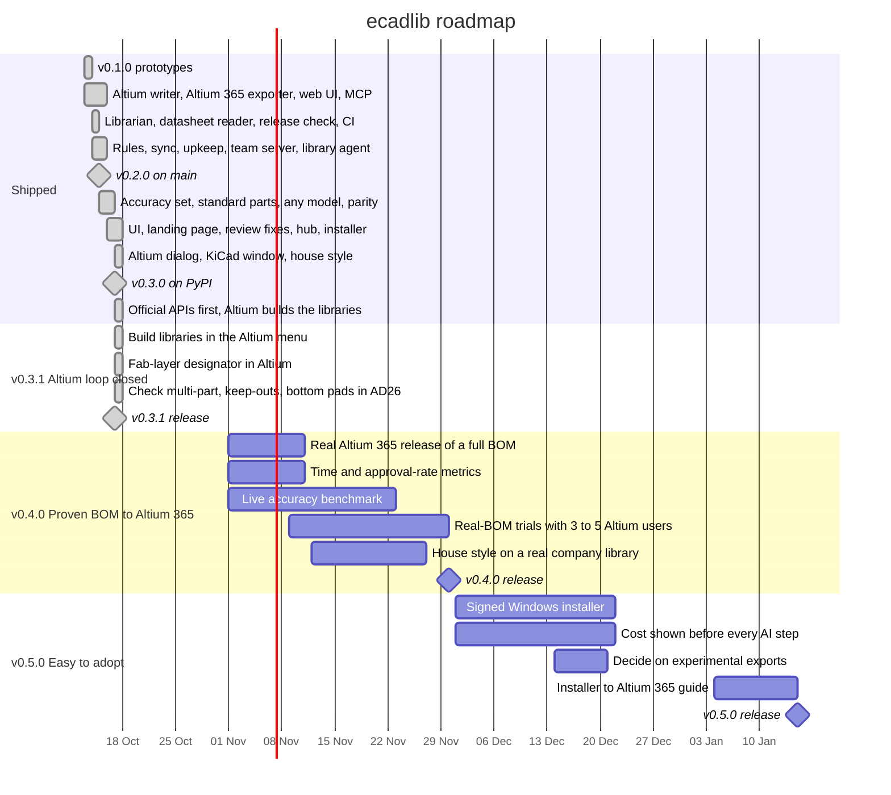

# Roadmap

Last updated 2026-10-17. What ecadlib is for, who it is for and how success is measured are in
[docs/PRODUCT_SPEC.md](docs/PRODUCT_SPEC.md). Every planned item below has an issue, and every milestone is a
[GitHub milestone](https://github.com/oliBrowne/PCBLIVINGLIBRARY/milestones) with the same due date.

Milestones follow the package version (v0.3.1, v0.4.0, v0.5.0), not v1 / v1.1: ecadlib is at 0.3.1 on PyPI, and
the changelog keeps 0.x minor releases free to change command-line options and file formats until 1.0.0.

**Focus until v0.4.0:** a proven BOM-to-Altium 365 flow with a published accuracy benchmark, and real-BOM trials
with 3 to 5 Altium users (from the 2026-10-17 market-fit review). Altium (Altium 365 first) and KiCad are the
supported targets; the Fusion Electronics / EAGLE and EasyEDA Pro exports are experimental.

## Shipped

Dates are the day each pull request was merged to `main`. PRs #1-#12 were opened on 2026-10-13 and 2026-10-14 and
merged together on 2026-10-15. GitHub shows some PRs as closed rather than merged because the history was rewritten
on 2026-10-17; their commits are on `main`.

| Merged | PRs | What shipped |
|---|---|---|
| 2026-10-13 | (first commits) | **v0.1.0** prototypes: IPC-7351B footprint generator, BOM triage, Altium DbLib export |
| 2026-10-14 | #4 | KiCad import, datasheet reader, lifecycle watcher, BOM-to-library librarian, release check, upstream alerts, CI |
| 2026-10-15 | #1, #2, #3, #5, #6, #7 | **v0.2.0**: Altium 365 exporter (Nexar), pure-Python `.PcbLib` / `.SchLib` writer, local web UI, MCP server and CLI, held-part picker, KiCad output, DbLib sync, 3D models, sourcing, approvals, library rules, two-way Altium 365 sync, upkeep, sim models, Altium projects |
| 2026-10-15 | #8, #9, #10, #11, #12 | Datasheet batch reader, big-chip symbols, BGA / connector footprints, team server and Docker, library agent with review queue, 78 review fixes with soak / fuzz / real-world BOM tests, real Altium / KiCad checks |
| 2026-10-16 | #13, #14, #15, #16 | 331-part accuracy set, standard parts without a model, cheaper datasheet reads, any model with your own key, end-to-end tests, cross-checked reads, KiCad / Altium parity, accuracy gate in CI, safe upgrades, first Altium menu |
| 2026-10-16 and 17 | #17, #18, #19, #20, #21, #22, #23, #24, #25, #26 | Hairline web UI and landing page, one plain voice in every interface, 42 bugs from the full technical review, cost per job for every model, library hub, footprint rule book in the release gate, Fusion / EAGLE and EasyEDA Pro exports, Windows installer and setup page |
| 2026-10-17 | #27, #28, #29, #30, #33 | Altium menu fixes from a real AD26 PC, house style (`ecadlib style`), one pin rule for every IC symbol, tidier converted footprints, the ecadlib dialog in Altium and window in KiCad, EasyEDA credit on converted parts |
| 2026-10-17 | #31, #32, #34 | **v0.3.0** released: on PyPI (`pip install ecadlib`) and as a Windows installer on the GitHub release |
| 2026-10-17 | #35 | Official part APIs first with unofficial endpoints fenced off, weekly sources canary, and Altium rebuilding every library itself (8 of 8 test libraries, 0 differences on AD26) |
| 2026-10-17 | #61-#80 (issues #36-#40) | **v0.3.1** released: Build libraries in the Altium menu, fab-layer designator in Altium, multi-part symbols, keep-outs and bottom-side pads checked in AD26, and the fixes from the overnight system test |

## Next milestones

### v0.4.0: Proven BOM-to-Altium 365 flow (due 2026-11-30)

**Goal.** Show, with numbers, that a real BOM becomes a correct, house-style library in Altium 365 faster than by
hand.

| Item | Issue | Label |
|---|---|---|
| P5. Publish an accuracy benchmark on real parts | [#42](https://github.com/oliBrowne/PCBLIVINGLIBRARY/issues/42) | docs, feature |
| P6. Real-BOM trials with 3 to 5 Altium users | [#43](https://github.com/oliBrowne/PCBLIVINGLIBRARY/issues/43) | docs |
| P7. Measure time from BOM to released library | [#44](https://github.com/oliBrowne/PCBLIVINGLIBRARY/issues/44) | feature |
| P8. Report the review and approval rate | [#45](https://github.com/oliBrowne/PCBLIVINGLIBRARY/issues/45) | feature |
| P9. Try house style on a real company library | [#46](https://github.com/oliBrowne/PCBLIVINGLIBRARY/issues/46) | feature |
| P10. Release a full BOM into a real Altium 365 workspace | [#47](https://github.com/oliBrowne/PCBLIVINGLIBRARY/issues/47) | feature |

**Exit criteria.** A live benchmark of 100+ parts is published with a pad-match rate of 97% or better against
KiCad's library; at least 3 outside Altium users have run their own BOMs, with time, held parts and review errors
recorded for each; a 20+ line BOM has been released to a real Altium 365 workspace and places correctly in Altium
Designer.

### v0.5.0: Easy to adopt (due 2027-01-15)

**Goal.** An Altium user can go from download to a released BOM without a warning dialog, a surprise bill or help
from us.

| Item | Issue | Label |
|---|---|---|
| P11. Sign the Windows installer | [#48](https://github.com/oliBrowne/PCBLIVINGLIBRARY/issues/48) | feature |
| P12. Show the cost before every AI step in Altium, KiCad and the web UI | [#49](https://github.com/oliBrowne/PCBLIVINGLIBRARY/issues/49) | feature |
| P13. Decide on the experimental Fusion / EAGLE and EasyEDA Pro exports | [#50](https://github.com/oliBrowne/PCBLIVINGLIBRARY/issues/50) | docs |
| P14. One-page guide from installer to a BOM in Altium 365 | [#51](https://github.com/oliBrowne/PCBLIVINGLIBRARY/issues/51) | docs |

**Exit criteria.** The installer is signed and installs without a SmartScreen warning; every place that starts a
model call shows its estimated cost first; the experimental exports are kept or removed with the reason recorded;
a trial user follows docs/START_HERE.md to a released BOM without help.

## Risks

Seven risks are tracked in the [product spec](docs/PRODUCT_SPEC.md#risks), each with an issue labelled
[`risk`](https://github.com/oliBrowne/PCBLIVINGLIBRARY/issues?q=label%3Arisk) (#52-#58).

## Timeline

Past bars run from the day a PR was opened to the day it was merged. Future bars are plans.

