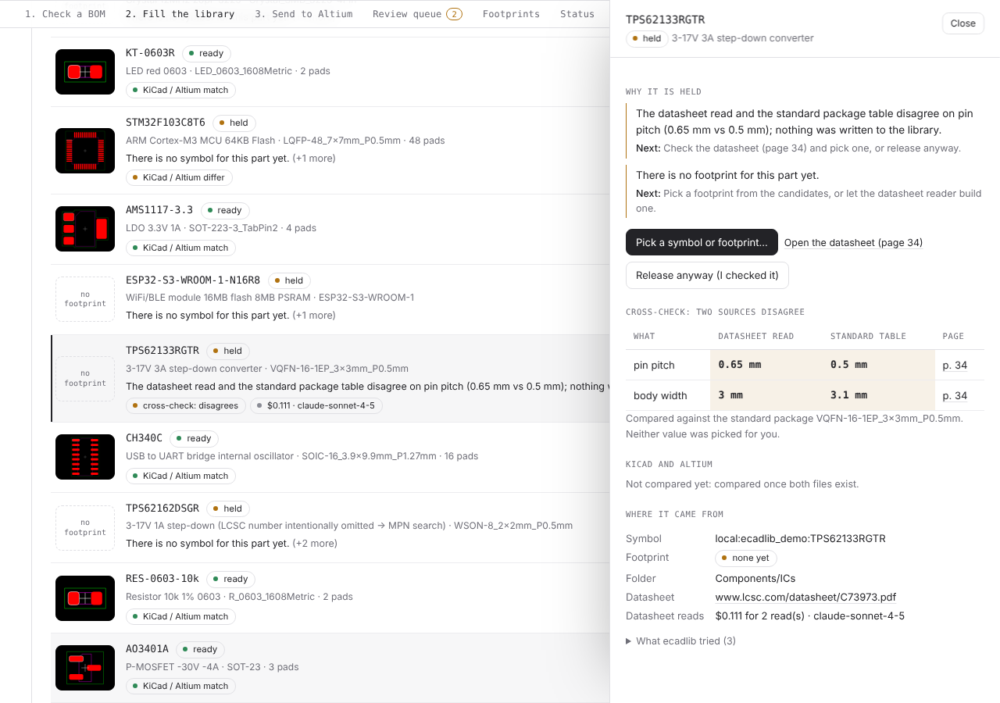
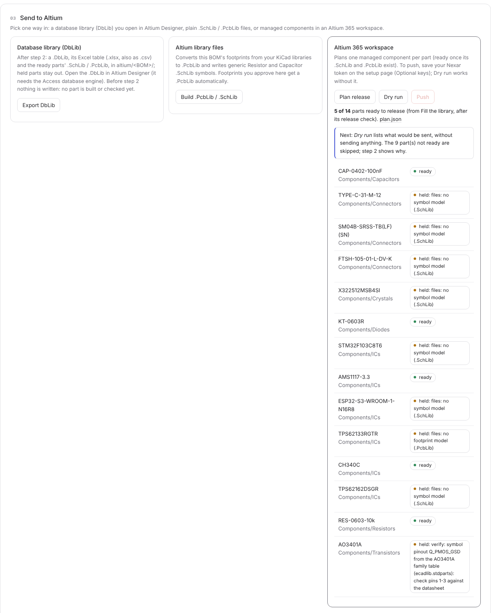

# Start here

ecadlib builds the parts your BOM is missing (schematic symbol, footprint, 3D model) and puts them in your Altium or
KiCad library. It is free and open source. This page takes an Altium user from the installer to a project BOM
released into Altium 365. If you would rather not use a terminal, it is all you need.

## 1. Install (Windows)

1. Download **ecadlib-setup-<version>.exe** from the
   [Releases page](https://github.com/oliBrowne/PCBLIVINGLIBRARY/releases).
2. Run it. It installs for your Windows account only, so it does not ask for an administrator password.
   If Windows shows "Windows protected your PC" (builds made before code signing was set up), click
   **More info**, then **Run anyway**.
3. At the end, leave **Start ecadlib now** ticked.

ecadlib comes with everything it needs (its own Python), so there is nothing else to install. It shows up in the
Start menu as **ecadlib** and **ecadlib setup**.

On macOS or Linux, or if you like the command line: `pip install ecadlib`, then `ecadlib start`.

## 2. Set it up (the setup page)

The first start opens the setup page in your web browser. It has four steps:

1. **AI model.** Pick a provider: Claude (the default), OpenAI, Gemini, OpenRouter, a model on your own computer
   (Ollama), or no AI for now. Paste your API key and press **Check key**. You pay the provider directly. The key is
   stored only on this computer, encrypted with your Windows account. Without AI, parts still come from KiCad's
   library, EasyEDA/LCSC and ecadlib's built-in standard packages; only parts that need a datasheet read are held.
2. **Your tools.** ecadlib shows which of Altium Designer and KiCad it found. Pick the one you make libraries for,
   or both.
3. **Folders.** The workspace, where ecadlib keeps your BOMs and the libraries it builds (default:
   `Documents\ecadlib`). If you already have library folders, paste their paths, one per line. ecadlib reuses those
   parts and learns your naming from them.
4. **Add ecadlib to Altium and KiCad** (optional). This adds the ecadlib commands inside your tool.
   - **Altium:** close Altium Designer, then press **Add to Altium**. The **ecadlib** menu is in Altium's menu bar
     the next time it starts (section 3a).
   - **KiCad:** press **Add to KiCad** and restart KiCad. The command is in the PCB editor under Tools > External
     Plugins > ecadlib: add part.

Press **Save setup**. You can come back to this page any time (Start menu > **ecadlib setup**).

## 3. Altium: from a project BOM to Altium 365

This is the path ecadlib is built for. You stay inside Altium Designer for every step except reviewing held parts.

### 3a. Open the ecadlib menu

After **Add to Altium** on the setup page, start Altium Designer and open a schematic or PCB. The **ecadlib** menu
is in the menu bar, just before **Window**. It has three entries:

- **Add part from MPN...** builds one part from its manufacturer part number.
- **Check this project BOM** checks the open project against your library.
- **Open review queue** opens the parts that need a person, in your browser.

If the menu is not there, close Altium, press **Add to Altium** on the setup page again, and start Altium. Without
closing Altium: gear icon > Preferences > Scripting System > Global Projects > **Install from file...** and pick
`Documents\ecadlib\altium-menu\ecadlib_menu.PrjScr`; the entries are then under **File > Run Script...**.

### 3b. Point ecadlib at your Altium 365 workspace

Skip this to get a database library (DbLib) folder instead of Altium 365.

1. Make a Nexar token at [portal.nexar.com](https://portal.nexar.com/applications) with your Altium account (scopes
   `openid`, `user.access`, `design.domain`). On the setup page, paste it under **Optional keys > Altium 365 (Nexar)
   token** and save. Like your AI key, it stays in ecadlib's own key store, never in an environment variable.
2. Open `Documents\ecadlib\ecadlib.toml` (your workspace folder) in Notepad and add your workspace's address:

   ```toml
   [altium365]
   workspace = "https://yourcompany.365.altium.com/"
   ```

Parts are released into `Components/<category>` (Capacitors, ICs, Resistors ...). `[folders]` in the same file
changes that; `ecadlib rules show` lists every setting.

### 3c. Check the project BOM

With your board project open, pick **ecadlib > Check this project BOM**. The ecadlib dialog reads the project's
parts and counts them: already in your library, found in a public library, or missing. It then asks **Later** or
**Fill the library now**.

### 3d. Fill the library

**Fill the library now** finds or builds every missing part: KiCad's library and ecadlib's standard packages first,
then EasyEDA/LCSC, and only then the AI datasheet reader. The dialog shows its progress live.

Before any datasheet is read by AI, the dialog shows the model and the estimated cost ("3 parts need the datasheet
read by AI (claude-opus-5-5): about $0.42, at most $1.10") and waits for you. Say no and those parts stay held. Afterwards it shows what the reads really cost. [api-keys.md](api-keys.md) has the details.

Every part then goes through the release check (pins match pads, footprint rules, 3D height, fields). Parts that
pass are **ready**; the others are **held**, and the dialog says how many and why.

### 3e. Review held parts

Pick **ecadlib > Open review queue**. Each held part says why in plain words and what to do next: pick another
symbol or footprint from the candidates, open the datasheet at the right page, or **Release anyway (I checked it)**.
Held parts never reach your library until a person decides.



When you are done, run **Check this project BOM** again and fill: the parts you fixed are released too.

### 3f. Released to Altium 365

Ready parts are released to your workspace as managed components, each with its symbol, footprint, 3D body and
parameters (Manufacturer, Manufacturer Part Number, Datasheet). In Altium, refresh the **Components** panel: the
parts are there to place. Without an Altium 365 workspace in `ecadlib.toml`, they go into a DbLib in
`Documents\ecadlib\altium-library` instead, which ecadlib installs in Altium for you.

To check what would be sent without sending anything, use the web UI's **Send to Altium** step (**Open ecadlib**):
**Plan release**, then **Dry run**.



### One part at a time

**ecadlib > Add part from MPN...** does the same for a single part: type the MPN (and the manufacturer if you know
it), confirm the AI cost if it needs a datasheet read, and the part is released or held as above.

## 4. Without Altium

Open ecadlib (the **Open ecadlib** button, or the Start menu) and drop your BOM on the first card. CSV or Excel works,
as Altium or KiCad export it. Then **Check the BOM**, **Fill the library** and **Send to your tool**: a DbLib,
`.SchLib`/`.PcbLib` files, an Altium 365 workspace, or KiCad `.kicad_sym`/`.pretty` files. In KiCad, the PCB editor
has **Tools > External Plugins > ecadlib** after **Add to KiCad**.

## Trying ecadlib for us? Send two numbers

After your first BOM, run `ecadlib status` in a terminal (or `ecadlib status --json`) and send us the **last run**
line and the **review** line:

- **last run:** how long the BOM took to become a released library, step by step (triage, build, release check,
  your review, the Altium 365 push), and how much of that was ecadlib's own work.
- **review:** how many parts went through as ecadlib built them, how many were held (and the top reasons), and how
  many you approved, rejected or changed.

## While it runs

A small "ecadlib is running" window stays open. It has buttons for Open, Setup, Workspace folder and Quit. Closing
the window stops ecadlib. Nothing runs in the background after that.

## If something is wrong

- **The browser page does not open:** go to <http://127.0.0.1:8765/> yourself.
- **"no Altium 365 (Nexar) token":** save the token on the setup page (**Optional keys**), then try again.
  Altium does not need a restart.
- **The ecadlib menu says "ecadlib was not found":** press **Add to Altium** on the setup page again.
- **"API key refused":** copy the key again from your provider's page. Then on the setup page, press **Save key** and
  **Check key**.
- **The setup check:** the setup page shows what ecadlib found. In a terminal, `ecadlib doctor` lists every check,
  with a fix for each one.
- **Uninstall:** Windows Settings > Apps > ecadlib. Your workspace and your stored keys (`%APPDATA%\ecadlib`) are kept.
  Delete those folders yourself if you want them gone.
- Anything else: [open an issue](https://github.com/oliBrowne/PCBLIVINGLIBRARY/issues) and include the message you
  saw.
